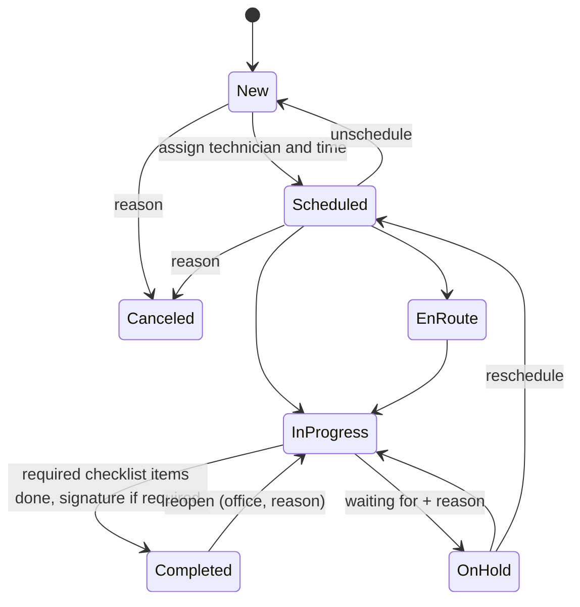

# Architecture

This document describes FieldOps as built. The product requirements are in [PRD.md](PRD.md); decisions and their
reasons are in [adr/](adr).

## Containers

| Container  | What it runs                                                             | Database role                 | Limits        |
| ---------- | ------------------------------------------------------------------------ | ----------------------------- | ------------- |
| `web`      | Next.js standalone server: pages, server actions, `/api/v1`, `/docs/api` | `fieldops_app` (RLS enforced) | 512 MB, 1 CPU |
| `worker`   | pg-boss schedules (nightly demo reset, maintenance), email outbox loop   | owner                         | 384 MB, 1 CPU |
| `migrate`  | One-shot: SQL migrations, then sets the `fieldops_app` password          | owner                         | exits         |
| `postgres` | PostgreSQL 18, internal network only                                     | —                             | 384 MB, 1 CPU |

nginx on the host terminates TLS (Let's Encrypt, Cloudflare in front with Full (strict)) and proxies
`fieldops.tinggalpake.com` to `127.0.0.1:8097`. The site config is in `infra/proxy/`.

## Request path

1. `src/proxy.ts` redirects signed-out visitors away from app pages (a cookie check only).
2. A server component or server action calls `requireActor()`, which resolves the Better Auth session to an
   `Actor` (user, member, organization, role).
3. `runService()` opens a transaction with `app.org_id` set (`withTenant`), builds the `Store`, and calls a core
   service.
4. The service checks permissions with `can()` / `assertCan()`, validates input with the shared Zod schema, applies
   business rules and calls repositories.
5. Repositories add `organization_id` to every query; PostgreSQL RLS enforces it again.
6. Domain errors become typed results for forms (`ActionResult`) or RFC 9457 problems for the API.

`/api/v1` follows the same path through `apiRoute()`: session cookie or bearer token, the same services, plus
idempotency keys, ETags and problem details.

## Packages

- **`packages/shared`**: constants and Zod schemas. Inputs and API representations use snake_case.
- **`packages/core`**: `domain/` (permissions, job status machine, money, numbering, cursors, schedule, working
  hours and availability, at-risk rules) and `services/` (use cases against the `Store` interface: jobs and
  assignment conflicts, schedule, checklists, time entries, signatures, expenses, dashboard, saved views, bulk
  actions, search). No framework dependencies.
- **`packages/db`**: Drizzle schema, migrations (`drizzle/`), RLS policies, the `Store` implementation, the demo
  seed and the migration runner.
- **`packages/email`**: React Email templates rendered by the web app into the outbox.

## Job lifecycle

Assigning technicians and a window to a New job schedules it; clearing either sends it back to New. An assignment
is checked for four conflicts per technician: overlapping visits, outside working hours, time off and missing
skills. Any of them is rejected (409 with `details.conflicts`) unless the dispatcher gives an override reason, which
is kept in the timeline with the overridden conflicts.

Status changes also drive the clocks: En route starts travel time, Start and Resume start work time, and Hold,
Complete, Cancel and Unschedule stop every clock on the job.

## Files

Uploads go straight from the browser to storage through short-lived signed URLs, then the server confirms them and
makes thumbnails. With R2 configured the URLs are S3 presigned URLs; without it they point at `/api/files/…`, which
checks an HMAC signature, the type and the size, and stores the file on the `fieldops_files` volume (ADR 015).

## Demo environment

`DEMO_MODE=true` turns on one-click sign-in, captured emails (Demo inbox for visitors, Demo outbox for owners),
5 MB image-only uploads (signatures and receipts included), protection for the seeded accounts, and the nightly reset at 00:00 UTC: wipe, seed again
relative to the reset time, delete uploads. The seed is deterministic (fixed faker seed) and is covered by tests.
