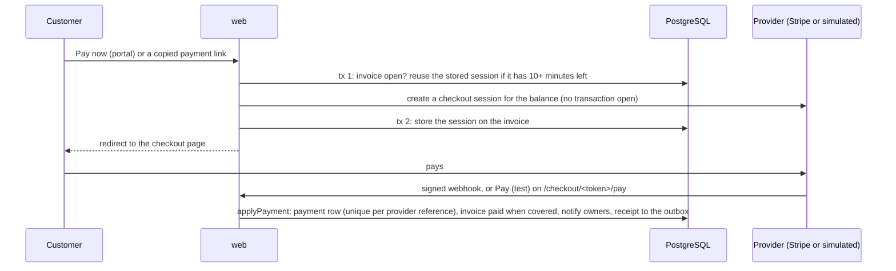
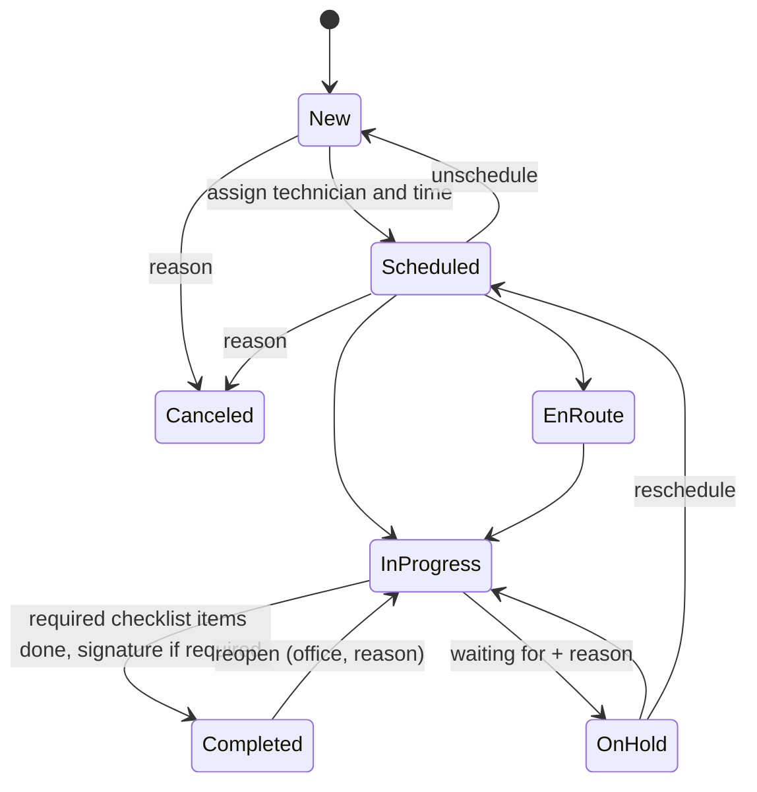

# Architecture

This document describes FieldOps as built. The product requirements are in [PRD.md](PRD.md); decisions and their
reasons are in [adr/](adr).

## Containers

| Container  | What it runs                                                                         | Database role                 | Limits        |
| ---------- | ------------------------------------------------------------------------------------ | ----------------------------- | ------------- |
| `web`      | Next.js standalone server: pages, server actions, `/api/v1`, `/docs/api`             | `fieldops_app` (RLS enforced) | 512 MB, 1 CPU |
| `worker`   | pg-boss schedules (see [Worker](#worker)), the email outbox and the AI drafting loop | owner                         | 384 MB, 1 CPU |
| `migrate`  | One-shot: SQL migrations, then sets the `fieldops_app` password                      | owner                         | exits         |
| `postgres` | PostgreSQL 18, internal network only                                                 | —                             | 384 MB, 1 CPU |

nginx on the host terminates TLS (Let's Encrypt, Cloudflare in front with Full (strict)) and proxies
`fieldops.tinggalpake.com` to `127.0.0.1:8097`. The site config is in `infra/proxy/`.

## Request path

1. `src/proxy.ts` redirects signed-out visitors away from app pages (a cookie check only).
2. A server component or server action calls `requireActor()`, which resolves the Better Auth session to an
   `Actor` (user, member, organization, role).
3. `runService()` opens a transaction with `app.org_id` set (`withTenant`), plus the actor, IP address and user
   agent for the audit log (`app.user_id`, `app.ip`, `app.ua`), builds the `Store`, and calls a core service.
4. The service checks permissions with `can()` / `assertCan()`, validates input with the shared Zod schema, applies
   business rules and calls repositories.
5. Repositories add `organization_id` to every query; PostgreSQL RLS enforces it again.
6. Domain errors become typed results for forms (`ActionResult`) or RFC 9457 problems for the API.

`/api/v1` follows the same path through `apiRoute()`: session cookie or bearer token, the same services, plus
idempotency keys, ETags and problem details. `POST /api/v1/ai/assistant` is the exception: it streams, so it opens
its own short transactions (see [Ask FieldOps](#ask-fieldops)).

## API keys, rate limits and MCP

`authenticate()` in `src/server/api/handler.ts` is the one entrance for every `/api/v1` route and the MCP server
(ADR 023):

1. `Authorization: Bearer fo_…` is an API key. Its SHA-256 goes to `api_key_authenticate()`, a `SECURITY DEFINER`
   function that returns the key's organization, member, user and scopes (revoked and expired keys return
   nothing) and records the last use at most once a minute. The key then resolves to its member exactly like a
   session, so the role, row-level security and the audit log apply unchanged. The request method decides the
   scope (`read` for GET and HEAD, `write` otherwise); `/api-keys` refuses keys (`403 session_required`).
2. Otherwise the session cookie or a bearer session token, as before.
3. The request counts in a one-minute `rate_limit` window (`api:key:<id>` or `api:user:<id>`, per IP address too
   for the shared demo accounts) with one upsert outside the tenant transaction. Every response carries
   `RateLimit-*` headers; over the limit, `429` with `Retry-After`. AI routes show the tighter of this and their own
   limits.

`runService()` and `apiRoute()` mark changes made with a key in the audit log's user agent
(`API key fo_xxxx… · <client>`, `auditMetaFor` in `src/server/request-meta.ts`).

`POST /api/mcp` is a stateless Streamable HTTP MCP server (ADR 024, `@modelcontextprotocol/sdk`): a key with the
`read` scope, a new server and transport per request, JSON answers, `405` for GET and DELETE. Its tools are the
Ask FieldOps tools offered to the key's role (`packages/core/src/services/mcp-tools.ts`), each call in its own
tenant transaction as the key's member; no model of ours runs, so no AI quota is spent.

A few routes act for no signed-in user. They take the organization from something they verify first and then run
in that tenant's transaction like any request: the Stripe webhook (`/api/webhooks/stripe`, a signed event), the
simulated checkout (`/checkout/<token>`) and service report links (`/share/reports/<token>`), both HMAC-signed
tokens.

Pages that load data have a `loading.tsx` skeleton (`src/components/app/skeletons.tsx`). The skeleton streams before
the page renders, and from then on the response is a 200, so a check that must answer 404 (a role that can't use the
page, another organization's record) runs in the segment's `layout.tsx` with the helpers in `src/server/guards.ts`.
For the same reason list pages sit in route groups (`jobs/(list)`, `customers/(list)`, `schedule/(board)`): their
skeleton must not wrap the detail pages next to them.

## Packages

- **`packages/shared`**: constants and Zod schemas. Inputs and API representations use snake_case.
- **`packages/core`**: `domain/` (permissions, job status machine, money, billing totals and lifecycles,
  numbering, cursors, schedule, working hours and availability, SLA rules and pauses, recurrence dates) and
  `services/` (use cases against the `Store` interface: jobs and assignment conflicts, schedule, checklists, time
  entries, signatures, expenses, dashboard and revenue, saved views, bulk actions, search, quotes, invoices,
  payments, the portal's billing, service reports, maintenance plans, the digest and the assistant's tools). Ports
  for the outside world (AI models, payment providers, mailers, file storage) are interfaces here. No framework
  dependencies.
- **`packages/db`**: Drizzle schema, migrations (`drizzle/`), RLS policies, the `Store` implementation, the demo
  seed and the migration runner.
- **`packages/email`**: React Email templates rendered by the web app and the worker into the outbox.
- **`packages/ai`**: the intake, service report and assistant models (Claude through the official SDK, and test
  doubles), their prompts and the evaluation sets (`pnpm eval:intake`, `pnpm eval:assistant`).
- **`packages/documents`**: branded PDFs for quotes, invoices and service reports from plain view models, with
  labels in English and Bahasa Indonesia (ADR 018).
- **`packages/payments`**: the payment providers behind the core's port: Stripe Checkout and its webhook parser,
  and the simulated test checkout (ADR 021).

## Worker

pg-boss keeps the schedules durable in PostgreSQL (ADR 007). The business passes run per organization in that
tenant's transaction and are idempotent, so a repeated or overlapping run changes nothing twice.

| Schedule (UTC)  | What it does                                                                                                    |
| --------------- | --------------------------------------------------------------------------------------------------------------- |
| every 5 minutes | SLA monitor: moves open jobs along their deadlines (paused clocks skipped) and raises alerts once               |
| hourly, at :02  | Daily digest: sends it to owners and opted-in admins in the 07:00 hour of the organization's day                |
| hourly, at :10  | Maintenance plans: generates the jobs due within each plan's lead days                                          |
| hourly, at :15  | Billing pass: expires quotes, marks invoices overdue and sends reminders, by the organization's date            |
| daily, 03:30    | Clean-up: spent portal links and sessions, old rate-limit windows and notifications, conversations idle 30 days |
| daily, 00:00    | Demo reset, only with `DEMO_MODE=true`                                                                          |

Two loops poll between schedules: the email outbox, and AI drafting, which claims pending portal requests and
service reports (`FOR UPDATE SKIP LOCKED`, released after 10 minutes if a worker stops) and drafts them outside any
transaction.

## Audit log and live updates

Business tables carry two triggers. `audit_row()` writes the change (changed columns before and after) to
`audit_log` in the same transaction, with the actor, IP address and user agent from the transaction settings; the
runtime role can read the log but not write it (ADR 016). `live_notify()` publishes a small message (organization,
kind, id) on the `fieldops_live` channel, which PostgreSQL delivers on commit. Each web process listens on one
connection and forwards messages over server-sent events (`GET /api/v1/stream`) to the signed-in users they
concern; the page then fetches what changed through the normal path (ADR 011). Seeds and resets call `quiet()`
and write neither.

Notifications are written by `notify()` in the transaction of the change: an in-app row (which publishes a live
event) and, where the event has one, an email in the outbox, each following the user's settings.

## SLA and AI

Each job stores its response and resolution deadlines, the moments they turn "at risk" and their states,
computed by `domain/sla.ts` in calendar time or business hours. The worker's monitor moves open jobs along them
every 5 minutes and records each alert once in `sla_alert`; only new rows notify. On hold waiting for the customer
pauses the resolution clock (`sla_paused_at`); leaving the hold moves the deadline by the paused time, measured in
the policy's basis.

AI intake runs behind the `IntakeModel` port (`packages/ai`): Claude when `ANTHROPIC_API_KEY` is set, a
deterministic test double for E2E (`AI_PROVIDER=fixture`), otherwise "not configured". A draft is two short
transactions with the model call between them, so no transaction waits on the model. Portal requests are drafted
by the worker, which claims them like outbox rows. Rate limits are fixed-window counters in `rate_limit`.

Service reports (AI-03) follow the same pattern. Completing a job creates its report in the customer's language,
prefilled from the checklist, the notes marked for the customer and the parts used; with AI on it is `pending`,
and the worker claims and drafts it (`drafting`, released after 10 minutes if the worker stops). A draft only
replaces text nobody has edited since it was read. The writer sees notes for the customer only, never internal
notes. PDFs (`packages/documents`, `@react-pdf/renderer` with an embedded Inter subset) are rendered after the data
transaction, never inside it. Sending emails the customer a link to `/share/reports/<token>`: an HMAC-signed token
(organization, report, expiry after 30 days) that needs no sign-in and serves the PDF only while the report is
`sent`; editing a sent report or completing the job again takes it back to draft until someone sends it again.

## Ask FieldOps

`POST /api/v1/ai/assistant` answers with server-sent events over POST (ADR 019). It doesn't use `apiRoute()`, which
holds one transaction for the whole request: the checks (permission, AI setting, quota, rate limits) and the saved
question are one short transaction before the stream opens, so failures are ordinary problem responses. While Claude
streams through the SDK's tool runner, each call to one of the seven read-only tools opens its own tenant
transaction as the asking member and closes it before returning; the answer is saved in a last one. Tools are
offered and filtered by role, return at most 50 rows, stop after 8 calls, and hand records to the model as escaped
JSON inside `<tool_result>` elements. Stopping an answer or dropping the connection aborts the model call.

## Billing and payments

Totals are computed by `domain/billing.ts` with BigInt in minor units (ADR 017): line nets, a discount split
across the lines by the largest remainder, tax per line, half away from zero. Quote and invoice numbers come from
`org_counter` rows per year (`quote:<year>`, `invoice:<year>`) in the transaction that creates the quote or issues
the invoice, so they have no gaps; invoice drafts have none. Billing a part locks its expense request first, so two
invoices can't bill it twice.

Online payments (FIN-05, ADR 021) follow one path whatever the provider:

The provider is Stripe when `STRIPE_SECRET_KEY` and `STRIPE_WEBHOOK_SECRET` are set, the simulated checkout with
`DEMO_MODE=true` or `PAYMENTS_PROVIDER=simulated`, and otherwise none: the portal shows the bank transfer
instructions and staff record payments by hand. Any payment clears the stored session. The webhook answers 200 for
anything a retry can't change (recorded, repeated, ignored, or refused for a void or settled invoice, which is
logged) and 500 otherwise, so Stripe retries.

## Languages

The web app speaks English and Bahasa Indonesia (SET-05) through next-intl. Messages live in
`apps/web/messages/<locale>/<namespace>.json`; Indonesian is laid over English per key, so an untranslated key shows
in English rather than as its raw key, and a unit test keeps the keys and ICU arguments of both languages in step.
Terms follow `apps/web/messages/GLOSSARY.md`. The request config (`src/i18n/request.ts`, `src/server/locale.ts`)
picks the language:

- **The app:** the signed-in user's `user.locale`, changed in the user menu. Demo accounts are shared, so a visitor's
  choice stays in their browser (a cookie) instead.
- **The customer portal:** the visitor's choice (cookie), else the signed-in contact's customer `locale`, else the
  organization's customer language (`settings.locale`).
- **Signed-out pages:** the cookie, else `Accept-Language`, else English. New accounts start in that language.

Dates follow the organization's time zone and the reader's language (`src/lib/format.ts`: day-first with a 24-hour
clock in Indonesian), numbers and money use `Intl` with the reader's locale. Emails go out in the recipient's
language: staff in their own, customers in their customer's or business's; `packages/email` keeps a dictionary per
template. Domain errors and the REST API stay in English; server actions translate the messages they show
(`src/i18n/server-messages.ts`). CSV exports keep English column names and values.

## Customer portal

`/portal/<slug>` resolves the organization by slug and runs every request in that tenant's transaction, scoped to
the signed-in contact's customer. Customers aren't app users: one-time links and sessions live in `portal_token`
and `portal_session`, which store only SHA-256 hashes of the tokens. The session cookie is scoped to
`/portal/<slug>`, which is why the simulated checkout pays with a plain form POST and a 303 back into the portal.

Besides requests and jobs, the portal shows the customer's quotes (once sent) and invoices (once issued) through
`services/portal-billing.ts`, which strips costs and markups; another customer's record is "not found". Approving
or declining a quote goes through the same decision service as staff, with the contact as the decider.

## Job lifecycle

Assigning technicians and a window to a New job schedules it; clearing either sends it back to New. An assignment
is checked for four conflicts per technician: overlapping visits, outside working hours, time off and missing
skills. Any of them is rejected (a 409 problem with a `conflicts` list) unless the dispatcher gives an override reason, which
is kept in the timeline with the overridden conflicts.

Status changes also drive the clocks: En route starts travel time, Start and Resume start work time, and Hold,
Complete, Cancel and Unschedule stop every clock on the job.

## Files

Uploads go straight from the browser to storage through short-lived signed URLs, then the server confirms them and
makes thumbnails. With R2 configured the URLs are S3 presigned URLs; without it they point at `/api/files/…`, which
checks an HMAC signature, the type and the size, and stores the file on the `fieldops_files` volume (ADR 015).

## Demo environment

`DEMO_MODE=true` turns on one-click sign-in, captured emails (Demo inbox for visitors, Demo outbox for owners),
5 MB image-only uploads (signatures and receipts included), protection for the seeded accounts, the simulated
checkout instead of Stripe until keys are set, and the nightly reset at 00:00 UTC: wipe, seed again relative to
the reset time, delete uploads. The seed is deterministic (fixed faker seed) and is covered by tests.
