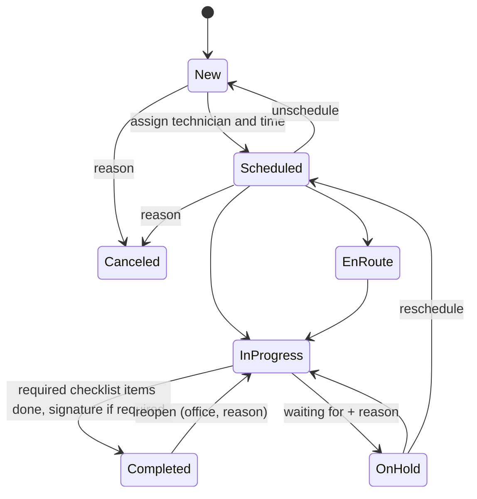

# Architecture

This document describes FieldOps as built. The product requirements are in [PRD.md](PRD.md); decisions and their
reasons are in [adr/](adr).

## Containers

| Container  | What it runs                                                                                                     | Database role                 | Limits        |
| ---------- | ---------------------------------------------------------------------------------------------------------------- | ----------------------------- | ------------- |
| `web`      | Next.js standalone server: pages, server actions, `/api/v1`, `/docs/api`                                         | `fieldops_app` (RLS enforced) | 512 MB, 1 CPU |
| `worker`   | pg-boss schedules (SLA monitor every 5 min, nightly demo reset, maintenance), email outbox and AI drafting loops | owner                         | 384 MB, 1 CPU |
| `migrate`  | One-shot: SQL migrations, then sets the `fieldops_app` password                                                  | owner                         | exits         |
| `postgres` | PostgreSQL 18, internal network only                                                                             | —                             | 384 MB, 1 CPU |

nginx on the host terminates TLS (Let's Encrypt, Cloudflare in front with Full (strict)) and proxies
`fieldops.tinggalpake.com` to `127.0.0.1:8097`. The site config is in `infra/proxy/`.

## Request path

1. `src/proxy.ts` redirects signed-out visitors away from app pages (a cookie check only).
2. A server component or server action calls `requireActor()`, which resolves the Better Auth session to an
   `Actor` (user, member, organization, role).
3. `runService()` opens a transaction with `app.org_id` set (`withTenant`), plus the actor, IP address and user
   agent for the audit log (`app.user_id`, `app.ip`, `app.ua`), builds the `Store`, and calls a core service.
4. The service checks permissions with `can()` / `assertCan()`, validates input with the shared Zod schema, applies
   business rules and calls repositories.
5. Repositories add `organization_id` to every query; PostgreSQL RLS enforces it again.
6. Domain errors become typed results for forms (`ActionResult`) or RFC 9457 problems for the API.

`/api/v1` follows the same path through `apiRoute()`: session cookie or bearer token, the same services, plus
idempotency keys, ETags and problem details.

Pages that load data have a `loading.tsx` skeleton (`src/components/app/skeletons.tsx`). The skeleton streams before
the page renders, and from then on the response is a 200, so a check that must answer 404 (a role that can't use the
page, another organization's record) runs in the segment's `layout.tsx` with the helpers in `src/server/guards.ts`.
For the same reason list pages sit in route groups (`jobs/(list)`, `customers/(list)`, `schedule/(board)`): their
skeleton must not wrap the detail pages next to them.

## Packages

- **`packages/shared`**: constants and Zod schemas. Inputs and API representations use snake_case.
- **`packages/core`**: `domain/` (permissions, job status machine, money, numbering, cursors, schedule, working
  hours and availability, at-risk rules) and `services/` (use cases against the `Store` interface: jobs and
  assignment conflicts, schedule, checklists, time entries, signatures, expenses, dashboard, saved views, bulk
  actions, search). No framework dependencies.
- **`packages/db`**: Drizzle schema, migrations (`drizzle/`), RLS policies, the `Store` implementation, the demo
  seed and the migration runner.
- **`packages/email`**: React Email templates rendered by the web app and the worker into the outbox.
- **`packages/ai`**: the intake and service report models (Claude through the official SDK, and test doubles), their prompts and the
  evaluation set (`pnpm eval:intake`).
- **`packages/documents`**: branded PDFs for quotes, invoices and service reports from plain view models, with
  labels in English and Bahasa Indonesia.

## Audit log and live updates

Business tables carry two triggers. `audit_row()` writes the change (changed columns before and after) to
`audit_log` in the same transaction, with the actor, IP address and user agent from the transaction settings; the
runtime role can read the log but not write it (ADR 016). `live_notify()` publishes a small message (organization,
kind, id) on the `fieldops_live` channel, which PostgreSQL delivers on commit. Each web process listens on one
connection and forwards messages over server-sent events (`GET /api/v1/stream`) to the signed-in users they
concern; the page then fetches what changed through the normal path (ADR 011). Seeds and resets call `quiet()`
and write neither.

Notifications are written by `notify()` in the transaction of the change: an in-app row (which publishes a live
event) and, where the event has one, an email in the outbox, each following the user's settings.

## SLA and AI

Each job stores its response and resolution deadlines, the moments they turn "at risk" and their states,
computed by `domain/sla.ts` in calendar time or business hours. The worker's monitor moves open jobs along them
every 5 minutes and records each alert once in `sla_alert`; only new rows notify.

AI intake runs behind the `IntakeModel` port (`packages/ai`): Claude when `ANTHROPIC_API_KEY` is set, a
deterministic test double for E2E (`AI_PROVIDER=fixture`), otherwise "not configured". A draft is two short
transactions with the model call between them, so no transaction waits on the model. Portal requests are drafted
by the worker, which claims them like outbox rows. Rate limits are fixed-window counters in `rate_limit`.

Service reports (AI-03) follow the same pattern. Completing a job creates its report in the customer's language,
prefilled from the checklist, the notes marked for the customer and the parts used; with AI on it is `pending`,
and the worker claims and drafts it (`drafting`, released after 10 minutes if the worker stops). A draft only
replaces text nobody has edited since it was read. The writer sees notes for the customer only, never internal
notes. PDFs (`packages/documents`, `@react-pdf/renderer` with an embedded Inter subset) are rendered after the data
transaction, never inside it. Sending emails the customer a link to `/share/reports/<token>`: an HMAC-signed token
(organization, report, expiry after 30 days) that needs no sign-in and serves the PDF only while the report is
`sent`; editing a sent report or completing the job again takes it back to draft until someone sends it again.

## Customer portal

`/portal/<slug>` resolves the organization by slug and runs every request in that tenant's transaction, scoped to
the signed-in contact's customer. Customers aren't app users: one-time links and sessions live in `portal_token`
and `portal_session`, which store only SHA-256 hashes of the tokens.

## Job lifecycle

Assigning technicians and a window to a New job schedules it; clearing either sends it back to New. An assignment
is checked for four conflicts per technician: overlapping visits, outside working hours, time off and missing
skills. Any of them is rejected (a 409 problem with a `conflicts` list) unless the dispatcher gives an override reason, which
is kept in the timeline with the overridden conflicts.

Status changes also drive the clocks: En route starts travel time, Start and Resume start work time, and Hold,
Complete, Cancel and Unschedule stop every clock on the job.

## Files

Uploads go straight from the browser to storage through short-lived signed URLs, then the server confirms them and
makes thumbnails. With R2 configured the URLs are S3 presigned URLs; without it they point at `/api/files/…`, which
checks an HMAC signature, the type and the size, and stores the file on the `fieldops_files` volume (ADR 015).

## Demo environment

`DEMO_MODE=true` turns on one-click sign-in, captured emails (Demo inbox for visitors, Demo outbox for owners),
5 MB image-only uploads (signatures and receipts included), protection for the seeded accounts, and the nightly reset at 00:00 UTC: wipe, seed again
relative to the reset time, delete uploads. The seed is deterministic (fixed faker seed) and is covered by tests.
