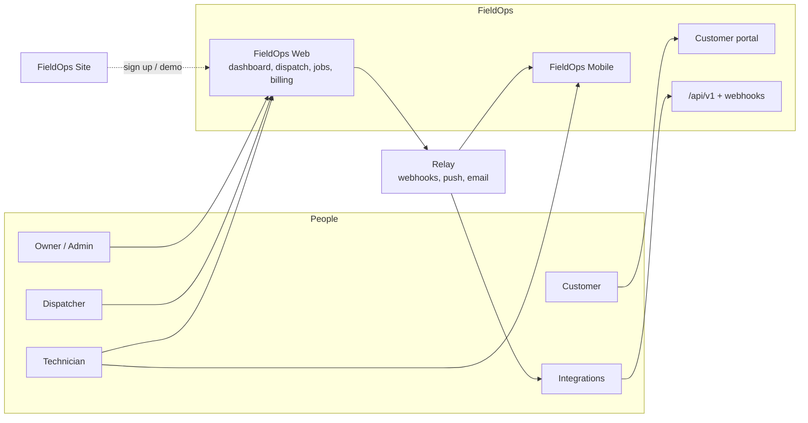
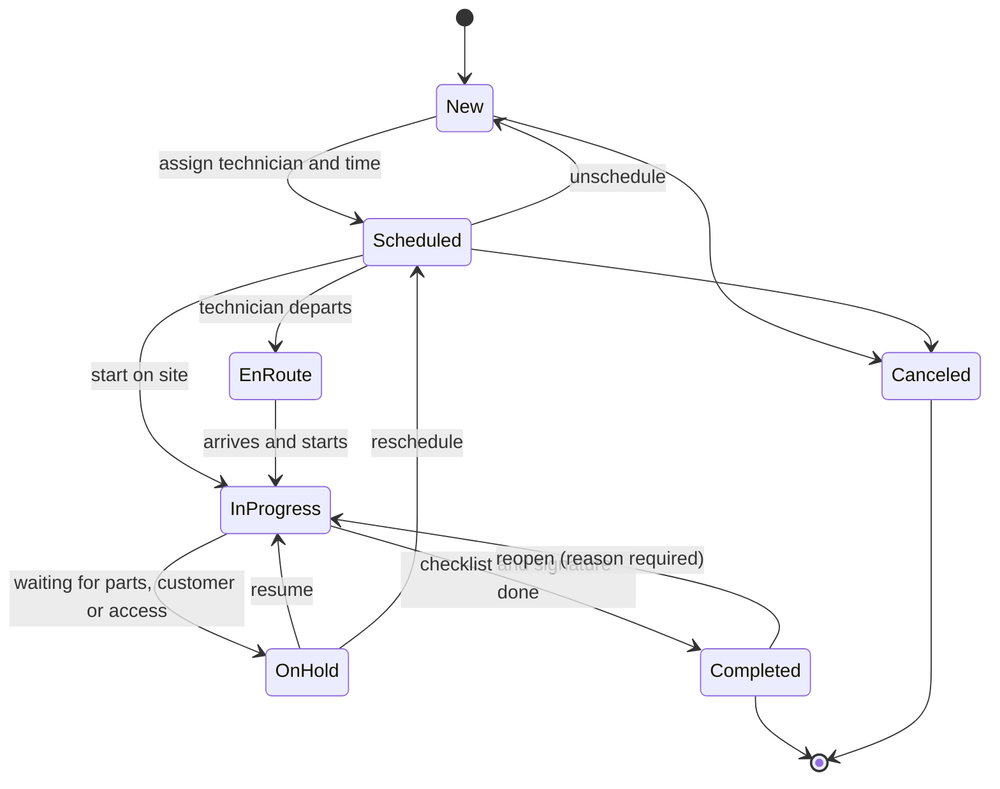
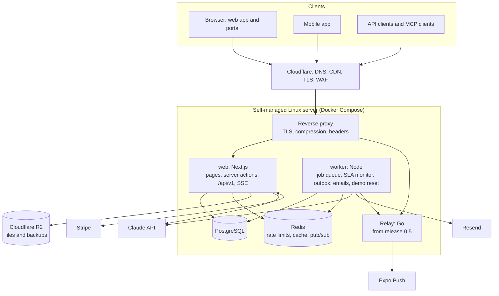
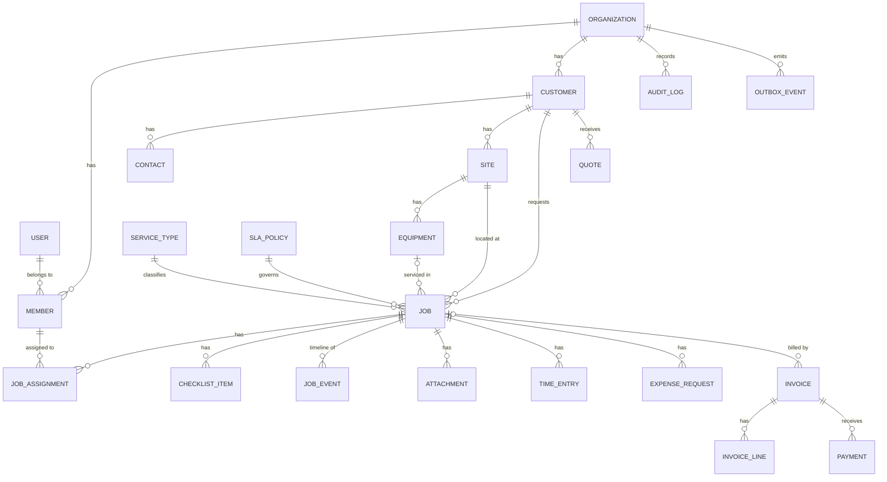

# FieldOps — Product Requirements Document

| | |
|---|---|
| **Product** | FieldOps (working title): field service management for small service businesses |
| **Status** | Draft 1.4 · release 0.2.1 live, repository public |
| **Owner** | Ahmad Izzat Maulana |
| **Last updated** | 10 November 2026 |
| **Live demo** | `https://fieldops.tinggalpake.com` (self-hosted) |
| **Repositories** | `fieldops` (web + mobile), `relay` (backend service), `fieldops-site` (marketing site) |
| **Implementation docs** | `docs/ARCHITECTURE.md`, `docs/RUNBOOK.md`, `docs/adr/` |

### Revision history

| Version | Date | Changes |
|---|---|---|
| 1.0 | 10 Nov 2026 | First draft. |
| 1.1 | 10 Nov 2026 | Release 0.1 built. Recorded the decisions made while building it: pinned versions (§14.3), services behind repository interfaces (§14.2), OpenFreeMap as the default map style (§14.3), Redis deferred to 0.3 (§15.3), the on-server release script until the Actions deploy is approved (§15.4), backups blocked until R2 is enabled (§15.5), the server capacity check (§23), and new open questions (§23). |
| 1.2 | 10 Nov 2026 | Repository published at github.com/guzmanloeracode/fieldops. **No hosted CI** (owner's decision): GitHub Actions is disabled and the checks run on the server as release gates — `pnpm verify` before the build, `infra/deploy/e2e.sh` on the new images before they go live (§15.4, §18.2, ADR 014). |
| 1.3 | 10 Nov 2026 | Release 0.2 built and live. Recorded the decisions made while building it in *As built (0.2)* notes: overridable conflict kinds and working-hours rules (§8.4), clocks driven by status changes and the signature setting (§8.5), approval thresholds and pre-ordered parts (§8.6), saved views, bulk actions and export (§8.3), provisional SLA targets until SLA-01 ships in 0.3 (§8.10), local file storage until R2 is enabled (§14.5, §15.5, ADR 015), new tables and fields (§16.3), new endpoints (§17.2) and the 0.2 seed (§19). |
| 1.4 | 10 Nov 2026 | Release 0.2.1: route-level loading skeletons for every page that loads data (§13 *As built (0.2.1)*). |

## Contents

1. [Summary](#1-summary)
2. [Why this project](#2-why-this-project)
3. [Problem](#3-problem)
4. [Goals, non-goals and success metrics](#4-goals-non-goals-and-success-metrics)
5. [Users, roles and permissions](#5-users-roles-and-permissions)
6. [Product overview](#6-product-overview)
7. [Key user journeys](#7-key-user-journeys)
8. [Functional requirements: FieldOps Web](#8-functional-requirements-fieldops-web)
9. [AI features](#9-ai-features)
10. [FieldOps Mobile](#10-fieldops-mobile)
11. [Relay (backend service)](#11-relay-backend-service)
12. [FieldOps Site (marketing site)](#12-fieldops-site-marketing-site)
13. [Non-functional requirements](#13-non-functional-requirements)
14. [Architecture and tech stack](#14-architecture-and-tech-stack)
15. [Hosting, deployment and operations](#15-hosting-deployment-and-operations)
16. [Data model](#16-data-model)
17. [API and integrations](#17-api-and-integrations)
18. [Quality engineering](#18-quality-engineering)
19. [Demo environment and seed data](#19-demo-environment-and-seed-data)
20. [Release plan](#20-release-plan)
21. [Portfolio packaging](#21-portfolio-packaging)
22. [Risks and mitigations](#22-risks-and-mitigations)
23. [Open questions](#23-open-questions)
24. [Glossary and sources](#24-glossary-and-sources)

Priority labels follow MoSCoW: **M** = must, **S** = should, **C** = could. The release column refers to the plan in [§20](#20-release-plan).

---

## 1. Summary

FieldOps is a multi-tenant SaaS for small service businesses: air-conditioning and HVAC, cleaning, plumbing, electrical and property maintenance companies with 5–50 staff. It covers the whole service loop. A request comes in, a dispatcher schedules a technician, the technician does the work on site with a checklist and photos, the customer gets a report, and the business gets paid. It replaces the chat threads, spreadsheets and paper job sheets most of these businesses still run on.

FieldOps is also a portfolio project. The author's production work lives in private repositories, so FieldOps gives prospective clients something they can open, click through, and read the code of. The goal is to show, in one coherent product, the skills clients hire for most: full-stack web development, AI integration, SaaS fundamentals (multi-tenancy, roles, billing), APIs and integrations, backend services, DevOps, front-end craft and mobile apps. Every part is built to production standards. It is open source, documented and tested, and it runs as a live demo on a self-managed server.

FieldOps ships as four deliverables:

| # | Deliverable | Location | What it proves |
|---|---|---|---|
| 1 | **FieldOps Web** | `fieldops/apps/web` | Full-stack SaaS: Next.js, PostgreSQL, auth and roles, AI, payments, self-hosted deployment |
| 2 | **Relay** | `relay` (own repo) | Backend engineering in Go: queues, retries, webhooks, push, observability, Docker |
| 3 | **FieldOps Site** | `fieldops-site` (own repo) | Front-end craft: GSAP motion, SEO, accessibility, Core Web Vitals |
| 4 | **FieldOps Mobile** | `fieldops/apps/mobile` | Expo app for technicians: offline mode, camera, location, push notifications |

**Original work.** All code, designs, copy and data are created for this project. No code, schema, data or UI from any employer or client is reused. All demo data is synthetic.

---

## 2. Why this project

### 2.1 Market evidence

| Signal | Evidence |
|---|---|
| Full-stack development remains a core skill clients hire for | Upwork's *In-Demand Skills 2026* report lists full-stack development among the leading Coding & Web Development skills, with demand staying strong year over year. [1] |
| AI work is where demand is growing fastest | In the same report, demand for skills that explicitly reference AI grew **109%** year over year, against **23%** for other skills. [1] |
| AI integration specifically | **AI integration** grew **178%** and **AI chatbot development** grew **71%**, the fastest-growing Coding & Web Development skills. [1] |
| The trend continued in 2026 | Upwork's June 2026 hiring insights name AI Apps & Integration as the strongest-growing category: **+34%** month over month and **+33%** year over year. [2] |
| Field service software is a real, growing market | IBISWorld sizes the US field service management software industry at **$3.1bn in 2026**, growing 7.5% that year. [3] Verdantix puts the global market at **$5.9bn in 2025**. [4] |

A real, growing vertical means the demo looks like software clients already understand and ask for: booking, scheduling, dispatch, approvals, invoicing and dashboards.

### 2.2 Typical client requests and where FieldOps shows them

| Typical client request | Where FieldOps shows it |
|---|---|
| "Build our SaaS MVP with Next.js and PostgreSQL" | FieldOps Web, end to end |
| "Multi-tenant app with roles and permissions" | Organizations, invitations, role-based access, tenant-isolation tests, PostgreSQL row-level security |
| "Integrate AI into our app" / "AI chatbot over our data" | AI job intake, the *Ask FieldOps* assistant with tool use, AI service reports, an MCP server |
| "Admin dashboard with charts and data tables" | KPI dashboard, server-side filtered tables, CSV export |
| "Stripe payments and subscriptions" | Invoice payments, SaaS plans, Stripe webhooks |
| "Booking or scheduling system with a calendar" | Drag-and-drop dispatch board, customer portal requests |
| "REST API with docs", "webhooks", "integrations" | `/api/v1`, OpenAPI 3.1, API keys, signed webhooks |
| "Background jobs, queues, a scalable backend" | Worker with a Postgres job queue; Relay in Go |
| "Deploy to my VPS with Docker and CI/CD" | Docker Compose production stack, GitHub Actions deploys, backups, monitoring |
| "Fast, animated, SEO-friendly landing page" | FieldOps Site |
| "React Native app with offline mode, camera and push" | FieldOps Mobile |
| "Clean, tested, maintainable code" | Monorepo, typed contracts, unit/integration/E2E tests, CI, ADRs |

---

## 3. Problem

**Target customer.** Owner-run service businesses with 5–50 staff and 2–30 technicians in the field.

**How they work today**

- Requests arrive by phone, chat and email, and someone retypes them.
- The schedule lives on a whiteboard or spreadsheet. Technicians receive jobs as chat messages.
- Job sheets are on paper. Photos stay in technicians' personal phone galleries.
- Invoices are made days later in a word processor or spreadsheet.
- The owner can't see workload, overdue jobs or revenue without asking around.

**What it costs them**

- Missed or double-booked visits, and service-level (SLA) breaches discovered only when a customer complains.
- Slow invoicing, which means slow cash collection.
- Disputes with no evidence of what was done.
- No data to decide on hiring, pricing or which services to push.

**The FieldOps angle.** Established field service suites exist, and FieldOps doesn't try to out-feature them. Its angle is fast setup for small teams, AI that removes retyping and report writing, and a clean, modern interface that works as well on a phone as on a desktop.

---

## 4. Goals, non-goals and success metrics

### 4.1 Product goals

| ID | Goal |
|---|---|
| G1 | Turn any incoming request into a well-formed job in under 30 seconds. |
| G2 | Let a dispatcher plan a full day for 8 technicians in under 5 minutes. |
| G3 | Make SLA risk visible before a breach, not after. |
| G4 | Capture proof of work (checklist, photos, signature) on every completed job. |
| G5 | Shorten the time from job completion to invoice sent to under 1 hour. |
| G6 | Give the owner a live view of jobs, SLA compliance and revenue. |

### 4.2 Portfolio goals

| ID | Goal |
|---|---|
| P1 | Every deliverable is public, live, documented and runnable locally in under 10 minutes. |
| P2 | The code reads like a professional team's codebase: clear layering, typed contracts, tests, CI, ADRs. |
| P3 | Each deliverable stands alone as a portfolio piece for one service: full stack, backend, front end and mobile. |
| P4 | A reviewer can understand the product in 2 minutes from the README, GIFs and demo video. |

### 4.3 Non-goals

- Payroll, HR or full inventory management. FieldOps only records parts used on jobs.
- Accounting. Integrations such as QuickBooks or Xero are future work.
- Route optimization. A simple distance-aware suggestion is the most FieldOps does.
- Processing real payments. The demo uses Stripe test mode only.
- Enterprise features such as SSO/SAML, custom roles or data residency.

### 4.4 Success metrics

| Area | Metric | Target |
|---|---|---|
| Product | Time to create a job from a pasted message, with AI intake | < 30 s (usability test, 3 participants) |
| Product | AI intake: service-type accuracy on the evaluation set | ≥ 90% |
| Performance | Server response time for list and detail pages on demo data (p95) | < 400 ms |
| Performance | Lighthouse on key app pages (performance, accessibility, best practices) | ≥ 90 each |
| Accessibility | Serious or critical axe violations on key pages | 0 |
| Quality | Line coverage on the `core` domain package | ≥ 90% |
| Quality | Duration of the release gates (`pnpm verify` + E2E on the images) | < 12 min (measured: about 1 min + 2 min, plus the image build) |
| Security | Open high or critical vulnerabilities older than 7 days | 0 |
| Operations | Demo uptime per month | ≥ 99.5% |
| Operations | Restore from backup, tested quarterly | < 30 min |
| Portfolio | Reviewer time from clone to running app (documented) | < 10 min |

---

## 5. Users, roles and permissions

### 5.1 Personas

| Persona | Role | Needs |
|---|---|---|
| **Olivia, owner** | Owner | See the business at a glance, approve spending, get paid, control costs |
| **Dan, dispatcher** | Dispatcher | Turn requests into jobs fast, fill the schedule, react to delays and SLA risks |
| **Tom, technician** | Technician | Know where to go next, record the work quickly, get parts approved, minimal typing |
| **Cara, customer** | Customer (portal) | Request service easily, know when someone is coming, approve quotes, pay online |
| **Ivan, integrator** | API client | Connect FieldOps to other systems through the API and webhooks |

### 5.2 Permission matrix

| Capability | Owner | Admin | Dispatcher | Technician | Customer |
|---|:-:|:-:|:-:|:-:|:-:|
| Organization settings, billing, API keys | ✓ | ✓ (no billing) | – | – | – |
| Invite members and change roles | ✓ | ✓ | – | – | – |
| Customers, sites and equipment: create and edit | ✓ | ✓ | ✓ | view (assigned only) | own only |
| Jobs: create, edit, assign, schedule | ✓ | ✓ | ✓ | – | request only |
| Jobs: update status, checklist, photos, notes | ✓ | ✓ | ✓ | assigned only | – |
| Approve parts and expenses | ✓ | ✓ | below threshold* | – | – |
| Quotes and invoices | ✓ | ✓ | ✓ | – | view, approve, pay own |
| Dashboard: financial KPIs | ✓ | ✓ | – | – | – |
| Dashboard: operational KPIs | ✓ | ✓ | ✓ | own stats | – |
| Audit log | ✓ | ✓ | – | – | – |
| AI assistant | ✓ | ✓ | ✓ | own jobs | – |

\* The approval threshold is set per organization.

Permissions are enforced on the server for every page, server action and API call, through one authorization function in the domain layer. Hiding UI elements is a convenience, not a security measure.

---

## 6. Product overview



### Modules

| Module | Summary |
|---|---|
| Accounts and organizations | Sign-up, organizations, invitations, roles, tenant isolation |
| Customers, sites and equipment | Lightweight CRM with service history per site and per unit |
| Jobs | Work orders with a status lifecycle, checklist, photos, notes, time and timeline |
| Scheduling and dispatch | Drag-and-drop board per technician, availability, conflicts, map |
| Technician workspace | "My day" on phone-sized screens; later the native mobile app |
| Parts and expenses | Requests with receipts, approval rules, billable lines |
| SLA and notifications | SLA policies, a monitor, in-app, email and push notifications |
| Quotes, invoices and payments | Quotes, invoices, PDFs, Stripe payments |
| Customer portal | Request service, track jobs, approve quotes, pay invoices |
| Dashboard and reports | KPIs, charts, drill-down, CSV export |
| AI | Job intake, assistant, service reports, MCP server |
| Audit | Append-only log of sensitive and business-relevant changes |
| Platform | REST API, API keys, webhooks, SaaS plans |

---

## 7. Key user journeys

**J1. Request to scheduled job**
1. Cara submits "AC in the bedroom is leaking water and smells musty, can someone come Thursday morning?" with a photo in the portal.
2. AI intake drafts a job: service type *AC cleaning and repair*, priority *Normal*, a checklist, a 90-minute estimate, and one question ("How many indoor units?").
3. Dan opens the request, adjusts one field and confirms it. The job enters the unscheduled queue with its SLA clock running.
4. Dan drags the job onto Tom's Thursday 09:00 slot. FieldOps warns that Tom lacks the *refrigerant handling* skill, so Dan picks Rina instead. Rina and Cara are notified.

**J2. Work on site**
1. Rina opens *My day*, taps **En route**, then **Start** when she arrives.
2. She works through the checklist, takes before and after photos, and requests a $45 drain pump.
3. Olivia approves the part from her phone; it is under the auto-approve threshold, so this step is instant in most cases.
4. Rina records the part as used, captures Cara's signature and taps **Complete**.

**J3. Report and payment**
1. FieldOps drafts a service report from the checklist, notes and photos. Dan reviews and sends it.
2. An invoice is generated from labor time, the service price and the approved part.
3. Cara pays online through Stripe Checkout. The invoice is marked paid through a webhook, and the dashboard updates.

**J4. SLA risk**
1. An *Urgent* job is still unscheduled at 75% of its response window.
2. The SLA monitor raises *at risk*. Dan gets an in-app alert and an email; the job turns amber on the board.
3. If the job breaches, Olivia is notified too, and the breach counts in the SLA compliance KPI.

**J5. Owner questions**
1. Olivia asks *Ask FieldOps*: "Which technicians had the most callbacks last month?"
2. The assistant queries FieldOps through read-only tools, answers with numbers, and links each job it mentions.

**J6. Integration**
1. Ivan creates an API key with the `jobs:read` scope and registers a webhook endpoint for `job.completed`.
2. When a job completes, Relay delivers a signed webhook. A failed delivery is retried with backoff and visible in the delivery log.

---

## 8. Functional requirements: FieldOps Web

### 8.1 Accounts, organizations and access (AUTH)

| ID | Requirement | Pri | Rel |
|---|---|:-:|:-:|
| AUTH-01 | Sign up and sign in with email and password; email verification; password reset. | M | 0.1 |
| AUTH-02 | Sign in with Google. | S | 0.3 |
| AUTH-03 | First sign-up creates an organization (name, slug, timezone, currency, country). The creator becomes Owner. | M | 0.1 |
| AUTH-04 | Invite members by email with a role. Invitations expire after 7 days and can be resent or revoked. | M | 0.1 |
| AUTH-05 | Roles Owner, Admin, Dispatcher and Technician, enforced on the server per [§5.2](#52-permission-matrix). | M | 0.1 |
| AUTH-06 | A user can belong to several organizations and switch between them. | S | 0.2 |
| AUTH-07 | Two-factor authentication (TOTP). | C | 0.5 |
| AUTH-08 | Active session list with "sign out other sessions". | C | 0.5 |
| AUTH-09 | Demo sign-in: one click as Owner, Dispatcher or Technician of a demo organization (demo environment only). | M | 0.1 |

*As built (0.2), AUTH-06:* the user menu lists every membership with its role and switches the active organization in the same session. A signed-in member can create another organization at `/onboarding?new=1`; demo accounts can't. In the demo, Olivia is also an Admin of Acme Teknik.

**Acceptance criteria: tenant isolation (AUTH-05)**
- *Given* a user in organization A and a record in organization B, *when* the user requests that record by ID through any page, server action or API endpoint, *then* the response is "not found" and no data from B is returned.
- An automated test runs this check for every tenant-scoped resource and fails CI if one is missing.

### 8.2 Customers, sites and equipment (CUS)

| ID | Requirement | Pri | Rel |
|---|---|:-:|:-:|
| CUS-01 | Customers: residential or commercial, name, several contacts (name, role, email, phone), billing address, tags and notes. | M | 0.1 |
| CUS-02 | Sites per customer: address, coordinates, access instructions and an on-site contact. | M | 0.1 |
| CUS-03 | Equipment per site: type, brand, model, serial number, install date, warranty end and service history. | S | 0.2 |
| CUS-04 | Customer page showing sites, equipment, job history, invoices and lifetime value. | M | 0.1 (invoices 0.4) |
| CUS-05 | Server-side search, filter and pagination. Warn about duplicates on matching email or phone. | M | 0.1 |
| CUS-06 | CSV import with column mapping, a validation preview and per-row errors. CSV export. | S | 0.5 |

*As built (0.2), CUS-03:* equipment is added, edited and soft-deleted from the customer page, with a warranty badge; `/equipment/{id}` shows details and the service history (jobs on that unit).

### 8.3 Jobs (JOB)

| ID | Requirement | Pri | Rel |
|---|---|:-:|:-:|
| JOB-01 | Create a job: customer, site, optional equipment, service type, title, description, priority (Low, Normal, High, Urgent), source (Manual, Portal, AI intake, API) and preferred time window. Each job gets a per-organization number such as `JOB-000123`. | M | 0.1 |
| JOB-02 | Status lifecycle per the diagram below. The server rejects invalid transitions. Every transition is recorded in the timeline with actor, time and reason when one is required. | M | 0.1 |
| JOB-03 | Jobs table: server-side search, filters (status, priority, technician, service type, date range, SLA state), multi-column sort, pagination, column visibility, and filter state kept in the URL. | M | 0.1 |
| JOB-04 | Saved views and bulk actions (assign, change status, export). | S | 0.2 |
| JOB-05 | Job page: summary, customer and site card with a map, checklist, notes, attachments, parts and expenses, time entries, timeline and related invoices. Sections are added as releases land. | M | 0.1 |
| JOB-06 | Attachments: photos and documents up to 10 MB each, uploaded directly to object storage. Thumbnails; before and after tags. | M | 0.1 |
| JOB-07 | Notes are internal or customer-visible. | M | 0.1 |
| JOB-08 | Checklists generated from service-type templates. Item types: checkbox, number with unit, text, required photo. A job cannot be completed with required items missing. | S | 0.2 |
| JOB-09 | Several technicians per job (one lead, helpers). | S | 0.2 |
| JOB-10 | Customer signature captured on completion. | S | 0.2 |
| JOB-11 | Command palette (⌘K) to search jobs, customers and sites and to jump to actions. | S | 0.2 |
| JOB-12 | Follow-up job linked to its original, for example when a part has to be ordered. | C | 0.3 |
| JOB-13 | Recurring jobs for maintenance contracts: a recurrence rule generates jobs a set number of days ahead. | S | 0.4 |



**Acceptance criteria: completion (JOB-02, JOB-08)**
- *Given* a job with a required checklist item that is not done, *when* the technician taps **Complete**, *then* the request is rejected and the missing items are listed.
- *Given* a completed job, *when* a dispatcher reopens it, *then* a reason is required and the reopen appears in the timeline and audit log.

*As built (0.2):*
- **JOB-04:** saved views store the jobs-list query string, per person or shared with the office (`views.share`). Bulk assign and status changes run one transaction per job through the same services as single edits; skipped jobs are listed with the reason. CSV export is office-only, streamed in keyset pages, capped at 10,000 rows, and neutralizes spreadsheet formulas. The list gained `unassigned`, `revisit` and `date_field` (scheduled, created or completed) filters.
- **JOB-08:** a job's checklist is copied from its service type's template when the job is created. If the service type changes, the checklist follows only until the first item is done. Answers that aren't done are stored as null; *done* is decided by `done_at`. A photo answer must be a ready photo of the same job.
- **JOB-09:** one lead and any number of helpers; a job shows in every assignee's lane on the board.
- **JOB-10:** the signature is an attachment of kind `signature` (caption = signer's name), uploaded like any file and confirmed through `POST /jobs/{id}/signature`. It is required only when the organization turns on *Require a customer signature* (§8.12); the demo's Acme Air does.
- **JOB-11:** ⌘K / Ctrl+K opens a palette that searches job numbers and titles, customers and sites, and lists page shortcuts for the role. Technicians only find their assigned work.

### 8.4 Scheduling and dispatch (SCH)

| ID | Requirement | Pri | Rel |
|---|---|:-:|:-:|
| SCH-01 | Dispatch board with day and week views, one lane per technician, jobs as blocks sized by duration, and an unscheduled queue at the side. | M | 0.2 |
| SCH-02 | Drag and drop to schedule, reassign or resize. Every drag action has a keyboard equivalent. | M | 0.2 |
| SCH-03 | Conflict warnings for overlaps, outside working hours, time off and missing required skills. A dispatcher can override with a reason. | S | 0.2 |
| SCH-04 | Technician availability: working hours per weekday, time off and skills. | S | 0.2 |
| SCH-05 | Map of the day's jobs, colored by status, filterable by technician. | S | 0.2 |
| SCH-06 | Live board: changes by other users appear within 5 seconds without reloading. | S | 0.3 |
| SCH-07 | Assignment suggestion that ranks technicians by skill match, workload and distance, with the reasoning shown. The scoring is deterministic. | C | 0.5 |

*As built (0.2):*
- **Board:** day view rows run from 06:00 to 20:00 (wider when visits or hours need it), with off-hours, days off and time off shaded and a "now" line. The week view shows compact cards per technician per day; a drop there takes the first free 15-minute slot after the technician's day starts. Times snap to 15 minutes. Rows are technicians plus any office staff with visits in the range. The unscheduled queue shows up to 50 new jobs, urgent first, then oldest.
- **Drag and drop (dnd-kit):** moving to another technician swaps that one member and keeps the lead flag and helpers; dropping a scheduled job on the queue unschedules it. Keyboard: Space picks up, arrows move by 15 minutes or one lane (one day in the week view), Space/Enter/Tab drops, Escape cancels, Shift+←/→ resizes, Enter opens a reschedule dialog. Moves are announced through a live region.
- **Conflicts:** all four kinds (overlap, outside working hours, time off, missing skills) are warnings. Without `override_reason` the API answers 409 with a `conflicts[]` extension member (kind, member, message, job numbers or missing skills); with one, the assignment is saved and the `assigned` event records the reason and the overridden conflicts. Overlap ignores completed and canceled jobs. Skills match case-insensitively and are checked even without a time. A visit is inside working hours when it fits one working window on the local date it starts; a visit past midnight is always outside. Members with their own hours replace the business hours entirely. With no hours set anywhere, there is no restriction.
- **Availability:** time off is entered in whole days in the UI (the API accepts any instants). Existing time off is removed and re-added rather than edited.
- **Map:** MapLibre loads only when the Map tab opens; a status legend and a plain list of the day's visits sit beside it for screen readers and phones.
- **Limits:** `GET /schedule` covers at most 31 days and 3,000 jobs and is office-only; `GET /me/agenda` covers today plus 7 days.

### 8.5 Technician workspace (TEC)

Phone-first web screens until the native app ships ([§10](#10-fieldops-mobile)).

| ID | Requirement | Pri | Rel |
|---|---|:-:|:-:|
| TEC-01 | *My day*: today's jobs in time order with address, window and status. | M | 0.2 |
| TEC-02 | One-tap actions **En route**, **Start**, **Hold** (with a reason) and **Complete**, with large touch targets. | M | 0.2 |
| TEC-03 | Complete the checklist, add notes, take photos with the camera, record parts used and capture a signature. | M | 0.2 |
| TEC-04 | Travel and work time recorded from status changes. Editable with a reason. | S | 0.2 |
| TEC-05 | Technicians only see their assigned jobs and those jobs' customers and sites. | M | 0.2 |

*As built (0.2):* *My day* highlights the next visit with one-tap En route / Start / Resume and directions. On phones the job's status actions sit in a sticky bottom bar, and photos can be taken with the camera directly. Time (TEC-04) is driven by status changes: En route starts a travel clock, Start and Resume a work clock; Hold, Complete, Cancel and Unschedule stop every clock on the job. Time is charged to the person tapping if they are assigned, otherwise to the lead. Corrections and manual entries need a reason and appear as `time_edited` in the timeline; technicians edit only their own entries. Reopening a job doesn't restart a clock.

### 8.6 Parts and expenses (EXP)

| ID | Requirement | Pri | Rel |
|---|---|:-:|:-:|
| EXP-01 | A technician requests a part or expense on a job: item, quantity, unit cost, supplier, reason and receipt photo. | M | 0.2 |
| EXP-02 | Owners and Admins approve or reject with a comment. Dispatchers can approve below a threshold. Requests below a second threshold are approved automatically. | M | 0.2 |
| EXP-03 | Approvals inbox with filters and bulk approve. | S | 0.2 |
| EXP-04 | Approved items become billable invoice lines, with an optional markup percentage. | M | 0.4 |

*As built (0.2):* thresholds live in `organization.settings` and compare strictly ("below"). Defaults: auto-approve below $50 / Rp500,000, dispatchers approve below $250 / Rp2,500,000. A request can be decided once (a second decision is a 409, race-safe). Requests are allowed on any open job, including new and scheduled ones, so parts can be ordered before a visit. Receipts are ordinary job attachments captioned "Receipt". Approved parts can be marked used (TEC-03). Bulk decisions are a web action only, with a result per request; there is no bulk API endpoint. Notifications to requesters and approvers wait for NOT-01 (0.3).

### 8.7 SLA and notifications (SLA, NOT)

| ID | Requirement | Pri | Rel |
|---|---|:-:|:-:|
| SLA-01 | SLA policies per priority with a response target (job scheduled with a technician) and a resolution target (job completed), counted in calendar time or business hours. | M | 0.3 |
| SLA-02 | Each job stores its response and resolution deadlines. SLA state: on track, at risk (≥ 75% of the window used), breached or met. | M | 0.3 |
| SLA-03 | An SLA monitor runs every 5 minutes. It is idempotent and raises `sla.at_risk` and `sla.breached` once per job and target. | M | 0.3 |
| SLA-04 | *On hold: waiting for customer* pauses the resolution clock. | C | 0.4 |
| NOT-01 | In-app notification center with an unread badge, mark as read and deep links. | M | 0.3 |
| NOT-02 | Email notifications from templates (see the matrix below). | M | 0.3 |
| NOT-03 | Per-user preferences per event and channel. | S | 0.3 |
| NOT-04 | Daily owner digest: yesterday's KPIs, overdue jobs and pending approvals. | C | 0.4 |
| NOT-05 | Live updates in the notification center and on the dispatch board through server-sent events. | S | 0.3 |
| NOT-06 | Push notifications to the mobile app through Relay. | M | 1.0 |

**Notification matrix**

| Event | Recipients | In-app | Email | Push (1.0) |
|---|---|:-:|:-:|:-:|
| Invitation | Invitee | – | ✓ | – |
| Job assigned or rescheduled | Assigned technicians | ✓ | ✓ | ✓ |
| New portal request | Dispatchers | ✓ | ✓ | – |
| SLA at risk | Dispatchers | ✓ | ✓ | – |
| SLA breached | Dispatchers, Owner | ✓ | ✓ | – |
| Part or expense requested | Approvers | ✓ | – | ✓ |
| Part or expense decided | Requester | ✓ | – | ✓ |
| Job completed | Customer (with report) | – | ✓ | – |
| Quote sent, invoice sent, payment received | Customer; Owner for payments | ✓ | ✓ | – |

### 8.8 Quotes, invoices and payments (FIN)

| ID | Requirement | Pri | Rel |
|---|---|:-:|:-:|
| FIN-01 | Service catalog: services with default duration, price and tax; parts with prices. A minimal service-type list ships in 0.1. | M | 0.1 / 0.4 |
| FIN-02 | Quotes: line items, discount, tax and validity date. Sent to the customer, who approves or declines in the portal. An approved quote becomes a job. | S | 0.4 |
| FIN-03 | Invoices from a completed job, built from labor time, services and approved parts. Per-organization numbering, tax and due date. Statuses: draft, sent, paid, overdue and void. | M | 0.4 |
| FIN-04 | Branded PDFs for quotes, invoices and service reports. | M | 0.4 |
| FIN-05 | Online payment through Stripe Checkout (test mode in the demo). A webhook marks the invoice paid. Manual payments (cash, bank transfer) can be recorded. | M | 0.4 |
| FIN-06 | Overdue reminders after 3, 7 and 14 days. | S | 0.4 |
| FIN-07 | Money stored as integer minor units with an ISO currency code. USD and IDR supported. | M | 0.4 |

### 8.9 Customer portal (POR)

| ID | Requirement | Pri | Rel |
|---|---|:-:|:-:|
| POR-01 | Branded portal at `/portal/{org-slug}`. Customers sign in with a magic link. | S | 0.3 |
| POR-02 | Request service: description, photos and preferred times. AI intake drafts the job for a dispatcher to review. | M | 0.3 |
| POR-03 | Track jobs: status, scheduled window and the technician's first name. | S | 0.3 |
| POR-04 | Approve quotes, pay invoices, download reports. | S | 0.4 |
| POR-05 | Embeddable request form for the business's own website, with no sign-in needed. | C | 0.5 |

### 8.10 Dashboard and reports (DSH)

| ID | Requirement | Pri | Rel |
|---|---|:-:|:-:|
| DSH-01 | Owner dashboard KPI tiles, compared with the previous period: jobs created, jobs completed, SLA compliance, average response time, average resolution time and first-visit completion. Revenue invoiced, revenue collected and receivables are added in 0.4. | M | 0.2 |
| DSH-02 | Charts: jobs by status over time, SLA compliance trend, jobs by service type, technician workload and utilization; revenue trend from 0.4. | M | 0.2 |
| DSH-03 | Date range presets and filters by technician and service type. Every chart drills down into the matching jobs table. | S | 0.2 |
| DSH-04 | Dispatcher home: today's board summary, unassigned jobs, at-risk jobs and pending approvals. | M | 0.2 |
| DSH-05 | CSV export of any report. | S | 0.3 |
| DSH-06 | Aggregations run in SQL on indexed columns. Dashboard responses stay under 800 ms (p95) on demo data. | M | 0.2 |

*As built (0.2):*
- **Provisional SLA:** until SLA policies ship (SLA-01, 0.3), SLA compliance and the at-risk list use fixed per-priority targets (response / resolution): urgent 2 h / 1 day, high 8 h / 3 days, normal 1 day / 7 days, low 3 days / 14 days. The dashboard labels these figures as provisional.
- **Definitions:** response time = first time the job was scheduled − created, over jobs created in the period. First-visit completion = completed jobs that were never rescheduled from On hold or reopened (`job.revisit = false`). Utilization doesn't subtract time off yet.
- **Accessibility:** charts (Recharts) are hidden from screen readers; each has a "Show data as a table" view with drill-down links into `/jobs`.
- **DSH-04:** the *Today* tab is the default for dispatchers: today's status counts, each technician's load against working hours, unassigned and at-risk jobs, and pending approvals. Technicians get their own numbers instead.
- **DSH-06:** `pnpm --filter @fieldops/db bench:dashboard` runs the queries as the RLS role; measured p95 is 35–76 ms per organization on the demo seed.

### 8.11 Audit (AUD)

| ID | Requirement | Pri | Rel |
|---|---|:-:|:-:|
| AUD-01 | Append-only audit log covering business record changes, role changes, approvals, settings, API keys and sign-ins: actor, action, entity, before and after values, IP address, user agent and time. | M | 0.3 |
| AUD-02 | Each audit entry is written in the same database transaction as the change it records. | M | 0.3 |
| AUD-03 | Audit log viewer for Owners and Admins with filters and CSV export. | S | 0.3 |

### 8.12 Settings (SET)

| ID | Requirement | Pri | Rel |
|---|---|:-:|:-:|
| SET-01 | Organization profile: name, logo, brand color, address, timezone, currency, tax rates and business hours. | M | 0.1 |
| SET-02 | Members, roles and invitations. | M | 0.1 |
| SET-03 | Service types, checklist templates, skills, SLA policies, approval thresholds and number prefixes. | M | 0.2–0.3 |
| SET-04 | AI settings: turn AI features on or off, and set a monthly AI quota. | S | 0.3 |
| SET-05 | English and Bahasa Indonesia, chosen per user. The app is translation-ready from 0.1. | S | 0.4 |
| SET-06 | Export all organization data (JSON and CSV archive). Delete the organization after a 30-day grace period. | C | 0.5 |

*As built (0.2), SET-03:* service types carry required skills and a checklist template; `/settings/operations` (Owner, Admin) sets the two approval thresholds in the organization's currency and the *Require a customer signature* switch. SLA policies and number prefixes follow in 0.3.

### 8.13 SaaS plans and billing (BIL)

| ID | Requirement | Pri | Rel |
|---|---|:-:|:-:|
| BIL-01 | Free and Pro plans with limits on users, jobs per month, AI actions per month and API access. | S | 0.5 |
| BIL-02 | Upgrade through Stripe Checkout and manage the plan in the Stripe customer portal. Subscription state is synced by webhook. | S | 0.5 |
| BIL-03 | One entitlement check in the domain layer, `can(org, feature)`, with a friendly upgrade prompt at each limit. | S | 0.5 |
| BIL-04 | 14-day Pro trial for new organizations. | C | 0.5 |

### 8.14 Developer platform (PLT)

Details are in [§17](#17-api-and-integrations).

| ID | Requirement | Pri | Rel |
|---|---|:-:|:-:|
| PLT-01 | REST API `/api/v1` covering the resources the web and mobile apps use. OpenAPI 3.1 spec and interactive docs at `/docs/api`. It grows with each release. | M | 0.1 |
| PLT-02 | API keys per organization with scopes. Keys are hashed at rest, shown once, record a last-used time and can be revoked. | S | 0.5 |
| PLT-03 | Outgoing webhooks: endpoints subscribe to events. Deliveries are signed and retried, logged, and can be redelivered by hand. Relay delivers them. | S | 0.5 |
| PLT-04 | Rate limits per API key and per user, with standard rate-limit headers. AI endpoints are rate-limited from 0.3. | M | 0.3 / 0.5 |
| PLT-05 | MCP server that exposes read-only FieldOps tools to MCP clients, authenticated with an API key. | C | 0.5 |

---

## 9. AI features

### 9.1 Principles

1. **AI drafts, people decide.** No AI output changes data until a person confirms it.
2. **Scoped by tenant and role.** The AI only ever sees data the current user is allowed to see.
3. **Visible.** AI-generated content is labeled, and the user sees which records the assistant looked at.
4. **Measured.** Every call logs model, tokens, latency, outcome, and whether the user accepted or edited the draft.
5. **Optional and safe to fail.** Each organization can turn AI off. If the AI is down, every manual flow still works.

### 9.2 AI-01 Smart intake (M, 0.3)

Turns free text (a pasted chat message, an email, or a portal request), plus up to 3 photos, into a draft job.

- **Input:** the message (tuned for English and Bahasa Indonesia), optional photos, and the organization's service catalog, skills and priority definitions.
- **Output (schema-validated):**
  - title, service type (one of the organization's types), priority with a one-line reason, and a summary
  - suggested checklist items and estimated duration
  - equipment hints (type, brand, model when mentioned)
  - extracted contact details (name, phone, email, address), which are used to suggest an existing customer through ordinary database search
  - questions to ask the customer when information is missing
  - a confidence value per field
- **UX:** an "AI draft" panel prefills the job form. Low-confidence fields are highlighted. The dispatcher edits and confirms. Portal requests become jobs in status *New*, marked "Needs review" until a dispatcher confirms them.
- **Acceptance:**
  - A draft returns in under 6 seconds (p95).
  - The output always matches the schema, or the user sees a clear fallback to the manual form.
  - Evaluation set of 40 messages (20 English, 20 Indonesian): service type ≥ 90% correct, priority ≥ 80% exact and ≥ 95% within one level.

### 9.3 AI-02 *Ask FieldOps* assistant (S, 0.4)

A chat panel (⌘J) that answers questions about the organization's own data.

- **Tools (read-only):** `search_jobs`, `get_job`, `list_sla_risks`, `technician_workload`, `revenue_summary`, `customer_history`, `pending_approvals`.
- **Behavior:**
  - Answers stream in.
  - The panel shows which tools ran ("Looked up 12 jobs").
  - Every record mentioned links to its page, for example `JOB-000123`.
- **Example questions:** "Which jobs are at risk of breaching SLA today?" "How many AC jobs did we complete last month compared with the month before?" "Who has capacity tomorrow afternoon?"
- **Guardrails:**
  - Tools run on the server with the organization and role taken from the session, never from model output.
  - There are no write tools.
  - Results are capped at 50 rows and filtered by role. Technicians only reach their own jobs.
  - At most 8 tool calls per question.
  - Record contents are treated as data, not instructions, so text inside a job description cannot steer the assistant.
  - Conversations are kept for 30 days.
- **Acceptance:** an evaluation set of 25 questions on the seed data, checking both the tools chosen and the numbers in the answer.

### 9.4 AI-03 Service report writer (S, 0.4)

When a job is completed, FieldOps drafts a customer-facing report.

- **Input:** checklist results and readings, the technician's notes, parts used, and before and after photos.
- **Output:** work performed, findings, recommendations and a suggested next service date, in the customer's language.
- **Flow:** the dispatcher or technician edits the draft, then FieldOps sends it as a PDF and email.

### 9.5 AI-04 Weekly insights (C, 0.5)

A narrative summary of the week's KPI changes. All numbers are computed in SQL and passed in; the model only writes the narrative, and every number in the output is checked against the input.

### 9.6 AI-05 MCP server (C, 0.5)

The AI-02 tools exposed through the Model Context Protocol, so an owner can query FieldOps from an MCP client such as Claude. Access uses API keys with read-only scopes.

### 9.7 Technical design

| Topic | Decision |
|---|---|
| Provider and SDK | Anthropic Claude API through the official TypeScript SDK (`@anthropic-ai/sdk`). Called from the server only; the API key never reaches the browser. |
| Model | `claude-opus-5-5` by default for every feature, set per feature through configuration so it can change without code changes. |
| Effort | Set explicitly: `low` for intake, `medium` for the assistant and reports. |
| Structured output | Responses are constrained to a JSON schema generated from the shared Zod schemas (`output_config.format`), then validated again on the server. |
| Tool use | The SDK's tool runner with Zod-typed tools and strict schemas. Tool choice stays `auto`; current models don't accept forced tool choice. |
| Streaming | Used for the assistant and report drafts. |
| Prompt caching | Stable content (system prompt, tool definitions, service catalog) comes first, per-request data last. `cache_read_input_tokens` is monitored to confirm hits. |
| Refusals and errors | `stop_reason: "refusal"` is handled with a clear message, with server-side model fallback enabled. Rate-limit and server errors use the SDK's retries; anything else falls back to the manual flow. |
| Cost controls | Monthly quota per organization, per-user rate limits, a global daily budget switch, and a spend limit in the Anthropic Console. |
| Usage logging | An `ai_interaction` row per call: feature, model, input, output and cache tokens, latency, stop reason, accepted or edited. |
| Privacy | Only the fields a feature needs are sent. No payment data goes to the model. |
| Evaluations | Golden sets live in `packages/ai/evals` and run on demand (`pnpm eval:intake`, `pnpm eval:assistant`), not on every pull request, because each run costs money. |

**Cost estimate** at list prices for Claude Opus 5.5 ($4 per million input tokens, $20 per million output tokens, cache reads $0.20 per million), before thinking tokens:
- Intake: about 2,000 input and 500 output tokens, so about **$0.02 per draft**.
- Assistant: about 8,000 input tokens (mostly cached) and 1,000 output tokens, so about **$0.03–0.05 per answer**.
- Real numbers come from the evaluation runs and the usage log.

---

## 10. FieldOps Mobile

An Expo app for technicians, released as FieldOps 1.0. It uses the same `/api/v1` as the web app, with a typed client generated from the OpenAPI spec.

| ID | Requirement | Pri |
|---|---|:-:|
| MOB-01 | Sign in with the same account. Session tokens are kept in secure device storage. | M |
| MOB-02 | Today's and upcoming jobs, cached for offline use, with pull to refresh. | M |
| MOB-03 | Job details with hand-off to the phone's maps app for navigation, and tap-to-call the customer. | M |
| MOB-04 | Status actions stamped with the device's location at that moment (foreground only, with consent). | M |
| MOB-05 | Checklist, notes, photos (camera or gallery, compressed, uploaded from a retrying queue) and signature. | M |
| MOB-06 | Offline mode: actions are queued and replayed when the connection returns. The server's status wins on conflict, while notes and photos are merged. A sync indicator is always visible. | M |
| MOB-07 | Push notifications for assignments, reschedules and approval decisions, opening the right job. | M |
| MOB-08 | Part and expense requests with a receipt photo. | S |
| MOB-09 | Dark mode, dynamic type and screen-reader labels. | M |
| MOB-10 | English and Bahasa Indonesia. | S |
| MOB-11 | Biometric app lock. | C |

**Distribution**
- EAS Build for Android (APK and internal testing track) and iOS (TestFlight, if an Apple Developer account is available).
- Over-the-air updates through EAS Update.
- A QR code for reviewers, and a demo video in the README.

**Stack:** Expo (latest SDK) with Expo Router, TypeScript, TanStack Query with a persisted cache, NativeWind, and the Expo camera, image picker, location, notifications and secure-store modules.

**Tests:** Jest with React Native Testing Library, plus Maestro flows for sign-in, completing a job, and working offline.

---

## 11. Relay (backend service)

**Positioning:** a self-hostable event delivery service for webhooks, email, push and realtime, with retries and observability. It is written in Go and generic enough to be useful on its own. FieldOps is its first client.

### 11.1 Functional requirements

| ID | Requirement | Pri |
|---|---|:-:|
| REL-01 | Ingest: `POST /v1/events` with type, tenant, payload and targets. API key authentication, an `Idempotency-Key` header, and schema validation. Returns `202 Accepted` with an event ID. | M |
| REL-02 | Routing: per-tenant subscriptions map event types to channels (webhook, email, push, realtime). | M |
| REL-03 | Webhook delivery: HMAC-SHA256 signature with a timestamp to block replays, and a 10-second timeout. Retries use exponential backoff with jitter for up to 24 hours (8 attempts). Failed events go to a dead-letter queue and can be replayed by hand. An endpoint is disabled automatically after repeated failures. | M |
| REL-04 | Delivery log API: deliveries per event or endpoint with status, attempts, response code and latency. | M |
| REL-05 | Per-tenant rate and concurrency limits (token bucket in Redis), so a slow endpoint cannot starve others. | M |
| REL-06 | Push channel through the Expo Push API, including receipt checks and removal of dead tokens. | S |
| REL-07 | Email channel through a provider adapter (Resend or SMTP). | S |
| REL-08 | Realtime channel over WebSocket. Clients subscribe to tenant or user channels with short-lived tokens. | C |
| REL-09 | Management API for tenants, API keys and endpoints. | M |

### 11.2 Non-functional requirements

- At-least-once delivery. Consumers deduplicate on the event ID.
- Throughput of at least 500 events per second on a 2-vCPU VM, with the k6 load-test results published in the README.
- p99 ingest latency under 50 ms.
- Graceful shutdown that drains in-flight work. Workers scale horizontally.

### 11.3 Stack

- Go (latest stable) with `net/http` and chi.
- PostgreSQL through pgx and sqlc for durable state.
- Redis Streams with consumer groups for work queues. An ADR compares this with Postgres `SKIP LOCKED`.
- Observability: `slog` structured logs, OpenTelemetry traces, and Prometheus metrics with a Grafana dashboard.
- Packaging: multi-stage Docker builds on a distroless base, and Docker Compose for the full stack.
- Tooling: golangci-lint, unit tests, integration tests with testcontainers-go, k6, and an OpenAPI 3.1 spec.
- Deployed on the same server as FieldOps at `relay.tinggalpake.com`.

### 11.4 Integration with FieldOps (transactional outbox)

```mermaid
sequenceDiagram
    participant U as User
    participant W as FieldOps Web
    participant DB as PostgreSQL
    participant WK as FieldOps worker
    participant R as Relay
    participant X as Customer webhook endpoint
    U->>W: Complete job
    W->>DB: BEGIN; update job; insert audit_log; insert outbox_event; COMMIT
    WK->>DB: Claim unsent outbox events (SKIP LOCKED)
    WK->>R: POST /v1/events (Idempotency-Key = outbox id)
    R-->>WK: 202 Accepted
    WK->>DB: Mark outbox event sent
    R->>X: Signed webhook (retries with backoff)
```

---

## 12. FieldOps Site (marketing site)

| ID | Requirement | Pri |
|---|---|:-:|
| SITE-01 | Pages: Home, Features (Dispatch, Mobile, AI, Payments), Pricing (matching [BIL-01](#813-saas-plans-and-billing-bil)), Use cases (HVAC, cleaning, property maintenance), Changelog, Blog (MDX, three launch articles), Contact and Book a demo, and Legal pages clearly marked as samples. | M |
| SITE-02 | Motion with GSAP and ScrollTrigger: an animated dispatch board in the hero (HTML/SVG, not video), a scroll story of the job lifecycle, counters and micro-interactions. A static alternative is shown when the visitor prefers reduced motion. | M |
| SITE-03 | Design tokens for color, type scale, spacing and radius, shared with the app's visual identity. Light and dark themes. | M |
| SITE-04 | SEO: per-page metadata, generated Open Graph images, sitemap, robots rules, canonical URLs, JSON-LD (`SoftwareApplication`, `FAQPage`, `BreadcrumbList`) and `hreflang` for English and Indonesian. | M |
| SITE-05 | English and Bahasa Indonesia. | S |
| SITE-06 | Contact form: server-side validation, a honeypot field and a rate limit, delivered by email and stored. | M |
| SITE-07 | WCAG 2.2 AA, with axe checks in CI, full keyboard navigation and visible focus states. | M |
| SITE-08 | Performance budget: Lighthouse ≥ 95 in all categories on mobile; LCP < 2.0 s, CLS < 0.05, INP < 200 ms; under 170 KB of gzipped JavaScript on Home. | M |
| SITE-09 | Storybook for components, with screenshot-based visual regression tests. | S |
| SITE-10 | Privacy-friendly analytics with no cookie banner needed. | S |
| SITE-11 | Headless CMS (for example Sanity) for blog and use-case content. | C |

**Honesty rule:** no invented testimonials, customer logos or metrics. The site uses real product screenshots and sample scenarios that are labeled as such, and the footer says FieldOps is a portfolio project with fictional demo data.

**Stack:** Next.js (static output), Tailwind CSS, GSAP with `@gsap/react`, MDX and next-intl. It is served from the same server (domain to be decided; see [§23](#23-open-questions)).

---

## 13. Non-functional requirements

| Area | Requirement |
|---|---|
| **Performance** | Read endpoints and pages under 400 ms server time (p95) on demo data. Tables paginate on the server. Images are resized and served in modern formats. Bundle budgets are enforced in CI. |
| **Scale assumptions** | Works for 1,000 organizations, 50 users each and 100,000 jobs per organization without schema changes. Every tenant-scoped index starts with `organization_id`. |
| **Availability** | Demo ≥ 99.5% monthly. A `/api/health` endpoint is watched by an external uptime monitor. |
| **Security** | Server-side authorization on every action. Zod validation on every input. Parameterized queries only. Secure, HTTP-only, same-site cookies. Content Security Policy and security headers. Upload type and size checks. Secrets live only in environment files on the server, never in git (gitleaks in CI). Dependency and CodeQL scanning. Rate limits on auth, AI and API endpoints. OWASP Top 10 reviewed before each release. |
| **Tenant isolation** | Application-level scoping through tenant-aware repositories, plus PostgreSQL row-level security as a second line of defense. Covered by automated tests (see [AUTH-05](#81-accounts-organizations-and-access-auth)). |
| **Privacy** | Synthetic demo data only. Organization data export and deletion. The AI only receives the fields it needs. |
| **Accessibility** | WCAG 2.2 AA. Keyboard alternatives for drag and drop. Visible focus. Color is never the only signal. |
| **Devices and browsers** | Latest two versions of Chrome, Safari, Firefox and Edge. Layouts from 360 px to 1920 px. The dispatch board is designed for ≥ 1280 px, with a list fallback on small screens. |
| **Internationalization** | All strings live in message files from 0.1. Times are stored in UTC and shown in the organization's timezone. Numbers and currency are formatted with `Intl`. |
| **Observability** | Sentry for errors and traces. Structured JSON logs carrying request ID, organization ID and user ID. AI usage metrics. Web Vitals reporting. |
| **Reliability** | Idempotent scheduled jobs and webhook handlers. Transactional outbox for integrations. Forward-only database migrations. Nightly backups with tested restores. |
| **Maintainability** | TypeScript strict mode. ESLint and Prettier. Conventional commits. ADRs for significant decisions. Automated dependency updates. Coverage thresholds enforced in CI. |

*As built (0.2.1):* every page that loads data has a route-level skeleton (`loading.tsx`) shaped like the page, built from shared parts in `apps/web/src/components/app/skeletons.tsx`. It carries one polite "Loading…" status for screen readers, hides its shapes from them and stops pulsing under reduced motion. Changing filters, search or the date within a page is a transition, so the current page stays on screen and the skeleton only shows when moving to another page. Because a streamed skeleton fixes the HTTP status at 200, checks that must answer 404 (roles, other organizations' records) run in the segment's layout before the skeleton (`apps/web/src/server/guards.ts`), and list pages sit in route groups so their skeleton doesn't wrap the detail pages.

---

## 14. Architecture and tech stack

### 14.1 System context



### 14.2 Layering

```
UI (React Server Components and client components)
  → server actions (web) and route handlers (/api/v1): session, input validation, mapping
    → services in packages/core: business rules, authorization, transactions
      → tenant-scoped repositories (Drizzle)
        → PostgreSQL
```

Server actions and API routes call the same services, so the web app, mobile app and API behave the same way. Business rules (the status machine, SLA calculation, permissions, pricing and tax) live in `packages/core` as plain, fully tested TypeScript with no framework dependencies.

*As built (0.1):* services in `packages/core/services` depend on a `Store` interface (repositories bound to one organization and one transaction). `packages/db` implements it with Drizzle; unit tests use an in-memory store (ADR 013).

### 14.3 Stack

| Area | Choice | Why |
|---|---|---|
| Language | TypeScript (strict); Go for Relay | One language across web, mobile and shared packages |
| Monorepo | pnpm workspaces + Turborepo | Shared packages, cached builds and tests |
| Web framework | Next.js (App Router), React 19, standalone output | Full stack in one app, server components, self-hostable |
| UI | Tailwind CSS v4, shadcn/ui (Radix), lucide icons, TanStack Table, dnd-kit, react-hook-form, Recharts | Accessible primitives and a polished, consistent UI |
| Auth | Better Auth (email and password, OAuth, organization plugin, Expo client) | Self-hosted, data in our own database, works for web and mobile |
| Database | PostgreSQL (current major version) | Relational integrity, row-level security, full-text search |
| ORM and migrations | Drizzle ORM + drizzle-kit | Typed SQL with readable migrations |
| Contracts | Zod schemas in `packages/shared`; OpenAPI 3.1 generated from them; Scalar API reference | One source of truth for validation, types and docs |
| Background jobs | pg-boss (PostgreSQL job queue with cron schedules) in a `worker` container | Durable, transactional, no extra infrastructure |
| Cache and rate limits | Redis | Rate limiting, short-lived caches, pub/sub for live updates |
| Live updates | Server-sent events from Next.js route handlers, fed by Redis pub/sub | Simple, works through Cloudflare, no WebSocket server needed |
| Files | Cloudflare R2 (S3 API) with presigned uploads | Cheap storage with no egress fees; standard S3 skills |
| Email | Resend with React Email templates (Mailpit locally) | Good deliverability, templates as components |
| Payments | Stripe Checkout, Billing and webhooks (test mode) | The payment platform clients ask for most |
| AI | Claude API through `@anthropic-ai/sdk` | Structured outputs, tool use, streaming |
| Maps | MapLibre GL; OpenFreeMap style by default (no key), MapTiler optional through `NEXT_PUBLIC_MAP_STYLE_URL` | Open-source renderer, no lock-in, no key needed for the demo |
| PDF | `@react-pdf/renderer` | PDFs built from React components |
| Internationalization | next-intl | Translation for both server and client components |
| Observability | Sentry, pino JSON logs, external uptime monitor | Errors, traces and alerts |
| Testing | Vitest, Testing Library, Playwright, axe-core | Unit, integration, end-to-end and accessibility tests |
| CI/CD | ~~GitHub Actions, GHCR images, SSH deploy, release-please, Renovate~~ **No hosted CI (1.2):** release gates in `infra/deploy/release.sh` on the server; images built and kept locally | Repeatable builds and releases without a hosted pipeline |
| Mobile | Expo, Expo Router, TanStack Query, NativeWind, EAS | See [§10](#10-fieldops-mobile) |

**Versions in use (release 0.1, November 2026):** Node 24 (images) / 22 (local), pnpm 10, Turborepo 2.11, Next.js 16.4, React 19.3, TypeScript 6.0 (7.0's native compiler isn't supported by Next.js tooling yet, ADR 012), Tailwind CSS 4.3, Better Auth 1.7, Drizzle ORM 0.45, Zod 4.6, zod-openapi 6, pg-boss 12, PostgreSQL 18, Vitest 5, Playwright 1.65, TanStack Table 8.

### 14.4 Repository layout

```
fieldops/
├── apps/
│   ├── web/            Next.js app: UI, server actions, /api/v1, portal, SSE
│   ├── worker/         Background jobs: SLA monitor, outbox, emails, demo reset
│   └── mobile/         Expo app (release 1.0)
├── packages/
│   ├── core/           Domain logic: status machine, SLA, permissions, pricing
│   ├── db/             Drizzle schema, migrations, row-level security policies, seed
│   ├── shared/         Zod schemas and types shared by web, worker, mobile and API
│   ├── api-client/     Typed client generated from OpenAPI (used by mobile)
│   ├── ai/             Prompts, output schemas, tools and evaluations
│   ├── email/          React Email templates
│   └── config/         Shared ESLint, TypeScript and Tailwind configuration
├── infra/
│   ├── docker/         Dockerfiles for web and worker
│   ├── compose/        compose.yml (production) and compose.dev.yml (local)
│   └── proxy/          Reverse proxy site config for the subdomain
├── docs/
│   ├── PRD.md
│   ├── ARCHITECTURE.md
│   ├── RUNBOOK.md      Deploy, rollback, backup and restore steps
│   └── adr/            Architecture decision records
└── infra/deploy/       release.sh (gates + deploy), e2e.sh, security.sh
```

### 14.5 Architecture decisions to record (ADRs)

| ADR | Decision |
|---|---|
| 001 | Monorepo with pnpm workspaces and Turborepo |
| 002 | One Next.js full-stack app with no separate API server. Server actions for web mutations, route handlers for `/api/v1`; both call `packages/core`. |
| 003 | Shared-database multi-tenancy: an `organization_id` column, tenant-scoped repositories, and PostgreSQL row-level security |
| 004 | Drizzle ORM with SQL migrations committed to git |
| 005 | Better Auth instead of a hosted auth service: data stays in our database and there is no per-user cost |
| 006 | Self-hosting on a VPS with Docker Compose instead of serverless (see [§15](#15-hosting-deployment-and-operations)) |
| 007 | pg-boss for background jobs instead of a separate queue service |
| 008 | Transactional outbox for every integration event |
| 009 | Money as integer minor units with ISO currency codes |
| 010 | Offset pagination in the UI (users expect page numbers), cursor pagination in the API |
| 011 | Server-sent events instead of WebSockets for live updates in the web app |
| 012 | TypeScript 6.0, not 7.0, for now |
| 013 | Services in `packages/core` depend on repository interfaces |
| 014 | No hosted CI; checks run on the server as release gates |
| 015 | Local file storage behind the same presigned-URL interface until R2 is enabled |

---

## 15. Hosting, deployment and operations

### 15.1 Why self-host

FieldOps runs on a self-managed Linux server, not on a serverless platform:

- **No platform limits.** The SLA monitor needs to run every 5 minutes, the worker runs continuously, and live updates keep connections open. All of these are easy on a server and awkward or paid extras on free serverless tiers.
- **Predictable cost.** A single server hosts FieldOps, Relay and the marketing site.
- **It is part of the showcase.** "Deploy to my VPS with Docker and CI/CD" is a common client request, and this deployment demonstrates it.
- **Trade-off.** We own patching, backups and uptime. The runbook and monitoring below cover that.

### 15.2 Domains

| Host | Serves | From |
|---|---|---|
| `fieldops.tinggalpake.com` | FieldOps Web, portal, API and API docs. A project page is shown until 0.1 ships. | Now |
| `relay.tinggalpake.com` | Relay API | Release 0.5 |
| To be decided | FieldOps Site | Site release |

DNS is managed in Cloudflare. Records are proxied for CDN, TLS at the edge and DDoS protection, with SSL mode *Full (strict)* and a valid certificate on the origin. Live updates send a heartbeat every 30 seconds so they stay under Cloudflare's idle timeout.

*As built:* the `fieldops` A record is proxied. The zone's SSL mode stays *Full* for the other sites on it; a Cloudflare configuration rule sets *Full (strict)* for `fieldops.tinggalpake.com` only. The origin certificate is Let's Encrypt (certbot, nginx).

### 15.3 Production stack (Docker Compose)

| Service | Image | Notes |
|---|---|---|
| `web` | `ghcr.io/<owner>/fieldops-web:<version>` | Next.js standalone, non-root user, health check on `/api/health` |
| `worker` | `ghcr.io/<owner>/fieldops-worker:<version>` | pg-boss workers and cron schedules |
| `postgres` | Official PostgreSQL image | Named volume. Not exposed outside the Docker network. |
| `redis` | Official Redis image | Password-protected and internal only. **Added in 0.3**, when rate limits and live updates need it; 0.1 runs without it to save memory on the shared server. |
| `migrate` | Worker image, `migrate` command | One-shot container that runs the SQL migrations and sets the runtime role's password before `web` and `worker` start |
| `relay`, `relay-worker` | From release 0.5 | See [§11](#11-relay-backend-service) |

Only the reverse proxy listens on ports 80 and 443. Every other service is reachable only on the internal Docker network. The proxy setup follows whatever the server already uses (nginx, Caddy or Traefik), and the FieldOps site config lives in `infra/proxy/`.

*As built:* nginx on the host proxies to the web container on `127.0.0.1:8097`. Memory limits: web 512 MB, worker 384 MB, postgres 384 MB. The web app connects as `fieldops_app` (row-level security enforced); the worker and `migrate` use the owner role.

### 15.4 Deployment pipeline

1. A pull request runs CI (see [§18](#18-quality-engineering)) against an ephemeral Docker Compose stack inside GitHub Actions.
2. A merge to `main` builds the `web` and `worker` images, tags them with the commit SHA, and pushes them to GHCR.
3. The deploy job connects over SSH as a dedicated, non-root `deploy` user. It pulls the images, runs database migrations, and restarts `web` and `worker`.
4. A health check runs after the restart. If it fails, the previous image tag is restored automatically.
5. release-please turns conventional commits into a changelog, a version tag and a GitHub Release.

The target downtime per deploy is under 10 seconds. The demo's banner shows the running version and commit.

*As built (1.2): there is no hosted CI, by the owner's decision.* Steps 1–5 above are replaced by one script on the server. `infra/deploy/release.sh` first runs `pnpm verify` (format, lint, typecheck, unit and integration tests), builds the images, runs `infra/deploy/e2e.sh` (Playwright + axe against the new images with a throwaway database), and only then deploys. Previously described interim flow: releases run on the server with `infra/deploy/release.sh`. It builds both images from `git archive HEAD`, tags the running images for rollback first (the server's containerd image store drops an image as soon as its tag moves), runs `migrate`, restarts `web` and `worker`, waits for `/api/health` to report the new commit, checks the public URL and rolls back automatically on failure. No `deploy` user, GitHub secret or GHCR registry is needed.

### 15.5 Operations

| Topic | Practice |
|---|---|
| Backups | Nightly `pg_dump` to Cloudflare R2, kept 14 days. Restores are tested every quarter and documented in `RUNBOOK.md`. *Blocked until R2 is enabled on the Cloudflare account (§23); the demo database is rebuilt from the seed every night, so nothing is lost meanwhile.* |
| Monitoring | An external uptime check on `/api/health` every minute, Sentry alerts, and disk and memory alerts. |
| Logs | JSON logs with rotation (Docker `local` driver, capped size). |
| Server hardening | SSH keys only, a non-root deploy user, a firewall that allows only ports 22, 80 and 443, fail2ban and automatic security updates. Changes to an existing server are agreed with its owner first. |
| Secrets | A `.env` file on the server readable only by its owner, never committed. An `.env.example` in the repo documents every variable. |
| Resources | Container memory limits so FieldOps cannot starve other services on the server. |
| Uploads | *As built (0.2):* until R2 is enabled, files live on the `fieldops_files` Docker volume behind HMAC-signed `/api/files/…` URLs (PUT 10 minutes, GET 1 hour) with type and size checks; the nightly reset empties it (ADR 015). |

---

## 16. Data model

### 16.1 Conventions

- UUIDv7 primary keys, which sort by creation time.
- `created_at` and `updated_at` as `timestamptz`, stored in UTC.
- Soft delete (`deleted_at`) for customers, sites, equipment and jobs.
- `organization_id` on every tenant-scoped table, protected by row-level security.
- Money as `amount_minor` (bigint) plus `currency` (char 3).
- Per-organization counters for human-readable numbers (`JOB-000123`, `INV-2026-0042`).

### 16.2 Entity relationships



### 16.3 Entities

| Entity | Key fields |
|---|---|
| `organization` | name, slug, timezone, currency, country, logo, brand color, business hours, settings (JSON), plan |
| `user`, `session`, `account`, `member`, `invitation` | Managed by Better Auth. `member` holds the role and the technician's skills. |
| `customer` | type, name, billing address, tags, notes, source |
| `contact` | customer, name, role, email, phone, is_primary |
| `site` | customer, label, address lines, city, postal code, latitude, longitude, access notes |
| `equipment` | site, type, brand, model, serial, install date, warranty end |
| `service_type` | name, default duration, default price, required skills, checklist template |
| `sla_policy` | priority, response minutes, resolution minutes, business-hours flag |
| `job` | number, customer, site, equipment, service type, title, description, priority, status, source, SLA policy, response and resolution deadlines, SLA state, scheduled start and end, completed at, AI-drafted flag, needs-review flag |
| `job_assignment` | job, member, is_lead |
| `checklist_item` | job, label, kind, required, value, done by, done at |
| `job_event` | job, type, from status, to status, actor, payload, time |
| `attachment` | job, kind (photo, document, signature), storage key, MIME type, size, before/after tag, taken at |
| `time_entry` | job, member, kind (travel or work), start, end, edited reason |
| `expense_request` | job, requester, item, quantity, unit cost, receipt, status, approver, decided at, comment, billable, markup |
| `quote`, `quote_line` | number, customer, site, status, valid until, totals; line description, quantity, unit price, tax |
| `invoice`, `invoice_line`, `payment` | number, customer, job, status, issue and due dates, totals, Stripe checkout ID; payment method, amount, paid at |
| `notification` | user, type, payload, read at |
| `notification_preference` | user, event type, channels |
| `audit_log` | actor, action, entity type, entity ID, before, after, IP, user agent, time |
| `outbox_event` | type, payload, status, attempts, available at, sent at |
| `api_key` | name, prefix, hash, scopes, last used at, revoked at |
| `webhook_endpoint` | URL, events, secret (encrypted), status |
| `ai_interaction` | feature, model, input, output and cache tokens, latency, stop reason, outcome |
| `subscription` | Stripe customer and subscription IDs, plan, status, current period end |

*As built (0.2):* `member.working_hours` (JSON, null = business hours) and `member.skills`; `time_off` (member, starts at, ends at, reason); `saved_view` (member, resource, name, query, shared); `job.first_scheduled_at` and `job.revisit` for the KPIs; `attachment.caption`; `organization.settings` holds `approval` thresholds and `require_signature`. Every new table has an `organization_id` and the row-level security policy (migration `0002_dispatch`).

---

## 17. API and integrations

### 17.1 Conventions

| Topic | Convention |
|---|---|
| Base path | `/api/v1`, JSON only |
| Authentication | Session cookie (web), bearer session token (mobile), or API key `Authorization: Bearer fo_…` (integrations) |
| Errors | RFC 9457 problem details (`type`, `title`, `status`, `detail`, `errors[]`) |
| Pagination | Cursor based: `?limit=50&cursor=…`, with `next_cursor` in the response |
| Filtering and sorting | `?status=scheduled&priority=high&sort=-scheduled_start` |
| Idempotency | `Idempotency-Key` header on POST requests, stored for 24 hours |
| Concurrency | `ETag` and `If-Match` on PATCH to prevent lost updates |
| Rate limits | `RateLimit-Limit`, `RateLimit-Remaining` and `RateLimit-Reset` headers |
| Versioning | Breaking changes only in a new major path (`/api/v2`) |
| Documentation | OpenAPI 3.1 generated from Zod. Interactive reference at `/docs/api`. |

### 17.2 Resources

| Resource | Endpoints |
|---|---|
| Jobs | `GET/POST /jobs`, `GET/PATCH/DELETE /jobs/{id}`, `POST /jobs/{id}/transitions`, `PUT /jobs/{id}/assignments`, `GET/PATCH /jobs/{id}/checklist`, `GET/POST /jobs/{id}/time-entries`, `PATCH /time-entries/{id}`, `POST /jobs/{id}/signature`, `GET/POST /jobs/{id}/notes`, `POST /jobs/{id}/attachments` (presigned upload), `GET /jobs/{id}/events` |
| Customers | `GET/POST /customers`, `GET/PATCH/DELETE /customers/{id}`, `GET/POST /customers/{id}/sites` |
| Sites and equipment | `GET/PATCH /sites/{id}`, `GET/POST /sites/{id}/equipment`, `GET/PATCH /equipment/{id}` |
| Schedule | `GET /schedule?from=&to=&member=`, `GET /me/agenda` |
| Expenses | `GET/POST /jobs/{id}/expenses`, `GET /expenses`, `POST /expenses/{id}/decision`, `POST /expenses/{id}/used` |
| Quotes and invoices | `GET/POST /quotes`, `POST /quotes/{id}/send`, `GET/POST /invoices`, `POST /invoices/{id}/send`, `POST /invoices/{id}/checkout` |
| Members | `GET /members`, `GET /me` |
| Notifications | `GET /notifications`, `POST /notifications/read`, `GET /stream` (server-sent events) |
| AI | `POST /ai/intake`, `POST /ai/assistant` (streamed), `POST /jobs/{id}/report-draft` |
| Platform | `GET/POST/DELETE /api-keys`, `GET/POST/PATCH/DELETE /webhook-endpoints`, `GET /webhook-endpoints/{id}/deliveries` |
| System | `GET /health` |

Internal routes such as `/api/webhooks/stripe` are not part of the public API.

### 17.3 Webhook events

`job.created`, `job.updated`, `job.status_changed`, `job.assigned`, `job.completed`, `sla.at_risk`, `sla.breached`, `quote.sent`, `quote.accepted`, `invoice.sent`, `invoice.paid`, `expense.decided`

Every event uses the same envelope:

```json
{
  "id": "evt_01J…",
  "type": "job.completed",
  "created_at": "2026-11-10T09:30:00Z",
  "organization_id": "org_01J…",
  "data": { "job": { "id": "…", "number": "JOB-000123", "status": "completed" } }
}
```

Each delivery carries a `FieldOps-Signature: t=<unix>,v1=<hex HMAC-SHA256>` header. Receivers verify the signature and reject timestamps older than 5 minutes.

### 17.4 Third-party services

| Service | Use | Environment |
|---|---|---|
| Stripe | Invoice payments and SaaS subscriptions | Test mode |
| Resend | Transactional email | Demo emails are captured, not sent (see [§19](#19-demo-environment-and-seed-data)) |
| Cloudflare | DNS, CDN, TLS and R2 storage | Production |
| Anthropic | Claude API | Production, with spend limits |
| Google | OAuth sign-in | Production |
| MapTiler | Map tiles and geocoding | Free tier |
| Expo | Push notifications and builds | Production |
| Sentry | Errors and performance | Free tier |

**Future integrations:** Google Calendar sync, QuickBooks or Xero, and the WhatsApp Business API for requests and notifications.

---

## 18. Quality engineering

### 18.1 Testing strategy

| Level | Tool | Scope | When |
|---|---|---|---|
| Unit | Vitest | `packages/core`: status machine, SLA calculation, permissions, pricing, tax, money | Every pull request |
| Integration | Vitest + PostgreSQL in Docker | Repositories, row-level security, tenant isolation, server actions, API handlers | Every pull request |
| Contract | OpenAPI schema checks | API responses match the published spec | Every pull request |
| End to end | Playwright | Journeys J1–J6 and demo sign-in | Every pull request, against the Compose stack |
| Accessibility | axe-core in Playwright | Key pages | Every pull request |
| Performance | Lighthouse CI | Key pages against budgets | Every pull request (warn), each release (block) |
| AI evaluations | Custom scripts | Intake and assistant golden sets | On demand and before releases |
| Load | k6 | Relay ingestion and delivery | Before Relay releases |

**Coverage thresholds:** `packages/core` ≥ 90% of lines, the whole repository ≥ 70%.

*Status at 0.1:* `packages/core` has 258 unit tests at 100% line coverage (services run against an in-memory store). `packages/db` has 74 integration tests against PostgreSQL 18 in Testcontainers, including a guard that fails CI when a tenant table lacks row-level security.

### 18.2 Continuous integration

> **As built (1.2):** no hosted CI. The list below runs on the server as release gates: steps 1–4 are `pnpm verify`, steps 5–6 are `infra/deploy/e2e.sh`, step 8 is `pnpm security` (gitleaks over the full history and `pnpm audit`). Lighthouse CI (step 7) and CodeQL are not run. Branch protection and required checks don't apply while the owner pushes to `main` directly.

On every pull request:

1. Install with the pnpm cache.
2. Lint, format check and type check.
3. Unit tests.
4. Integration tests against a PostgreSQL service container.
5. Build the images.
6. Start the full Compose stack and run the Playwright and axe checks.
7. Lighthouse CI.
8. CodeQL, gitleaks and the dependency audit.

Merging to `main` runs the deploy pipeline ([§15.4](#154-deployment-pipeline)).

**Repository rules:**
- Branch protection on `main`, with all required checks passing before merge.
- A pull request template and conventional commits.
- Small pull requests, and squash merges.

### 18.3 Documentation

- `README.md`: overview, GIFs, demo link and accounts, features, architecture, stack, local setup in five commands or fewer, testing, roadmap.
- `docs/ARCHITECTURE.md`, `docs/adr/`, `docs/RUNBOOK.md`.
- `CONTRIBUTING.md`, `SECURITY.md`, `CHANGELOG.md` and `LICENSE` (MIT).
- API reference at `/docs/api`.

---

## 19. Demo environment and seed data

| ID | Requirement | Pri | Rel |
|---|---|:-:|:-:|
| DEM-01 | Public demo at `https://fieldops.tinggalpake.com` with one-click sign-in as Owner, Dispatcher or Technician. | M | 0.1 |
| DEM-02 | A deterministic seed (fixed faker seed) generates two fictional organizations (see below). | M | 0.1 |
| DEM-03 | Dates are generated relative to the reset time, so the demo always looks current: a past history, a busy today, and a scheduled week ahead. | M | 0.1 |
| DEM-04 | Nightly reset at 00:00 UTC restores the seed and removes uploads. A banner says "Demo data resets daily". | M | 0.1 |
| DEM-05 | Demo safeguards: | M | 0.1–0.4 |
| | • Emails go to an in-app *Demo outbox* instead of being sent. | | |
| | • Stripe runs in test mode, and the test card number is shown on the checkout hint. | | |
| | • AI actions are limited per visitor per day, with a global daily budget. | | |
| | • Uploads are limited to 5 MB images. | | |
| | • Destructive organization actions (delete organization, transfer ownership) are disabled. | | |
| DEM-06 | Guided tour: a first-visit checklist, "Try these 5 things". | C | 0.3 |

**Seed scenario**

| | Acme Air & Clean | Acme Teknik Nusantara |
|---|---|---|
| Business | AC servicing and commercial cleaning | AC installation and maintenance |
| Locale | Austin, Texas · USD · English · America/Chicago | Jakarta · IDR · Bahasa Indonesia · Asia/Jakarta |
| Team | 1 owner, 1 admin, 2 dispatchers, 8 technicians | 1 owner, 1 dispatcher, 5 technicians |
| Data | 300 customers, 380 sites, 500 equipment units, about 2,500 jobs over 180 days | 120 customers, 150 sites, about 900 jobs |

The data follows realistic patterns:
- Seasonal peaks for AC work.
- About 8% SLA breaches and about 5% callbacks.
- Partial and overdue payments.
- A mix of approved and rejected expenses.

Sample photos are license-free (CC0). Every person, company and address is fictional.

*As built (0.2):* the seed adds per-member working hours, skills with deliberate gaps and time off (the board's "today" has no conflicts, but overriding is easy to try); checklist templates for all 14 service types (Indonesian for Acme Teknik) with answers and time entries derived from each job's status history; about 590 expense requests for Acme Air and 170 for Acme Teknik, including a few pending ones above the dispatcher limit; four shared saved views per organization; and Olivia's second membership. Acme Air requires a customer signature. A full reset takes about 30 seconds.

---

## 20. Release plan

The plan follows the agreed order: **full stack first, then backend, then front end, then mobile.** Durations are targets at about 15–20 hours a week alongside a full-time job.

| Release | Theme | Scope | Target |
|---|---|---|---|
| **0.1** Core ✅ live 10 Nov 2026, repository public | Public launch | Monorepo, CI, Docker images, deploy pipeline. AUTH-01/03/04/05/09, CUS-01/02/04/05, JOB-01–03/05–07, SET-01/02, FIN-01 (minimal), PLT-01 (jobs, customers), DEM-01–05. README with screenshots. **The repository goes public.** | 2 weeks |
| **0.2** Dispatch ✅ live 10 Nov 2026 | Daily operations | SCH-01–05, TEC-01–05, EXP-01–03, JOB-04/08–11, CUS-03, DSH-01–04/06, AUTH-06 | 2 weeks |
| **0.3** Automate | SLA and AI | SLA-01–03, NOT-01–03/05, AUD-01–03, AI-01, POR-01–03, AUTH-02, SCH-06, DSH-05, PLT-04 (AI routes) | 2 weeks |
| **0.4** Get paid | Money and AI depth | FIN-02–07, EXP-04, POR-04, AI-02, AI-03, JOB-13, SET-05, NOT-04, SLA-04 | 3 weeks |
| | **Full-stack showcase complete** | | |
| **Relay 1.0** | Backend | REL-01–07 and REL-09, Compose stack, k6 report, deploy at `relay.tinggalpake.com` | 3 weeks |
| **0.5** Platform | Integrations | PLT-02–05, BIL-01–04, CUS-06, SCH-07, AI-04, AI-05, AUTH-07/08, SET-06; FieldOps events flow through Relay | 2 weeks |
| **Site 1.0** | Front end | SITE-01–10 | 2 weeks |
| **1.0** Mobile | Mobile | MOB-01–10, NOT-06 | 4 weeks |

**Definition of done for every release**
- All Must items for the release are complete, with tests.
- The release gates pass (`pnpm verify`, E2E with axe on the built images), and the release is deployed to production and verified on the live demo.
- The demo seed covers the new features.
- README, screenshots and changelog are updated.
- A GitHub Release is published with release notes and a short GIF.
- No open high or critical security findings.

---

## 21. Portfolio packaging

| Asset | Content |
|---|---|
| README | A one-line pitch, a hero GIF, a **Live demo** button with role logins, features, architecture diagram, stack, engineering highlights (tenant isolation, outbox, SLA engine, AI guardrails, self-hosted CI/CD), local setup, tests and CI badges, roadmap |
| Demo video | 2–3 minutes: journeys J1–J3 plus the dashboard and assistant |
| Case study | Problem, approach, architecture, trade-offs and results, on the author's portfolio site |
| GitHub | Repository description, topics, website link, social preview image; FieldOps, Relay and Site pinned on the profile |
| Upwork portfolio items | One per service: **Full stack** (FieldOps Web), **Backend** (Relay), **Front end** (FieldOps Site), **Mobile** (FieldOps Mobile). Each has its own screenshots, role description and skill tags. |
| Release posts | A short LinkedIn post per release with a GIF and one lesson learned |

---

## 22. Risks and mitigations

| Risk | Impact | Likelihood | Mitigation |
|---|---|---|---|
| Scope is too large for part-time work | High | High | Strict release slicing. Release 0.1 is public in 2 weeks. Could and Should items are cut before dates slip. |
| AI cost abuse on the public demo | Medium | Medium | Per-visitor limits, a global daily budget switch, and a spend limit in the Anthropic Console |
| Stripe account availability for an Indonesia-based owner | Medium | Medium | Test mode is enough for the demo. Confirm at sign-up; fall back to Xendit or Midtrans sandbox if needed. |
| The shared server is also used by other services | High | Medium | Container memory limits. Only the proxy is exposed. FieldOps changes are limited to its own site config and containers, and the proxy config is tested before every reload. |
| Single server failure or data loss | Medium | Low | Nightly off-site backups to R2, tested restores, and a runbook to rebuild on a new server |
| Leaking secrets in a public repository | High | Low | gitleaks in CI, `.env` files never committed, `.env.example` only, credentials rotated if exposed |
| Reuse of employer intellectual property | High | Low | Everything is written from scratch with fictional data. A review before the repository goes public. |
| Demo vandalism | Low | Medium | Nightly reset, disabled destructive actions, input length limits |
| Product name conflicts with an existing trademark | Low | Medium | Check the name before the public launch. The subdomain can be renamed easily. |

---

## 23. Open questions

| # | Question | Default until decided |
|---|---|---|
| 1 | Final product name | FieldOps (working title) |
| 2 | Domain for FieldOps Site: a subdomain of tinggalpake.com or a dedicated domain? | Decide before the Site release |
| 3 | Model per AI feature: keep Claude Opus 5.5 everywhere, or use a cheaper model such as Claude Haiku 5.5 ($0.10 / $0.50 per million tokens) for intake once evaluations show quality holds? | Claude Opus 5.5 everywhere |
| 4 | Server capacity: are CPU, memory and disk enough for FieldOps, Relay and the site next to existing services? | **Checked 10 Nov 2026:** 4 vCPU, 7.8 GB RAM with about 4 GB free, no swap, 22 GB free disk. FieldOps runs within ~1.3 GB of limits. Risk: a Next.js build next to a dev server triggered the OOM killer once (no production service was hit). Builds now cap the Node heap; adding a 4 GB swap file is recommended (owner's decision, it affects every service on the server). |
| 5 | Apple Developer account for TestFlight, or Android plus video only? | Android plus video |
| 6 | License: MIT, or AGPL to discourage closed forks? | MIT |
| 7 | WhatsApp Business integration, which is valuable in the Indonesian market? | Backlog |
| 8 | Enable Cloudflare R2 on the account (dashboard only; it asks for a payment method even on the free tier). Needed for attachments and backups. | Uploads are off in the demo until enabled; the bucket `fieldops-demo` and its CORS rules are scripted and ready. |
| 9 | GitHub account and visibility for the public repositories (P1 requires them public). | **Decided 10 Nov 2026:** public under `guzmanloeracode` — github.com/guzmanloeracode/fieldops. |
| 10 | Deploy from GitHub Actions: create a non-root `deploy` user on the server and store its SSH key as a repository secret? | **Decided 10 Nov 2026: no hosted CI or Actions deploy.** Release gates run on the server (§15.4). |
| 11 | Real email for non-demo sign-ups: Resend account and a sending domain (SPF/DKIM)? | Demo mode captures every email, so none is needed for the demo |

---

## 24. Glossary and sources

### Glossary

| Term | Meaning |
|---|---|
| Dispatcher | The person who turns requests into jobs and plans technicians' schedules |
| Job (work order) | A unit of service work at a customer site |
| SLA | Service-level agreement: response and resolution time targets |
| First-visit completion | Share of jobs completed without a follow-up visit |
| Outbox | A table written in the same transaction as a change, from which events are reliably published |
| RLS | PostgreSQL row-level security: database-enforced row filtering per tenant |
| MCP | Model Context Protocol: an open standard for connecting AI applications to tools and data |

### Sources

1. Upwork, *In-Demand Skills 2026* (February 2026): <https://www.upwork.com/research/in-demand-skills-2026>; press release: <https://investors.upwork.com/news-releases/news-release-details/upworks-demand-skills-2026-demand-top-ai-skills-more-doubles-ai>
2. Upwork, *Monthly Hiring Insights: June 2026*: <https://www.upwork.com/research/upwork-monthly-hiring-report-june-2026>
3. IBISWorld, *Field Service Management Software in the US*: <https://www.ibisworld.com/united-states/industry/field-service-management-software/5393/>
4. Verdantix, *Market Size And Forecast: Field Service Management Software 2025–2031 (Global)*: <https://www.verdantix.com/venture/report/market-size-and-forecast--field-service-management-software-2025-2031-global>
