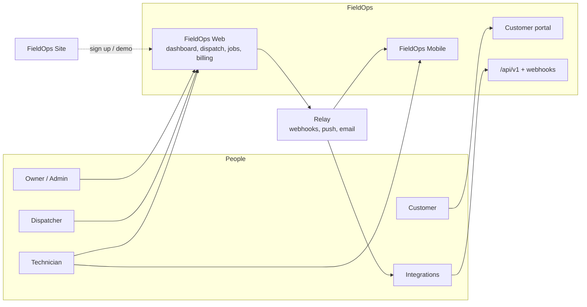
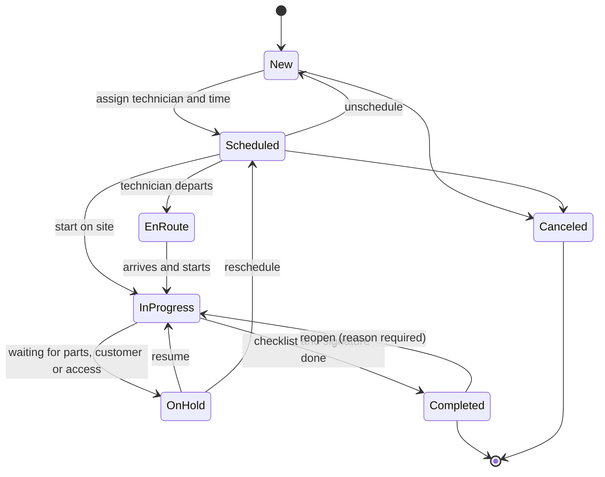
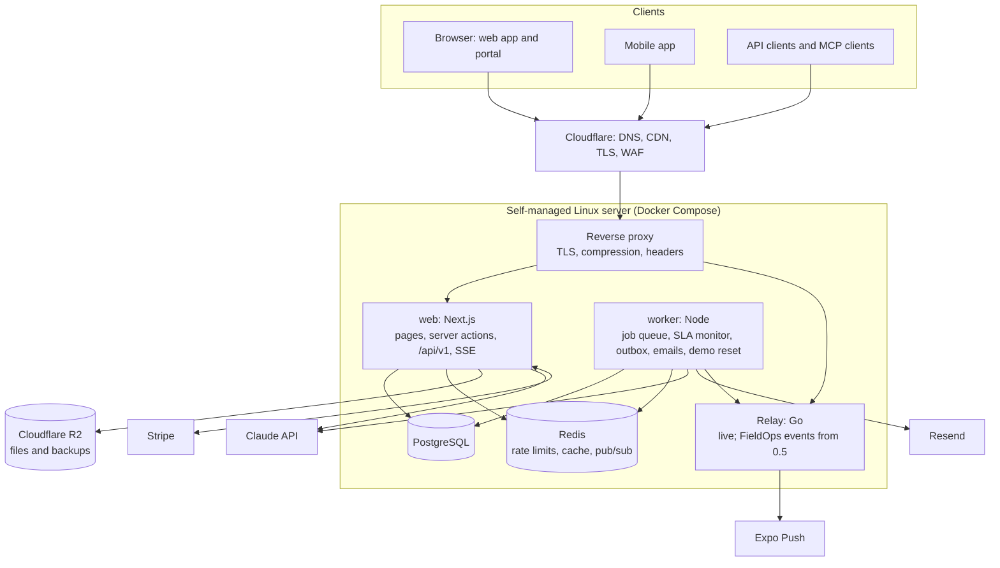
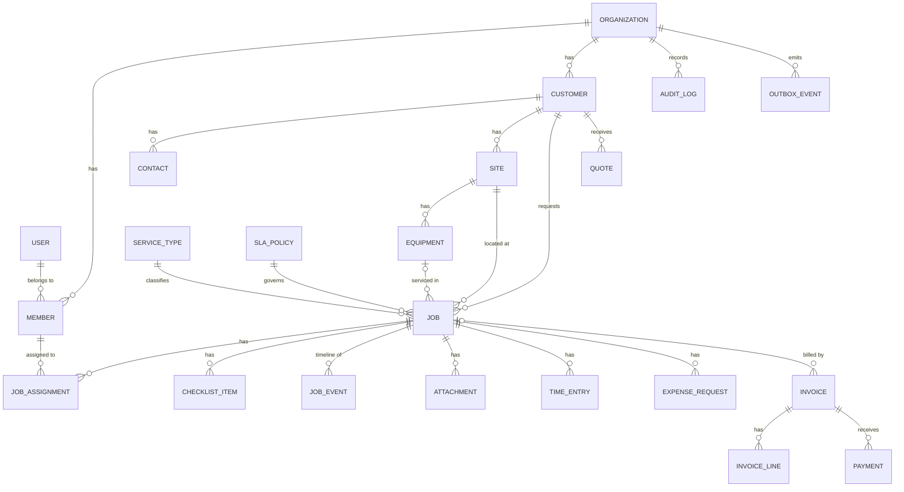

# FieldOps — Product Requirements Document

| | |
|---|---|
| **Product** | FieldOps (working title): field service management for small service businesses |
| **Status** | Draft 2.0 · release 0.4.1 and Relay 1.0 live |
| **Owner** | Ahmad Izzat Maulana |
| **Last updated** | 11 November 2026 |
| **Live demo** | `https://fieldops.tinggalpake.com` (self-hosted); Relay at `https://relay.tinggalpake.com` |
| **Repositories** | `fieldops` (web + mobile), [`relay`](https://github.com/guzmanloeracode/relay) (backend service), `fieldops-site` (marketing site) |
| **Implementation docs** | `docs/ARCHITECTURE.md`, `docs/RUNBOOK.md`, `docs/adr/` |

### Revision history

| Version | Date | Changes |
|---|---|---|
| 1.0 | 10 Nov 2026 | First draft. |
| 1.1 | 10 Nov 2026 | Release 0.1 built. Recorded the decisions made while building it: pinned versions (§14.3), services behind repository interfaces (§14.2), OpenFreeMap as the default map style (§14.3), Redis deferred to 0.3 (§15.3), the on-server release script until the Actions deploy is approved (§15.4), backups blocked until R2 is enabled (§15.5), the server capacity check (§23), and new open questions (§23). |
| 1.2 | 10 Nov 2026 | Repository published at github.com/guzmanloeracode/fieldops. **No hosted CI** (owner's decision): GitHub Actions is disabled and the checks run on the server as release gates — `pnpm verify` before the build, `infra/deploy/e2e.sh` on the new images before they go live (§15.4, §18.2, ADR 014). |
| 1.3 | 10 Nov 2026 | Release 0.2 built and live. Recorded the decisions made while building it in *As built (0.2)* notes: overridable conflict kinds and working-hours rules (§8.4), clocks driven by status changes and the signature setting (§8.5), approval thresholds and pre-ordered parts (§8.6), saved views, bulk actions and export (§8.3), provisional SLA targets until SLA-01 ships in 0.3 (§8.10), local file storage until R2 is enabled (§14.5, §15.5, ADR 015), new tables and fields (§16.3), new endpoints (§17.2) and the 0.2 seed (§19). |
| 1.4 | 10 Nov 2026 | Release 0.2.1: route-level loading skeletons for every page that loads data (§13 *As built (0.2.1)*). |
| 1.5 | 10 Nov 2026 | Summary, market (§2), delivery goals (§4.2) and documentation and launch (§21) rewritten around the product and its customers. |
| 1.6 | 10 Nov 2026 | Release 0.3 built and live. Recorded the decisions made while building it in *As built (0.3)* notes: Google sign-in (§8.1), the live board (§8.4), SLA time basis, the monitor and notification rules (§8.7), the portal sign-in and requests (§8.9), real SLA figures and CSV export (§8.10), the audit log written by database triggers (§8.11, ADR 016), SLA and AI settings (§8.12), AI rate limits (§8.14), AI intake (§9.2), live updates through PostgreSQL instead of Redis (§14.3, §15.3, ADR 011), new tables and endpoints (§16.3, §17.2) and the 0.3 seed (§19). |
| 1.7 | 10 Nov 2026 | Release 0.3.1: collapsible desktop sidebar (§13 *As built (0.3.1)*) and demo data where each job's description matches its title and portal requests arrive without a service type (§19 *As built (0.3.1)*). |
| 1.8 | 11 Nov 2026 | Release 0.4 built and live: billing, online payments, documents, the assistant, operations and Bahasa Indonesia. Recorded the decisions made while building it in *As built (0.4)* notes: maintenance plans (§8.3), parts billed once (§8.6), the SLA pause, the daily digest and the new notifications (§8.7), the catalog, quotes, invoices, online payments, PDFs, reminders and totals (§8.8), quotes, invoices and reports in the portal (§8.9), revenue on the dashboard (§8.10), catalog and billing settings and the two languages (§8.12, §13), *Ask FieldOps* (§9.3), the service report writer (§9.4), ADRs 017–021 and the missing 016 in the ADR list (§14.5), new tables, endpoints and Stripe (§16.3, §17.2, §17.4), the 0.4 seed and demo payments (§19), the payment provider risk (§22) and Stripe test keys for the demo (§23). |
| 1.9 | 11 Nov 2026 | Release 0.4.1: past *Ask FieldOps* conversations readable while AI is off (§9.3), next plan visits with their year (§8.3), KPI changes that round to zero read as the same (§8.10), and demo quotes whose title, service and parts match (§19). |
| 2.0 | 11 Nov 2026 | Relay 1.0 built and live at `relay.tinggalpake.com`, repository `relay` public. Recorded the decisions made while building it in *As built (Relay 1.0)* notes: tenants, keys and scopes, routing at ingestion with a group commit, Standard Webhooks signatures, retries and automatic disabling, limits with parking lots, Expo push and email adapters, Redis Streams with PostgreSQL as the source of truth, and the k6 results against the targets (§11); its hosting (§15.2, §15.3) and load testing (§18.1); a dedicated-VM load test as an open question (§23). |
| 2.1 | 11 Nov 2026 | Release 0.5 narrowed to the platform: API keys, rate limits, webhooks through Relay and the MCP server (PLT-02–05, AI-05); the other 0.5 items moved to a backlog (§20). |

## Contents

1. [Summary](#1-summary)
2. [Market and opportunity](#2-market-and-opportunity)
3. [Problem](#3-problem)
4. [Goals, non-goals and success metrics](#4-goals-non-goals-and-success-metrics)
5. [Users, roles and permissions](#5-users-roles-and-permissions)
6. [Product overview](#6-product-overview)
7. [Key user journeys](#7-key-user-journeys)
8. [Functional requirements: FieldOps Web](#8-functional-requirements-fieldops-web)
9. [AI features](#9-ai-features)
10. [FieldOps Mobile](#10-fieldops-mobile)
11. [Relay (backend service)](#11-relay-backend-service)
12. [FieldOps Site (marketing site)](#12-fieldops-site-marketing-site)
13. [Non-functional requirements](#13-non-functional-requirements)
14. [Architecture and tech stack](#14-architecture-and-tech-stack)
15. [Hosting, deployment and operations](#15-hosting-deployment-and-operations)
16. [Data model](#16-data-model)
17. [API and integrations](#17-api-and-integrations)
18. [Quality engineering](#18-quality-engineering)
19. [Demo environment and seed data](#19-demo-environment-and-seed-data)
20. [Release plan](#20-release-plan)
21. [Documentation and launch](#21-documentation-and-launch)
22. [Risks and mitigations](#22-risks-and-mitigations)
23. [Open questions](#23-open-questions)
24. [Glossary and sources](#24-glossary-and-sources)

Priority labels follow MoSCoW: **M** = must, **S** = should, **C** = could. The release column refers to the plan in [§20](#20-release-plan).

---

## 1. Summary

FieldOps is a multi-tenant SaaS for small service businesses: air-conditioning and HVAC, cleaning, plumbing, electrical and property maintenance companies with 5–50 staff. It covers the whole service loop. A request comes in, a dispatcher schedules a technician, the technician does the work on site with a checklist and photos, the customer gets a report, and the business gets paid. It replaces the chat threads, spreadsheets and paper job sheets most of these businesses still run on.

FieldOps is open source and runs as a live demo with two fictional companies, so a prospective customer can try every role, from owner to technician, before signing up. It is built to production standards: database-enforced tenant isolation, typed contracts from the database to the API, tests at every layer, and automated release gates for a self-managed server.

FieldOps ships as four deliverables:

| # | Deliverable | Location | What it is |
|---|---|---|---|
| 1 | **FieldOps Web** | `fieldops/apps/web` | The product: the office web app, the technician workspace, the customer portal, the REST API, AI features and payments |
| 2 | **Relay** | `relay` (own repo) | Event delivery service in Go: queues, retries, signed webhooks, push notifications, observability |
| 3 | **FieldOps Site** | `fieldops-site` (own repo) | Marketing site: product pages, pricing, use cases, blog and demo booking |
| 4 | **FieldOps Mobile** | `fieldops/apps/mobile` | Expo app for technicians: offline mode, camera, location, push notifications |

**Demo data.** All demo data is synthetic: every person, company and address in the demo is fictional.

---

## 2. Market and opportunity

### 2.1 Market

| Signal | Evidence |
|---|---|
| Field service software is a real, growing market | IBISWorld sizes the US field service management software industry at **$3.1bn in 2026**, growing 7.5% that year. [1] Verdantix puts the global market at **$5.9bn in 2025**. [2] |
| Small teams are underserved | Established suites are built for mid-size and enterprise field teams, with long setups and per-seat prices to match. Owner-run businesses with 2–30 technicians still run on chat, spreadsheets and paper ([§3](#3-problem)). |
| AI removes the most repetitive office work | Requests arrive as free text in chats and emails, and reports are written by hand after each visit. Both are tasks where AI drafts and a person confirms ([§9](#9-ai-features)). |

### 2.2 What service businesses ask for, and where FieldOps answers

| What the business says | Where FieldOps answers |
|---|---|
| "Requests come in by chat and email, and someone retypes them" | AI job intake, customer portal requests |
| "We double-book technicians" | Drag-and-drop dispatch board with conflict checks |
| "We hear about late jobs when the customer complains" | SLA policies, at-risk alerts and notifications |
| "There's no proof of what was done on site" | Checklists, photos, customer signatures, audit log |
| "Invoices go out days after the job" | Invoices from completed jobs, online payment |
| "The owner can't see what's going on" | KPI dashboard, the dispatcher's *Today* view, CSV export |
| "Technicians work from their phones, often with bad signal" | Phone-first technician workspace; offline mobile app |
| "Customers keep calling to ask when someone is coming" | Customer portal with job status and the visit window |
| "Our other tools need the data" | REST API with OpenAPI docs, API keys, signed webhooks |
| "We run more than one company or branch" | Several organizations per user, roles per organization |
| "Our data has to stay ours" | Tenant isolation enforced by the database, self-hosting with Docker, full data export |

---

## 3. Problem

**Target customer.** Owner-run service businesses with 5–50 staff and 2–30 technicians in the field.

**How they work today**

- Requests arrive by phone, chat and email, and someone retypes them.
- The schedule lives on a whiteboard or spreadsheet. Technicians receive jobs as chat messages.
- Job sheets are on paper. Photos stay in technicians' personal phone galleries.
- Invoices are made days later in a word processor or spreadsheet.
- The owner can't see workload, overdue jobs or revenue without asking around.

**What it costs them**

- Missed or double-booked visits, and service-level (SLA) breaches discovered only when a customer complains.
- Slow invoicing, which means slow cash collection.
- Disputes with no evidence of what was done.
- No data to decide on hiring, pricing or which services to push.

**The FieldOps angle.** Established field service suites exist, and FieldOps doesn't try to out-feature them. Its angle is fast setup for small teams, AI that removes retyping and report writing, and a clean, modern interface that works as well on a phone as on a desktop.

---

## 4. Goals, non-goals and success metrics

### 4.1 Product goals

| ID | Goal |
|---|---|
| G1 | Turn any incoming request into a well-formed job in under 30 seconds. |
| G2 | Let a dispatcher plan a full day for 8 technicians in under 5 minutes. |
| G3 | Make SLA risk visible before a breach, not after. |
| G4 | Capture proof of work (checklist, photos, signature) on every completed job. |
| G5 | Shorten the time from job completion to invoice sent to under 1 hour. |
| G6 | Give the owner a live view of jobs, SLA compliance and revenue. |

### 4.2 Delivery goals

| ID | Goal |
|---|---|
| E1 | Every deliverable is public, live, documented and runnable locally in under 10 minutes. |
| E2 | The code reads like a professional team's codebase: clear layering, typed contracts, tests, release gates, ADRs. |
| E3 | Each deliverable (web app, Relay, site, mobile app) builds, deploys and is documented on its own. |
| E4 | A new visitor understands the product in 2 minutes from the README, GIFs and demo video. |

### 4.3 Non-goals

- Payroll, HR or full inventory management. FieldOps only records parts used on jobs.
- Accounting. Integrations such as QuickBooks or Xero are future work.
- Route optimization. A simple distance-aware suggestion is the most FieldOps does.
- Processing real payments. The demo uses Stripe test mode only.
- Enterprise features such as SSO/SAML, custom roles or data residency.

### 4.4 Success metrics

| Area | Metric | Target |
|---|---|---|
| Product | Time to create a job from a pasted message, with AI intake | < 30 s (usability test, 3 participants) |
| Product | AI intake: service-type accuracy on the evaluation set | ≥ 90% |
| Performance | Server response time for list and detail pages on demo data (p95) | < 400 ms |
| Performance | Lighthouse on key app pages (performance, accessibility, best practices) | ≥ 90 each |
| Accessibility | Serious or critical axe violations on key pages | 0 |
| Quality | Line coverage on the `core` domain package | ≥ 90% |
| Quality | Duration of the release gates (`pnpm verify` + E2E on the images) | < 12 min (measured: about 1 min + 2 min, plus the image build) |
| Security | Open high or critical vulnerabilities older than 7 days | 0 |
| Operations | Demo uptime per month | ≥ 99.5% |
| Operations | Restore from backup, tested quarterly | < 30 min |
| Developer experience | Time from clone to running app (documented) | < 10 min |

---

## 5. Users, roles and permissions

### 5.1 Personas

| Persona | Role | Needs |
|---|---|---|
| **Olivia, owner** | Owner | See the business at a glance, approve spending, get paid, control costs |
| **Dan, dispatcher** | Dispatcher | Turn requests into jobs fast, fill the schedule, react to delays and SLA risks |
| **Tom, technician** | Technician | Know where to go next, record the work quickly, get parts approved, minimal typing |
| **Cara, customer** | Customer (portal) | Request service easily, know when someone is coming, approve quotes, pay online |
| **Ivan, integrator** | API client | Connect FieldOps to other systems through the API and webhooks |

### 5.2 Permission matrix

| Capability | Owner | Admin | Dispatcher | Technician | Customer |
|---|:-:|:-:|:-:|:-:|:-:|
| Organization settings, billing, API keys | ✓ | ✓ (no billing) | – | – | – |
| Invite members and change roles | ✓ | ✓ | – | – | – |
| Customers, sites and equipment: create and edit | ✓ | ✓ | ✓ | view (assigned only) | own only |
| Jobs: create, edit, assign, schedule | ✓ | ✓ | ✓ | – | request only |
| Jobs: update status, checklist, photos, notes | ✓ | ✓ | ✓ | assigned only | – |
| Approve parts and expenses | ✓ | ✓ | below threshold* | – | – |
| Quotes and invoices | ✓ | ✓ | ✓ | – | view, approve, pay own |
| Dashboard: financial KPIs | ✓ | ✓ | – | – | – |
| Dashboard: operational KPIs | ✓ | ✓ | ✓ | own stats | – |
| Audit log | ✓ | ✓ | – | – | – |
| AI assistant | ✓ | ✓ | ✓ | own jobs | – |

\* The approval threshold is set per organization.

Permissions are enforced on the server for every page, server action and API call, through one authorization function in the domain layer. Hiding UI elements is a convenience, not a security measure.

---

## 6. Product overview



### Modules

| Module | Summary |
|---|---|
| Accounts and organizations | Sign-up, organizations, invitations, roles, tenant isolation |
| Customers, sites and equipment | Lightweight CRM with service history per site and per unit |
| Jobs | Work orders with a status lifecycle, checklist, photos, notes, time and timeline |
| Scheduling and dispatch | Drag-and-drop board per technician, availability, conflicts, map |
| Technician workspace | "My day" on phone-sized screens; later the native mobile app |
| Parts and expenses | Requests with receipts, approval rules, billable lines |
| SLA and notifications | SLA policies, a monitor, in-app, email and push notifications |
| Quotes, invoices and payments | Quotes, invoices, PDFs, Stripe payments |
| Customer portal | Request service, track jobs, approve quotes, pay invoices |
| Dashboard and reports | KPIs, charts, drill-down, CSV export |
| AI | Job intake, assistant, service reports, MCP server |
| Audit | Append-only log of sensitive and business-relevant changes |
| Platform | REST API, API keys, webhooks, SaaS plans |

---

## 7. Key user journeys

**J1. Request to scheduled job**
1. Cara submits "AC in the bedroom is leaking water and smells musty, can someone come Thursday morning?" with a photo in the portal.
2. AI intake drafts a job: service type *AC cleaning and repair*, priority *Normal*, a checklist, a 90-minute estimate, and one question ("How many indoor units?").
3. Dan opens the request, adjusts one field and confirms it. The job enters the unscheduled queue with its SLA clock running.
4. Dan drags the job onto Tom's Thursday 09:00 slot. FieldOps warns that Tom lacks the *refrigerant handling* skill, so Dan picks Rina instead. Rina and Cara are notified.

**J2. Work on site**
1. Rina opens *My day*, taps **En route**, then **Start** when she arrives.
2. She works through the checklist, takes before and after photos, and requests a $45 drain pump.
3. Olivia approves the part from her phone; it is under the auto-approve threshold, so this step is instant in most cases.
4. Rina records the part as used, captures Cara's signature and taps **Complete**.

**J3. Report and payment**
1. FieldOps drafts a service report from the checklist, notes and photos. Dan reviews and sends it.
2. An invoice is generated from labor time, the service price and the approved part.
3. Cara pays online through Stripe Checkout. The invoice is marked paid through a webhook, and the dashboard updates.

**J4. SLA risk**
1. An *Urgent* job is still unscheduled at 75% of its response window.
2. The SLA monitor raises *at risk*. Dan gets an in-app alert and an email; the job turns amber on the board.
3. If the job breaches, Olivia is notified too, and the breach counts in the SLA compliance KPI.

**J5. Owner questions**
1. Olivia asks *Ask FieldOps*: "Which technicians had the most callbacks last month?"
2. The assistant queries FieldOps through read-only tools, answers with numbers, and links each job it mentions.

**J6. Integration**
1. Ivan creates an API key with the `jobs:read` scope and registers a webhook endpoint for `job.completed`.
2. When a job completes, Relay delivers a signed webhook. A failed delivery is retried with backoff and visible in the delivery log.

---

## 8. Functional requirements: FieldOps Web

### 8.1 Accounts, organizations and access (AUTH)

| ID | Requirement | Pri | Rel |
|---|---|:-:|:-:|
| AUTH-01 | Sign up and sign in with email and password; email verification; password reset. | M | 0.1 |
| AUTH-02 | Sign in with Google. | S | 0.3 |
| AUTH-03 | First sign-up creates an organization (name, slug, timezone, currency, country). The creator becomes Owner. | M | 0.1 |
| AUTH-04 | Invite members by email with a role. Invitations expire after 7 days and can be resent or revoked. | M | 0.1 |
| AUTH-05 | Roles Owner, Admin, Dispatcher and Technician, enforced on the server per [§5.2](#52-permission-matrix). | M | 0.1 |
| AUTH-06 | A user can belong to several organizations and switch between them. | S | 0.2 |
| AUTH-07 | Two-factor authentication (TOTP). | C | 0.5 |
| AUTH-08 | Active session list with "sign out other sessions". | C | 0.5 |
| AUTH-09 | Demo sign-in: one click as Owner, Dispatcher or Technician of a demo organization (demo environment only). | M | 0.1 |

*As built (0.3), AUTH-02:* Google sign-in is turned on by setting `GOOGLE_CLIENT_ID` and `GOOGLE_CLIENT_SECRET`; until then the button is hidden. Google always asks which account to use, and a Google account links to an existing FieldOps account with the same email. A new user without an organization goes to onboarding.

*As built (0.2), AUTH-06:* the user menu lists every membership with its role and switches the active organization in the same session. A signed-in member can create another organization at `/onboarding?new=1`; demo accounts can't. In the demo, Olivia is also an Admin of Acme Teknik.

**Acceptance criteria: tenant isolation (AUTH-05)**
- *Given* a user in organization A and a record in organization B, *when* the user requests that record by ID through any page, server action or API endpoint, *then* the response is "not found" and no data from B is returned.
- An automated test runs this check for every tenant-scoped resource and fails CI if one is missing.

### 8.2 Customers, sites and equipment (CUS)

| ID | Requirement | Pri | Rel |
|---|---|:-:|:-:|
| CUS-01 | Customers: residential or commercial, name, several contacts (name, role, email, phone), billing address, tags and notes. | M | 0.1 |
| CUS-02 | Sites per customer: address, coordinates, access instructions and an on-site contact. | M | 0.1 |
| CUS-03 | Equipment per site: type, brand, model, serial number, install date, warranty end and service history. | S | 0.2 |
| CUS-04 | Customer page showing sites, equipment, job history, invoices and lifetime value. | M | 0.1 (invoices 0.4) |
| CUS-05 | Server-side search, filter and pagination. Warn about duplicates on matching email or phone. | M | 0.1 |
| CUS-06 | CSV import with column mapping, a validation preview and per-row errors. CSV export. | S | 0.5 |

*As built (0.2), CUS-03:* equipment is added, edited and soft-deleted from the customer page, with a warranty badge; `/equipment/{id}` shows details and the service history (jobs on that unit).

### 8.3 Jobs (JOB)

| ID | Requirement | Pri | Rel |
|---|---|:-:|:-:|
| JOB-01 | Create a job: customer, site, optional equipment, service type, title, description, priority (Low, Normal, High, Urgent), source (Manual, Portal, AI intake, API) and preferred time window. Each job gets a per-organization number such as `JOB-000123`. | M | 0.1 |
| JOB-02 | Status lifecycle per the diagram below. The server rejects invalid transitions. Every transition is recorded in the timeline with actor, time and reason when one is required. | M | 0.1 |
| JOB-03 | Jobs table: server-side search, filters (status, priority, technician, service type, date range, SLA state), multi-column sort, pagination, column visibility, and filter state kept in the URL. | M | 0.1 |
| JOB-04 | Saved views and bulk actions (assign, change status, export). | S | 0.2 |
| JOB-05 | Job page: summary, customer and site card with a map, checklist, notes, attachments, parts and expenses, time entries, timeline and related invoices. Sections are added as releases land. | M | 0.1 |
| JOB-06 | Attachments: photos and documents up to 10 MB each, uploaded directly to object storage. Thumbnails; before and after tags. | M | 0.1 |
| JOB-07 | Notes are internal or customer-visible. | M | 0.1 |
| JOB-08 | Checklists generated from service-type templates. Item types: checkbox, number with unit, text, required photo. A job cannot be completed with required items missing. | S | 0.2 |
| JOB-09 | Several technicians per job (one lead, helpers). | S | 0.2 |
| JOB-10 | Customer signature captured on completion. | S | 0.2 |
| JOB-11 | Command palette (⌘K) to search jobs, customers and sites and to jump to actions. | S | 0.2 |
| JOB-12 | Follow-up job linked to its original, for example when a part has to be ordered. | C | 0.3 |
| JOB-13 | Recurring jobs for maintenance contracts: a recurrence rule generates jobs a set number of days ahead. | S | 0.4 |



**Acceptance criteria: completion (JOB-02, JOB-08)**
- *Given* a job with a required checklist item that is not done, *when* the technician taps **Complete**, *then* the request is rejected and the missing items are listed.
- *Given* a completed job, *when* a dispatcher reopens it, *then* a reason is required and the reopen appears in the timeline and audit log.

*As built (0.2):*
- **JOB-04:** saved views store the jobs-list query string, per person or shared with the office (`views.share`). Bulk assign and status changes run one transaction per job through the same services as single edits; skipped jobs are listed with the reason. CSV export is office-only, streamed in keyset pages, capped at 10,000 rows, and neutralizes spreadsheet formulas. The list gained `unassigned`, `revisit` and `date_field` (scheduled, created or completed) filters.
- **JOB-08:** a job's checklist is copied from its service type's template when the job is created. If the service type changes, the checklist follows only until the first item is done. Answers that aren't done are stored as null; *done* is decided by `done_at`. A photo answer must be a ready photo of the same job.
- **JOB-09:** one lead and any number of helpers; a job shows in every assignee's lane on the board.
- **JOB-10:** the signature is an attachment of kind `signature` (caption = signer's name), uploaded like any file and confirmed through `POST /jobs/{id}/signature`. It is required only when the organization turns on *Require a customer signature* (§8.12); the demo's Acme Air does.
- **JOB-11:** ⌘K / Ctrl+K opens a palette that searches job numbers and titles, customers and sites, and lists page shortcuts for the role. Technicians only find their assigned work.

*As built (0.4), JOB-13:* recurring work is set up as **maintenance plans** on the customer page (office roles) or through `/recurrences`. A plan names a site, optional equipment and service type, a title and priority, an interval (every N days, weeks, months or years), a start date, an optional end date (inclusive), an optional visit window in the organization's time zone, the lead days (up to 90) and a suggested technician.
- **Dates:** occurrence *n* is always start + *n* × interval, never the previous date plus one interval, so month ends don't drift (Jan 31 → Feb 28 or 29 → Mar 31).
- **Generation:** jobs are created up to today + the lead days, when a plan is created or changed and hourly in the worker, each built like a manual job (service type duration and checklist, SLA deadlines, source *recurring*). A unique index on plan and visit date and `FOR UPDATE SKIP LOCKED` on the plan make a repeated or concurrent run create nothing twice.
- **Assignment:** generated jobs arrive *New* and unassigned. The plan's technician is only a suggestion: the dispatcher assigns with the usual conflict checks, and nobody is notified weeks ahead.
- **SLA:** a generated job's clock starts at local midnight of its visit date (or when it is created, if later), so a job made weeks ahead isn't late before its visit.
- **Changes:** a plan that starts in the past, a changed rule and a resume continue from today after the dates that already have jobs, so no backlog of past visits is created. Other changes apply to jobs generated from then on. Deleting a plan keeps its jobs. The jobs list and the job page show a badge with the plan's visit date.

*As built (0.4.1):* the plan card lists the next visits with their year, and shows how many jobs the plan created only once it has created one: a plan doesn't backfill visits from before it was added, and *Next visits* already says when the first job comes.

### 8.4 Scheduling and dispatch (SCH)

| ID | Requirement | Pri | Rel |
|---|---|:-:|:-:|
| SCH-01 | Dispatch board with day and week views, one lane per technician, jobs as blocks sized by duration, and an unscheduled queue at the side. | M | 0.2 |
| SCH-02 | Drag and drop to schedule, reassign or resize. Every drag action has a keyboard equivalent. | M | 0.2 |
| SCH-03 | Conflict warnings for overlaps, outside working hours, time off and missing required skills. A dispatcher can override with a reason. | S | 0.2 |
| SCH-04 | Technician availability: working hours per weekday, time off and skills. | S | 0.2 |
| SCH-05 | Map of the day's jobs, colored by status, filterable by technician. | S | 0.2 |
| SCH-06 | Live board: changes by other users appear within 5 seconds without reloading. | S | 0.3 |
| SCH-07 | Assignment suggestion that ranks technicians by skill match, workload and distance, with the reasoning shown. The scoring is deterministic. | C | 0.5 |

*As built (0.2):*
- **Board:** day view rows run from 06:00 to 20:00 (wider when visits or hours need it), with off-hours, days off and time off shaded and a "now" line. The week view shows compact cards per technician per day; a drop there takes the first free 15-minute slot after the technician's day starts. Times snap to 15 minutes. Rows are technicians plus any office staff with visits in the range. The unscheduled queue shows up to 50 new jobs, urgent first, then oldest.
- **Drag and drop (dnd-kit):** moving to another technician swaps that one member and keeps the lead flag and helpers; dropping a scheduled job on the queue unschedules it. Keyboard: Space picks up, arrows move by 15 minutes or one lane (one day in the week view), Space/Enter/Tab drops, Escape cancels, Shift+←/→ resizes, Enter opens a reschedule dialog. Moves are announced through a live region.
- **Conflicts:** all four kinds (overlap, outside working hours, time off, missing skills) are warnings. Without `override_reason` the API answers 409 with a `conflicts[]` extension member (kind, member, message, job numbers or missing skills); with one, the assignment is saved and the `assigned` event records the reason and the overridden conflicts. Overlap ignores completed and canceled jobs. Skills match case-insensitively and are checked even without a time. A visit is inside working hours when it fits one working window on the local date it starts; a visit past midnight is always outside. Members with their own hours replace the business hours entirely. With no hours set anywhere, there is no restriction.
- **Availability:** time off is entered in whole days in the UI (the API accepts any instants). Existing time off is removed and re-added rather than edited.
- **Map:** MapLibre loads only when the Map tab opens; a status legend and a plain list of the day's visits sit beside it for screen readers and phones.
- **Limits:** `GET /schedule` covers at most 31 days and 3,000 jobs and is office-only; `GET /me/agenda` covers today plus 7 days.

*As built (0.3), SCH-06:* the board and the dispatcher's *Today* view refresh when another user changes a job, an assignment or time off (server-sent events, [§8.7](#87-sla-and-notifications-sla-not)). A refresh waits while a drag, a save or the conflict dialog is in progress. The approvals inbox doesn't refresh live, so a selection in progress is never lost.

### 8.5 Technician workspace (TEC)

Phone-first web screens until the native app ships ([§10](#10-fieldops-mobile)).

| ID | Requirement | Pri | Rel |
|---|---|:-:|:-:|
| TEC-01 | *My day*: today's jobs in time order with address, window and status. | M | 0.2 |
| TEC-02 | One-tap actions **En route**, **Start**, **Hold** (with a reason) and **Complete**, with large touch targets. | M | 0.2 |
| TEC-03 | Complete the checklist, add notes, take photos with the camera, record parts used and capture a signature. | M | 0.2 |
| TEC-04 | Travel and work time recorded from status changes. Editable with a reason. | S | 0.2 |
| TEC-05 | Technicians only see their assigned jobs and those jobs' customers and sites. | M | 0.2 |

*As built (0.2):* *My day* highlights the next visit with one-tap En route / Start / Resume and directions. On phones the job's status actions sit in a sticky bottom bar, and photos can be taken with the camera directly. Time (TEC-04) is driven by status changes: En route starts a travel clock, Start and Resume a work clock; Hold, Complete, Cancel and Unschedule stop every clock on the job. Time is charged to the person tapping if they are assigned, otherwise to the lead. Corrections and manual entries need a reason and appear as `time_edited` in the timeline; technicians edit only their own entries. Reopening a job doesn't restart a clock.

### 8.6 Parts and expenses (EXP)

| ID | Requirement | Pri | Rel |
|---|---|:-:|:-:|
| EXP-01 | A technician requests a part or expense on a job: item, quantity, unit cost, supplier, reason and receipt photo. | M | 0.2 |
| EXP-02 | Owners and Admins approve or reject with a comment. Dispatchers can approve below a threshold. Requests below a second threshold are approved automatically. | M | 0.2 |
| EXP-03 | Approvals inbox with filters and bulk approve. | S | 0.2 |
| EXP-04 | Approved items become billable invoice lines, with an optional markup percentage. | M | 0.4 |

*As built (0.2):* thresholds live in `organization.settings` and compare strictly ("below"). Defaults: auto-approve below $50 / Rp500,000, dispatchers approve below $250 / Rp2,500,000. A request can be decided once (a second decision is a 409, race-safe). Requests are allowed on any open job, including new and scheduled ones, so parts can be ordered before a visit. Receipts are ordinary job attachments captioned "Receipt". Approved parts can be marked used (TEC-03). Bulk decisions are a web action only, with a result per request; there is no bulk API endpoint. Notifications to requesters and approvers wait for NOT-01 (0.3).

*As built (0.4), EXP-04:* an invoice for a job is prefilled with every approved, billable part or expense not billed yet, priced at its unit cost plus the request's markup (cost × (1 + markup), rounded half away from zero). The markup can be changed per line, up to 1,000%; quantity and cost always come from the request. Parts become `part` lines and other expenses `expense` lines, at the organization's default tax rate. A request is billed once: a line on any invoice that isn't void counts, drafts included, so voiding an invoice frees its parts for another one. Saving or issuing an invoice locks the requests' rows first, so two invoices racing for the same part wait for each other and the second is refused with a 409 (ADR 017).

### 8.7 SLA and notifications (SLA, NOT)

| ID | Requirement | Pri | Rel |
|---|---|:-:|:-:|
| SLA-01 | SLA policies per priority with a response target (job scheduled with a technician) and a resolution target (job completed), counted in calendar time or business hours. | M | 0.3 |
| SLA-02 | Each job stores its response and resolution deadlines. SLA state: on track, at risk (≥ 75% of the window used), breached or met. | M | 0.3 |
| SLA-03 | An SLA monitor runs every 5 minutes. It is idempotent and raises `sla.at_risk` and `sla.breached` once per job and target. | M | 0.3 |
| SLA-04 | *On hold: waiting for customer* pauses the resolution clock. | C | 0.4 |
| NOT-01 | In-app notification center with an unread badge, mark as read and deep links. | M | 0.3 |
| NOT-02 | Email notifications from templates (see the matrix below). | M | 0.3 |
| NOT-03 | Per-user preferences per event and channel. | S | 0.3 |
| NOT-04 | Daily owner digest: yesterday's KPIs, overdue jobs and pending approvals. | C | 0.4 |
| NOT-05 | Live updates in the notification center and on the dispatch board through server-sent events. | S | 0.3 |
| NOT-06 | Push notifications to the mobile app through Relay. | M | 1.0 |

**Notification matrix**

| Event | Recipients | In-app | Email | Push (1.0) |
|---|---|:-:|:-:|:-:|
| Invitation | Invitee | – | ✓ | – |
| Job assigned or rescheduled | Assigned technicians | ✓ | ✓ | ✓ |
| New portal request | Dispatchers | ✓ | ✓ | – |
| SLA at risk | Dispatchers | ✓ | ✓ | – |
| SLA breached | Dispatchers, Owner | ✓ | ✓ | – |
| Part or expense requested | Approvers | ✓ | – | ✓ |
| Part or expense decided | Requester | ✓ | – | ✓ |
| Job completed | Customer (with report) | – | ✓ | – |
| Quote sent, invoice sent, payment received | Customer; Owner for payments | ✓ | ✓ | – |

*As built (0.3), SLA:*
- **Policies** (`/settings/sla`, Owner and Admin): one row per priority; a priority without a row uses the defaults (urgent 2 h / 1 day, high 8 h / 3 days, normal 1 day / 7 days, low 3 days / 14 days, calendar time). The response target must be shorter than the resolution target. Changes apply to new jobs and to priority changes.
- **Time basis:** business-hours targets count minutes of business time in the organization's time zone, so "1 day" means 24 business hours, not one working day; without business hours they fall back to calendar time. The "at risk" moment (75% of the window) is computed in the same basis and stored on the job (`response_at_risk_at`, `resolution_at_risk_at`).
- **States:** a priority change recomputes both deadlines from the creation time; the first scheduling settles the response target and completion the resolution target (met, or breached when late); reopening restarts the resolution target; canceling clears both. A job's *current* SLA, used by the jobs filter and the dashboard, is the worse of its open targets.
- **Monitor:** one SQL pass per organization every 5 minutes moves open jobs along their deadlines, then inserts `sla_alert` rows with `ON CONFLICT DO NOTHING`; only new rows notify. At risk goes to dispatchers (owners and admins when there is none); breached goes to dispatchers and owners. On an existing installation the first run alerts every job already at risk.

*As built (0.3), NOT:*
- **Events per role:** office roles receive portal requests, SLA alerts and part or expense requests; technicians receive assignments, reschedules and decisions on their requests. Nobody is notified about their own action. *Assigned* goes to technicians newly added to a job (board, keyboard, bulk and API all included); *rescheduled* goes to the job's technicians when the window of a scheduled job moves; *requested* goes to the members who may approve that amount; auto-approved requests notify nobody.
- **Center and settings:** a bell in the header (phones included) with the latest notifications, `/notifications` with an unread filter, and `/notifications/preferences` with in-app and email per event. Deep links open the job (expenses included).
- **Email:** one template, written to the outbox in the same transaction as the change; captured in the demo.
- **Live updates (NOT-05):** `GET /api/v1/stream` (server-sent events, a heartbeat every 25 s). Messages carry ids only; office roles receive board events, everyone receives only their own notifications (ADR 011).
- **Retention:** read notifications are kept 90 days, unread ones a year.

*As built (0.4):*
- **SLA-04:** putting a job on hold with the reason *customer* pauses its resolution clock; other hold reasons and the response target don't pause. Leaving that hold in any way (resume, reschedule or cancel) ends the pause. Its length is measured in the policy's time basis (business minutes for business-hours policies), a started minute counts as a whole one, and the resolution deadline and its at-risk moment move by the same amount in the same basis. While paused, the resolution state stays what it was when the pause began, and the monitor skips the job. A priority change keeps the minutes already paused. The timeline records the pause, then its length and the new deadline; badges show *Paused*. The job stores `sla_paused_at` and the total `sla_paused_minutes`.
- **NOT-04:** an hourly worker pass sends the digest in the 07:00 hour of the organization's time zone, once per recipient and local day: a `daily_digest` row written in the same transaction as the email keeps a retried run from sending twice. Owners get it unless they turn it off, admins when they turn it on (notification settings); it is email only, with no in-app entry. It covers yesterday's jobs created and completed, resolution SLA compliance, first-visit completion and revenue invoiced and collected, plus the open jobs whose SLA is breached (the ten most overdue by name, the rest counted) and the pending approvals.
- **New events:** `quote_decided` (a customer approved or declined a quote, or staff recorded it) goes to office roles and `payment_received` to owners, in-app and by email; nobody is notified about their own action. Customer emails (quote sent, invoice sent, payment receipt, overdue reminder and *Job completed*) go through the outbox in the customer's language and aren't user notifications. *Job completed* goes out when someone sends the service report, not at completion itself ([§9.4](#94-ai-03-service-report-writer-s-04)).

### 8.8 Quotes, invoices and payments (FIN)

| ID | Requirement | Pri | Rel |
|---|---|:-:|:-:|
| FIN-01 | Service catalog: services with default duration, price and tax; parts with prices. A minimal service-type list ships in 0.1. | M | 0.1 / 0.4 |
| FIN-02 | Quotes: line items, discount, tax and validity date. Sent to the customer, who approves or declines in the portal. An approved quote becomes a job. | S | 0.4 |
| FIN-03 | Invoices from a completed job, built from labor time, services and approved parts. Per-organization numbering, tax and due date. Statuses: draft, sent, paid, overdue and void. | M | 0.4 |
| FIN-04 | Branded PDFs for quotes, invoices and service reports. | M | 0.4 |
| FIN-05 | Online payment through Stripe Checkout (test mode in the demo). A webhook marks the invoice paid. Manual payments (cash, bank transfer) can be recorded. | M | 0.4 |
| FIN-06 | Overdue reminders after 3, 7 and 14 days. | S | 0.4 |
| FIN-07 | Money stored as integer minor units with an ISO currency code. USD and IDR supported. | M | 0.4 |

*As built (0.4):*
- **FIN-01:** services and their prices stay the service types, which gained a tax rate (empty uses the organization's default rate). Parts and fees live in a catalog (`/settings/catalog`, Owner and Admin): name, SKU (unique per organization), unit, price, optional cost, optional tax rate and an active switch. Everyone who builds quotes and invoices searches it by name or SKU from the line pickers (`GET /catalog-items`).
- **FIN-02:** a quote has lines (service, labor, part, expense or fee, each with its own tax rate), an optional discount (a percentage or an amount) and a validity date, by default today + the quote validity from billing settings. Statuses: draft → sent → approved, declined or expired. Only drafts are edited. A sent or expired quote can be revised back to draft and must be sent again before anyone decides on it. Approved and declined are final; *Duplicate* starts a new draft. A decision needs a sent quote that hasn't expired, is recorded once (race-safe), and comes from the customer's contact or from staff recording it on the customer's behalf; a decline needs a reason. Approval creates a *New* job (source *quote*) with the quote's customer, site, service type and title, its lines as the description, and SLA deadlines and checklist like any job. Office roles are notified. Sending emails the contact a link to the quote in the customer portal. The worker expires sent quotes past their validity date, by the organization's local date.
- **FIN-03:** an invoice is drafted for a completed job or for a customer. From a job, the lines are prefilled: the service at its price and tax, or instead the lines (and discount) of the approved quote the job came from; one labor line per technician for the recorded work time, rounded up to the quarter hour, at the labor rate from billing settings and the default tax rate; and the parts and expenses not billed yet (EXP-04). Drafts have no number and can be edited. *Send* issues a draft: it gets the next number of the year, the issue date (today in the organization's time zone) and the due date (issue date + payment terms), the job's timeline records `invoiced`, and the bill-to contact gets an email with a link to the customer portal. A sent invoice becomes paid once payments cover the total; the worker marks one past its due date with a balance as overdue. Drafts and issued invoices without payments can be voided with a reason; an invoice with payments can't. Staff record payments made by cash, bank transfer, a card taken elsewhere or other means: at most the balance and never in the future; owners are notified and the contact gets a receipt. The invoices list shows the outstanding and overdue balances, and the job page and customer page list their quotes and invoices.
- **FIN-04:** quotes, invoices and service reports are PDFs from `packages/documents` (ADR 018): a letterhead with the organization's name, address and a monogram in its brand color (darkened until it reads as text on white; logos aren't stored as files yet), labels in the document's language, amounts formatted like the app, line tables whose header repeats on every page, "Page 1 of 2" footers, PAID and VOID stamps on invoices, and Letter paper for USD organizations and A4 for IDR. The service report adds the checklist and readings, the parts used, up to six photos (before ones first) and the signature.
- **FIN-05:** online payments go through a provider port with two adapters in `packages/payments` (ADR 021). With `STRIPE_SECRET_KEY` and `STRIPE_WEBHOOK_SECRET` set, the provider is Stripe Checkout: a hosted page in payment mode for the invoice's balance, with the organization and invoice in the session's metadata. Without them, the public demo (or `PAYMENTS_PROVIDER=simulated`) uses a simulated checkout; otherwise there is no *Pay* button, the portal shows the bank transfer instructions, and staff record payments by hand. By the owner's decision of 10 Nov 2026 the public demo runs the simulated checkout until Stripe test keys are provided ([§23](#23-open-questions)).
  - **Checkout:** *Pay now* in the portal, *Copy payment link* on the invoice page and `POST /invoices/{id}/checkout` open a session for a sent or overdue invoice with a balance. The provider is called between two short transactions, never inside one. The session is stored on the invoice and reused until 10 minutes before it expires; any payment drops it, since its amount no longer matches. Stripe gets an idempotency key per invoice, amount and 10-minute window, so two clicks racing get one session.
  - **Confirmation:** `/api/webhooks/stripe` checks the `Stripe-Signature` with the endpoint's signing secret before reading anything, then records paid sessions from `checkout.session.completed` and `checkout.session.async_payment_succeeded` as card payments, with the payment intent as the provider reference. A unique index on the reference makes a repeated or concurrent delivery record one payment. The webhook answers 200 for recorded, repeated and ignored events, and also for payments a retry can't fix (the invoice was paid by hand meanwhile, or voided), which are logged for a person to refund or record; other errors answer 500, so Stripe retries. A refused payment raises no notification yet, only an error log. A recorded online payment works like a manual one: owners are notified and the contact gets a receipt.
  - **Simulated checkout:** `/checkout/<token>`, outside the portal like a hosted checkout link, labeled as a test and without card fields. The token is an HMAC over the organization, the invoice, the session and its expiry; a session lasts 1 hour, and paying needs it to still be the invoice's stored session. *Pay (test)* is a plain form POST to `/checkout/<token>/pay` that answers 303 to the invoice in the portal (a server-action redirect lost the portal's session cookie, which is scoped to `/portal/<slug>`), and records the balance as a card payment from the provider `simulated`.
  - **Staff** see each payment's provider (by hand, Stripe with its payment intent, or the test checkout) and when the customer first opened the quote or invoice (*Opened by the customer*).
- **FIN-06:** an hourly billing pass per organization, idempotent and keyed to its local date, records each reminder stage (3, 7 and 14 days after the due date) once per invoice in `invoice_reminder`. When several stages fall due together, for example right after reminders are turned on, one email goes out. Nothing is recorded while reminders are off or for a contact without an email. Reminders carry the balance and the payment instructions from billing settings.
- **FIN-07:** every total is computed by pure functions in `packages/core` with BigInt (ADR 017). Line net = quantity (up to two decimals) × unit price. The discount is capped at the subtotal and split across the lines in proportion to their net so the shares add up exactly; each line's tax applies to its net after its share, at the line's rate in basis points. Total = subtotal − discount + tax. Rounding is half away from zero on each line, never again on the total. A document uses the organization's currency; limits are 100 lines, 100,000 per quantity and 100,000,000.00 per unit price.

### 8.9 Customer portal (POR)

| ID | Requirement | Pri | Rel |
|---|---|:-:|:-:|
| POR-01 | Branded portal at `/portal/{org-slug}`. Customers sign in with a magic link. | S | 0.3 |
| POR-02 | Request service: description, photos and preferred times. AI intake drafts the job for a dispatcher to review. | M | 0.3 |
| POR-03 | Track jobs: status, scheduled window and the technician's first name. | S | 0.3 |
| POR-04 | Approve quotes, pay invoices, download reports. | S | 0.4 |
| POR-05 | Embeddable request form for the business's own website, with no sign-in needed. | C | 0.5 |

*As built (0.3), POR:*
- **Customers are contacts,** not app users: the portal has its own one-time links and sessions (`portal_token`, `portal_session`), storing only SHA-256 hashes. A link lasts 15 minutes and works once; it opens a *Continue* page, so email link scanners can't spend it. The session cookie is httpOnly, scoped to `/portal/<slug>`, and lasts 30 days.
- **Sign-in** answers the same way whether or not the email is on file. Limits: 5 links per hour per email, 20 per hour per IP address, 10 requests per day per contact. The demo offers a one-click demo customer per organization.
- **Requests:** a description, one of the customer's sites or a new address, 1–3 preferred visit windows (a day and a slot: morning, afternoon or any time, in the organization's time zone) and up to 3 photos. The request becomes a *New* job from the portal, marked *Needs review*, with SLA deadlines like any job; dispatchers are notified, and the staff timeline names the requesting contact and the windows.
- **Tracking:** open jobs first, customer-friendly status labels, the visit window and the lead technician's first name; a job page with a customer-facing history, the request, the customer's own photos and notes marked for the customer. Another customer's job answers 404.

*As built (0.4), POR-04:*
- **Quotes and invoices:** the portal gains *Quotes* and *Invoices* in its navigation and a *Waiting for you* block on its home page: quotes to decide, and invoices with a balance, overdue first. Customers see only what was sent to them (quotes once sent, invoices once issued, never drafts), without costs, markups or payment notes; another customer's record answers 404. A page shows the lines and totals, a quote's validity, an invoice's payments and balance, and the PDF. Opening a quote or invoice records the first view (`viewed_at`). *Approve* and *Decline* (with a reason) go through the same decision service as staff, with the contact as the one who decided, so an approval creates the job and notifies the office. *Pay now* opens the checkout (FIN-05); back on the invoice, the page says whether the payment is confirmed, still being confirmed or canceled. Without online payments the invoice shows the bank transfer instructions. The pages are in English and Indonesian.
- **Reports:** a signed-in customer downloads the service report of one of their jobs from its portal page (`/portal/<slug>/jobs/<number>/report`) once someone has sent it; before that, and for another customer's job, the answer is 404. The *Job completed* email links to `/share/reports/<token>`, which needs no sign-in: the token is an HMAC over the organization, the report and an expiry 30 days after sending (ADR 018). A report changed after sending shows a short "being updated" page until it is sent again, and an expired link answers 410.

### 8.10 Dashboard and reports (DSH)

| ID | Requirement | Pri | Rel |
|---|---|:-:|:-:|
| DSH-01 | Owner dashboard KPI tiles, compared with the previous period: jobs created, jobs completed, SLA compliance, average response time, average resolution time and first-visit completion. Revenue invoiced, revenue collected and receivables are added in 0.4. | M | 0.2 |
| DSH-02 | Charts: jobs by status over time, SLA compliance trend, jobs by service type, technician workload and utilization; revenue trend from 0.4. | M | 0.2 |
| DSH-03 | Date range presets and filters by technician and service type. Every chart drills down into the matching jobs table. | S | 0.2 |
| DSH-04 | Dispatcher home: today's board summary, unassigned jobs, at-risk jobs and pending approvals. | M | 0.2 |
| DSH-05 | CSV export of any report. | S | 0.3 |
| DSH-06 | Aggregations run in SQL on indexed columns. Dashboard responses stay under 800 ms (p95) on demo data. | M | 0.2 |

*As built (0.2):*
- **SLA figures (as built 0.3):** compliance comes from the states stored on each job ([§8.7](#87-sla-and-notifications-sla-not)): resolution compliance = met ÷ (met + breached) for jobs completed in the period, with response compliance next to it. The at-risk list is open jobs whose current SLA is at risk or breached. Until 0.3 these figures used fixed per-priority targets and were labeled provisional.
- **Definitions:** response time = first time the job was scheduled − created, over jobs created in the period. First-visit completion = completed jobs that were never rescheduled from On hold or reopened (`job.revisit = false`). Utilization doesn't subtract time off yet.
- **Accessibility:** charts (Recharts) are hidden from screen readers; each has a "Show data as a table" view with drill-down links into `/jobs`.
- **DSH-04:** the *Today* tab is the default for dispatchers: today's status counts, each technician's load against working hours, unassigned and at-risk jobs, and pending approvals. Technicians get their own numbers instead.
- **DSH-06:** `pnpm --filter @fieldops/db bench:dashboard` runs the queries as the RLS role; measured p95 is 35–76 ms per organization on the demo seed (0.3, with SLA states: worst p95 146 ms).
- **DSH-05 (0.3):** every KPI, chart and *Today* list downloads as CSV (`/dashboard/export?report=…` with the page's filters, UTF-8 with a byte order mark for Excel; office roles). The jobs export gained the SLA columns.

*As built (0.4), revenue (DSH-01, DSH-02):* owners and admins (`dashboard.financial`) see a revenue section on the overview; dispatchers don't. It shows revenue invoiced (invoices issued in the period, void ones excluded), revenue collected (payments received in the period), receivables at the end of the period and their overdue part, each against the previous period, and a trend of invoiced and collected amounts. Receivables are computed as of the end of each period, counting only payments made by then, so the previous period's figure is what was open at that time. Technician and service-type filters don't apply to money. The figures and the trend download as CSV (`report=revenue_kpis`, `report=revenue`).

*As built (0.4.1):* a KPI change that rounds to 0% or 0 points reads *Same as the previous period* rather than *Down 0%*.

### 8.11 Audit (AUD)

| ID | Requirement | Pri | Rel |
|---|---|:-:|:-:|
| AUD-01 | Append-only audit log covering business record changes, role changes, approvals, settings, API keys and sign-ins: actor, action, entity, before and after values, IP address, user agent and time. | M | 0.3 |
| AUD-02 | Each audit entry is written in the same database transaction as the change it records. | M | 0.3 |
| AUD-03 | Audit log viewer for Owners and Admins with filters and CSV export. | S | 0.3 |

*As built (0.3):* database triggers write the log in the same transaction as each change, with the actor, IP address and user agent taken from transaction settings; the app can read the log but never write, edit or delete it (ADR 016). Staff sign-ins and sign-outs are recorded too. `/settings/audit` shows entries newest first with filters (person or system, record type, action, dates, record id), the changed fields before and after, a link to the record (updates to a job's assignments, notes and other parts link to the job), and a CSV export of the filtered entries, capped at 10,000 rows. Jobs created from the portal show *Customer portal* as the actor. In demo mode the IP address isn't recorded: visitors share the demo accounts, so the owner's log would otherwise show each visitor's address to the next (the seeded history uses documentation IP ranges).

### 8.12 Settings (SET)

| ID | Requirement | Pri | Rel |
|---|---|:-:|:-:|
| SET-01 | Organization profile: name, logo, brand color, address, timezone, currency, tax rates and business hours. | M | 0.1 |
| SET-02 | Members, roles and invitations. | M | 0.1 |
| SET-03 | Service types, checklist templates, skills, SLA policies, approval thresholds and number prefixes. | M | 0.2–0.3 |
| SET-04 | AI settings: turn AI features on or off, and set a monthly AI quota. | S | 0.3 |
| SET-05 | English and Bahasa Indonesia, chosen per user. The app is translation-ready from 0.1. | S | 0.4 |
| SET-06 | Export all organization data (JSON and CSV archive). Delete the organization after a 30-day grace period. | C | 0.5 |

*As built (0.2), SET-03:* service types carry required skills and a checklist template; `/settings/operations` (Owner, Admin) sets the two approval thresholds in the organization's currency and the *Require a customer signature* switch. *0.3:* SLA policies at `/settings/sla`; number prefixes are still to come.

*As built (0.3), SET-04:* `/settings/ai` (Owner, Admin) turns AI on or off, sets the monthly quota (every call counts, failures included, per calendar month in UTC), and shows this month's calls, tokens and acceptance rate, the provider status and the active rate limits.

*As built (0.4), SET-03 and billing:* Owners and Admins manage the parts and fees **catalog** at `/settings/catalog` (FIN-01) and the **billing settings** at `/settings/billing`: payment terms (0–365 days, default 14), quote validity (1–365 days, default 30), the labor rate per hour (default $95 or Rp150,000), the invoice and quote prefixes (1–10 letters or digits, default `INV` and `QUO`, and different from each other), overdue reminders on or off (on by default) and payment instructions, which are printed on invoices and in invoice and reminder emails. The prefixes complete SET-03's number prefixes; changing one doesn't restart the year's sequence. Each service type can name one of the organization's tax rates.

*As built (0.4), SET-05:* the app, the customer portal, emails and PDFs come in English and Bahasa Indonesia (ADR 020).
- **Which language:** the app follows the signed-in user's `user.locale`, chosen in the user menu and kept for every device and for their emails. Demo accounts are shared, so a demo visitor's choice is kept in a cookie in their browser and never saved to the account. The customer portal follows the visitor's choice (cookie), else the signed-in contact's customer, else the organization's customer language. Signed-out pages follow the cookie, else the browser's `Accept-Language`, else English, and a new account starts in the language it was signed up in. `<html lang>` and page titles follow the language.
- **Settings:** *Customer language* in the organization settings (`settings.locale`) sets the portal, emails and documents for customers without a language of their own; *Language* on the customer form sets one customer's (empty follows the organization).
- **Translations:** one message file per namespace and language. Indonesian is laid over English key by key, so a key that isn't translated yet shows in English instead of its raw name, and a unit test keeps the keys and ICU arguments of both languages in step. Terms follow `apps/web/messages/GLOSSARY.md`: "job" is *pekerjaan*, "invoice" *faktur*, and people are addressed as *Anda*.
- **Formats:** dates and times stay in the organization's time zone and read in the reader's language; Indonesian is day-first with a 24-hour clock written with a period (`5 Nov 2026 · 14.30`). Numbers and money use `Intl` with the reader's locale (`Rp85.000`).
- **Emails and documents** go out in the recipient's language: staff (notifications, the digest, account emails) in their own; customers (portal sign-in, quotes, invoices, receipts, reminders, *Job completed*) in their customer's language, else the organization's; invitations in the inviter's, since the invitee has no account yet. Quote and invoice PDFs follow the customer's language; a service report keeps the language it was created in, which can be changed before sending. *Ask FieldOps* answers in the language of the question, else in the user's app language.
- **What stays English:** the REST API and the domain errors behind its problem details. Server actions translate the messages they show to people (`src/i18n/server-messages.ts`); a message without an Indonesian entry stays in English. CSV exports keep English column names and values, so spreadsheets and scripts get stable keys. Zod's messages for form checks are set in the browser only, because Zod's configuration is global and server requests in both languages share one process. There is no API to change a user's language yet.

### 8.13 SaaS plans and billing (BIL)

| ID | Requirement | Pri | Rel |
|---|---|:-:|:-:|
| BIL-01 | Free and Pro plans with limits on users, jobs per month, AI actions per month and API access. | S | 0.5 |
| BIL-02 | Upgrade through Stripe Checkout and manage the plan in the Stripe customer portal. Subscription state is synced by webhook. | S | 0.5 |
| BIL-03 | One entitlement check in the domain layer, `can(org, feature)`, with a friendly upgrade prompt at each limit. | S | 0.5 |
| BIL-04 | 14-day Pro trial for new organizations. | C | 0.5 |

### 8.14 Developer platform (PLT)

Details are in [§17](#17-api-and-integrations).

| ID | Requirement | Pri | Rel |
|---|---|:-:|:-:|
| PLT-01 | REST API `/api/v1` covering the resources the web and mobile apps use. OpenAPI 3.1 spec and interactive docs at `/docs/api`. It grows with each release. | M | 0.1 |
| PLT-02 | API keys per organization with scopes. Keys are hashed at rest, shown once, record a last-used time and can be revoked. | S | 0.5 |
| PLT-03 | Outgoing webhooks: endpoints subscribe to events. Deliveries are signed and retried, logged, and can be redelivered by hand. Relay delivers them. | S | 0.5 |
| PLT-04 | Rate limits per API key and per user, with standard rate-limit headers. AI endpoints are rate-limited from 0.3. | M | 0.3 / 0.5 |
| PLT-05 | MCP server that exposes read-only FieldOps tools to MCP clients, authenticated with an API key. | C | 0.5 |

*As built (0.3), PLT-04 for AI:* fixed-window counters in a PostgreSQL table: 20 drafts per user per hour, 15 per visitor (IP address) per day in the demo, and 300 per day across all organizations (each set by an environment variable; 0 turns it off). `POST /api/v1/ai/intake` sends `RateLimit-Limit`, `RateLimit-Remaining` and `RateLimit-Reset`, answers 429 with `Retry-After` when a limit is reached and 503 when AI isn't available.

*As built (0.5), PLT-02, PLT-04 and PLT-05 (ADR 023, ADR 024):*
- **API keys:** Settings → API keys (owners and admins) creates a key with a name, a scope (`read`, or `write`, which includes read) and an optional expiry of 30, 90 or 365 days, and shows it once with a copy button and a `curl` example. Keys are `fo_` + 40 base62 characters; the database keeps their SHA-256 hash and the first seven characters. A key acts as the member who created it, within that member's current role, and is deleted with the member's membership. The list shows who each key acts as, when it was created and last used, and when it expires; revoking takes effect on the next request. At most 20 active keys per organization. `GET/POST /api-keys` and `DELETE /api-keys/{id}` need a signed-in session: a key gets `403 session_required`, so a leaked key can't create more. The request method decides the scope a key needs (GET and HEAD read, everything else write), so AI endpoints need `write`; a missing scope is `403 insufficient_scope` with `WWW-Authenticate: Bearer error="insufficient_scope"`, an unknown, revoked or expired key `401 invalid_token`. Changes made with a key show `API key fo_xxxx… · <client>` as the user agent in the audit log. The keys are deleted with the demo's nightly reset.
- **Rate limits:** every authenticated `/api/v1` request and MCP call counts in a one-minute window: 300 per key and 600 per user for sessions (`API_KEY_RATE_LIMIT`, `API_USER_RATE_LIMIT`; 0 turns one off). Demo accounts are shared, so in the demo a session's window is per user and IP address. Every response carries `RateLimit-Limit`, `RateLimit-Remaining` and `RateLimit-Reset`; past the limit, `429` with `Retry-After`. AI endpoints keep their 0.3 limits and send whichever has fewer requests left. Unauthenticated requests aren't counted. The OpenAPI document lists the headers and the `429` on every operation.
- **MCP server:** `POST /api/mcp`, Streamable HTTP without sessions (JSON answers; `GET` and `DELETE` are `405`), authenticated with an API key that has the `read` scope; sessions aren't accepted. It offers the seven *Ask FieldOps* tools (§9.3) to the key's role with the same filtering, 50-row cap and one short transaction per call, annotated read-only. Settings → API keys shows the server URL and setup for Claude Code (`claude mcp add --transport http …`) and JSON-configured clients.

*As built (0.5), PLT-03 (ADR 022):* owners and admins turn webhooks on in **Settings → Webhooks** (the organization becomes a Relay tenant, named by its ID) and add up to 10 endpoints: an https URL on a public host, an optional description, and all events or a chosen set. The signing secret (`whsec_…`) is shown once, when the endpoint is added or its secret rotated (the old one keeps signing for 24 hours). Each endpoint has a page with its status (active, failing with the streak, or off and why), *Send test event* (a `webhook.test` event to that endpoint only), edit, turn off or on, rotate and delete, and its delivery log for the last 7 days: status (pending, retrying, delivered, failed), attempts, the last response code, and per attempt the code, latency, error and the first kilobyte of the answer. A failed delivery (out of attempts, or its endpoint turned off) can be redelivered once, with the same event ID. The page also documents verification and lists every event with a sample body. Relay holds endpoints, secrets and the log; FieldOps keeps only whether webhooks are on and its outbox, and audits endpoint changes. API: `GET/PUT /webhook-settings`, `GET/POST /webhook-endpoints`, `GET/PATCH/DELETE /webhook-endpoints/{id}`, `POST /webhook-endpoints/{id}/rotate-secret`, `POST /webhook-endpoints/{id}/test`, `GET /webhook-endpoints/{id}/deliveries`, `GET /webhook-deliveries/{id}`, `POST /webhook-deliveries/{id}/redeliver`; 503 when Relay isn't configured or can't be reached. Without `RELAY_URL` and `RELAY_API_KEY` the page says webhooks aren't set up.

---

## 9. AI features

### 9.1 Principles

1. **AI drafts, people decide.** No AI output changes data until a person confirms it.
2. **Scoped by tenant and role.** The AI only ever sees data the current user is allowed to see.
3. **Visible.** AI-generated content is labeled, and the user sees which records the assistant looked at.
4. **Measured.** Every call logs model, tokens, latency, outcome, and whether the user accepted or edited the draft.
5. **Optional and safe to fail.** Each organization can turn AI off. If the AI is down, every manual flow still works.

### 9.2 AI-01 Smart intake (M, 0.3)

Turns free text (a pasted chat message, an email, or a portal request), plus up to 3 photos, into a draft job.

- **Input:** the message (tuned for English and Bahasa Indonesia), optional photos, and the organization's service catalog, skills and priority definitions.
- **Output (schema-validated):**
  - title, service type (one of the organization's types), priority with a one-line reason, and a summary
  - suggested checklist items and estimated duration
  - equipment hints (type, brand, model when mentioned)
  - extracted contact details (name, phone, email, address), which are used to suggest an existing customer through ordinary database search
  - questions to ask the customer when information is missing
  - a confidence value per field
- **UX:** an "AI draft" panel prefills the job form. Low-confidence fields are highlighted. The dispatcher edits and confirms. Portal requests become jobs in status *New*, marked "Needs review" until a dispatcher confirms them.
- **Acceptance:**
  - A draft returns in under 6 seconds (p95).
  - The output always matches the schema, or the user sees a clear fallback to the manual form.
  - Evaluation set of 40 messages (20 English, 20 Indonesian): service type ≥ 90% correct, priority ≥ 80% exact and ≥ 95% within one level.

*As built (0.3):*
- **Providers:** the model sits behind an interface with three implementations: Claude through the official SDK when `ANTHROPIC_API_KEY` is set, a deterministic keyword-based test double for the E2E suite (`AI_PROVIDER=fixture`), and "not configured", where the panel says so and the manual form works as usual. The live demo runs without a key until one is provided ([§23](#23-open-questions)).
- **Calls:** `claude-opus-5-5` (override with `AI_MODEL_INTAKE`), effort `low`, output constrained to the shared Zod schema and validated again on the server, server-side model fallback on, and the system prompt and service catalog cached (about 900 tokens). Refusals, truncation and errors come back as results and show the manual form. The model can't introduce ids it wasn't given: an unknown service type becomes empty, and customers are suggested by an ordinary database search on the extracted contact details.
- **No transaction waits on the model:** a draft is two short transactions (checks and catalog; then validation and the usage log) with the model call between them.
- **Form:** *Draft with AI* on `/jobs/new` takes a message and up to 3 photos (downsized in the browser), prefills the form, marks AI-filled fields, highlights fields below 0.6 confidence, lists questions to ask and offers checklist suggestions to keep. Saving records whether the dispatcher accepted or edited the draft, compared on the server. A job a dispatcher saves from a draft counts as reviewed.
- **Portal requests:** the worker claims pending requests (`drafting`, like the email outbox), drafts them with their photos and marks them `drafted` or `failed` (`skipped` without AI). The job page shows a review panel to office roles: the request, the current values next to the suggestions, *Apply selected* and *Confirm request*. The jobs list has a *Needs review* filter.
- **Evaluations:** the 40-message set (20 English, 20 Indonesian) is in `packages/ai/evals`; `pnpm eval:intake` runs it only with an API key and hasn't been run yet.

### 9.3 AI-02 *Ask FieldOps* assistant (S, 0.4)

A chat panel (⌘J) that answers questions about the organization's own data.

- **Tools (read-only):** `search_jobs`, `get_job`, `list_sla_risks`, `technician_workload`, `revenue_summary`, `customer_history`, `pending_approvals`.
- **Behavior:**
  - Answers stream in.
  - The panel shows which tools ran ("Looked up 12 jobs").
  - Every record mentioned links to its page, for example `JOB-000123`.
- **Example questions:** "Which jobs are at risk of breaching SLA today?" "How many AC jobs did we complete last month compared with the month before?" "Who has capacity tomorrow afternoon?"
- **Guardrails:**
  - Tools run on the server with the organization and role taken from the session, never from model output.
  - There are no write tools.
  - Results are capped at 50 rows and filtered by role. Technicians only reach their own jobs.
  - At most 8 tool calls per question.
  - Record contents are treated as data, not instructions, so text inside a job description cannot steer the assistant.
  - Conversations are kept for 30 days.
- **Acceptance:** an evaluation set of 25 questions on the seed data, checking both the tools chosen and the numbers in the answer.

*As built (0.4):*
- **Panel:** ⌘J / Ctrl+J or the header button opens *Ask FieldOps* on every app page, for every staff role. Answers stream in; each lookup shows as a chip with its summary ("Looked up 12 jobs"). Job numbers and the names of records the tools returned become links; the answer renders a small Markdown subset as text, so raw HTML stays text and Markdown links show only their text. A polite live region announces progress. The panel has starter questions, the user's conversation history and a phone layout.
- **Tools:** the seven tools above, offered by role: `revenue_summary` only to owners and admins (`dashboard.financial`) and `pending_approvals` only to members who can approve. Each call runs in its own short tenant transaction as the signed-in member, so the organization and role come from the session and no transaction stays open while the model writes. Results are capped at 50 rows with the total still given, and technicians only reach their own jobs, those jobs' customers and their own schedule. From the ninth call on, a tool answers with an error asking the model to answer with what it has, and the runner stops after 10 model requests either way (ADR 019).
- **Injection guard:** tool results reach the model as JSON inside `<tool_result>` elements with `<` and `>` escaped, so text in a record can't close the element, and the system prompt says everything inside is data. A unit test runs a hostile job description through it.
- **Model:** Claude through the SDK's tool runner with strict, Zod-typed tools and streaming: `claude-opus-5-5` (override with `AI_MODEL_ASSISTANT`), effort `medium`, server-side model fallback, and prompt caching on the system prompt and tool definitions and on the growing conversation. A refusal ends the answer with an error. `AI_PROVIDER=fixture` swaps in a keyword-based test double that runs the real tools.
- **API and storage:** `POST /api/v1/ai/assistant` streams server-sent events over POST (`conversation`, `text`, `tool_started`, `tool_finished`, `done`, `error`); limits, a disabled AI and validation errors are problem responses before the stream starts. A question carries the conversation's last 20 messages. Conversations (`GET /ai/conversations`, `GET/DELETE /ai/conversations/{id}`) are private to their user and deleted by the worker 30 days after their last message. Refused or failed answers aren't saved.
- **Limits:** a question counts against the monthly AI quota and the same per-user, per-visitor and global rate limits as intake.
- **Evaluations:** the 25 questions are in `packages/ai/evals/assistant.jsonl`. `pnpm eval:assistant` checks the tools chosen and the numbers and records in each answer, with expected values computed from the seeded database when the run starts; it needs an API key, or runs the free fixture baseline. It hasn't been run against Claude yet.

*As built (0.4.1):* while AI is off or out of quota, the panel still opens past conversations and shows them below the reason; only asking a new question is disabled.

### 9.4 AI-03 Service report writer (S, 0.4)

When a job is completed, FieldOps drafts a customer-facing report.

- **Input:** checklist results and readings, the technician's notes, parts used, and before and after photos.
- **Output:** work performed, findings, recommendations and a suggested next service date, in the customer's language.
- **Flow:** the dispatcher or technician edits the draft, then FieldOps sends it as a PDF and email.

*As built (0.4):*
- **Flow:** completing a job creates its report (one per job) in the customer's language, or the organization's when the customer has none. It is prefilled without AI from the checklist, the notes marked for the customer and the parts used, so it can always be finished by hand. With AI on and quota left it starts `pending` and the worker drafts it; otherwise `skipped`. *Draft with AI* on the job page (`POST /jobs/{id}/report-draft`) drafts it right away. Office roles and the job's technicians edit and send it.
- **What the model sees:** checklist answers and readings, the job's request, notes marked for the customer (never internal notes), the parts used and up to four photos as small thumbnails, before ones first. Its output is validated and clipped on the server; a suggested next service date must fall after the completion date and within three years.
- **People's edits win:** a worker draft only replaces text nobody has changed since it was read; otherwise it is logged as discarded. A refusal or an error keeps the current text.
- **Customers only see a sent report.** Sending it to one of the customer's contacts records `report_sent` in the timeline and whether the AI draft went out as drafted or edited, and emails *Job completed* with a link valid for 30 days. Editing a sent report, or completing the job again, puts it back to draft until it is sent again. Completing again redoes an untouched draft and keeps an edited one; reopening changes nothing.
- **Model:** `claude-opus-5-5` (override with `AI_MODEL_REPORT`), effort `medium`, output constrained to the shared Zod schema, cached system prompt, streamed and collected. Like intake, a draft is two short transactions with the model call between them. Calls are logged as feature `report` and count against the monthly quota; *Draft with AI* also counts against the rate limits. The fixture writes a templated draft for the E2E suite.

### 9.5 AI-04 Weekly insights (C, 0.5)

A narrative summary of the week's KPI changes. All numbers are computed in SQL and passed in; the model only writes the narrative, and every number in the output is checked against the input.

### 9.6 AI-05 MCP server (C, 0.5)

The AI-02 tools exposed through the Model Context Protocol, so an owner can query FieldOps from an MCP client such as Claude. Access uses API keys with read-only scopes.

*As built (0.5, ADR 024):* `/api/mcp` serves the seven read-only tools of §9.3 over stateless Streamable HTTP with the official TypeScript SDK, to an API key with the `read` scope. The client's model does the reasoning: FieldOps runs no model for MCP calls, so they spend no AI quota and work while AI is turned off. Inputs the assistant sends as `null` may be left out. Tool results are JSON data with the tool's summary and count; a record that doesn't exist or invalid input comes back as an error result. OAuth discovery isn't offered yet: clients send the key as a header.

### 9.7 Technical design

| Topic | Decision |
|---|---|
| Provider and SDK | Anthropic Claude API through the official TypeScript SDK (`@anthropic-ai/sdk`). Called from the server only; the API key never reaches the browser. |
| Model | `claude-opus-5-5` by default for every feature, set per feature through configuration so it can change without code changes. |
| Effort | Set explicitly: `low` for intake, `medium` for the assistant and reports. |
| Structured output | Responses are constrained to a JSON schema generated from the shared Zod schemas (`output_config.format`), then validated again on the server. |
| Tool use | The SDK's tool runner with Zod-typed tools and strict schemas. Tool choice stays `auto`; current models don't accept forced tool choice. |
| Streaming | Used for the assistant and report drafts. |
| Prompt caching | Stable content (system prompt, tool definitions, service catalog) comes first, per-request data last. `cache_read_input_tokens` is monitored to confirm hits. |
| Refusals and errors | `stop_reason: "refusal"` is handled with a clear message, with server-side model fallback enabled. Rate-limit and server errors use the SDK's retries; anything else falls back to the manual flow. |
| Cost controls | Monthly quota per organization, per-user rate limits, a global daily budget switch, and a spend limit in the Anthropic Console. |
| Usage logging | An `ai_interaction` row per call: feature, model, input, output and cache tokens, latency, stop reason, accepted or edited. |
| Privacy | Only the fields a feature needs are sent. No payment data goes to the model. |
| Evaluations | Golden sets live in `packages/ai/evals` and run on demand (`pnpm eval:intake`, `pnpm eval:assistant`), not on every pull request, because each run costs money. |

**Cost estimate** at list prices for Claude Opus 5.5 ($4 per million input tokens, $20 per million output tokens, cache reads $0.20 per million), before thinking tokens:
- Intake: about 2,000 input and 500 output tokens, so about **$0.02 per draft**.
- Assistant: about 8,000 input tokens (mostly cached) and 1,000 output tokens, so about **$0.03–0.05 per answer**.
- Real numbers come from the evaluation runs and the usage log.

---

## 10. FieldOps Mobile

An Expo app for technicians, released as FieldOps 1.0. It uses the same `/api/v1` as the web app, with a typed client generated from the OpenAPI spec.

| ID | Requirement | Pri |
|---|---|:-:|
| MOB-01 | Sign in with the same account. Session tokens are kept in secure device storage. | M |
| MOB-02 | Today's and upcoming jobs, cached for offline use, with pull to refresh. | M |
| MOB-03 | Job details with hand-off to the phone's maps app for navigation, and tap-to-call the customer. | M |
| MOB-04 | Status actions stamped with the device's location at that moment (foreground only, with consent). | M |
| MOB-05 | Checklist, notes, photos (camera or gallery, compressed, uploaded from a retrying queue) and signature. | M |
| MOB-06 | Offline mode: actions are queued and replayed when the connection returns. The server's status wins on conflict, while notes and photos are merged. A sync indicator is always visible. | M |
| MOB-07 | Push notifications for assignments, reschedules and approval decisions, opening the right job. | M |
| MOB-08 | Part and expense requests with a receipt photo. | S |
| MOB-09 | Dark mode, dynamic type and screen-reader labels. | M |
| MOB-10 | English and Bahasa Indonesia. | S |
| MOB-11 | Biometric app lock. | C |

**Distribution**
- EAS Build for Android (APK and internal testing track) and iOS (TestFlight, if an Apple Developer account is available).
- Over-the-air updates through EAS Update.
- A QR code to install the test build, and a demo video in the README.

**Stack:** Expo (latest SDK) with Expo Router, TypeScript, TanStack Query with a persisted cache, NativeWind, and the Expo camera, image picker, location, notifications and secure-store modules.

**Tests:** Jest with React Native Testing Library, plus Maestro flows for sign-in, completing a job, and working offline.

---

## 11. Relay (backend service)

**Positioning:** a self-hostable event delivery service for webhooks, email, push and realtime, with retries and observability. It is written in Go and generic enough to be useful on its own. FieldOps is its first client.

### 11.1 Functional requirements

| ID | Requirement | Pri |
|---|---|:-:|
| REL-01 | Ingest: `POST /v1/events` with type, tenant, payload and targets. API key authentication, an `Idempotency-Key` header, and schema validation. Returns `202 Accepted` with an event ID. | M |
| REL-02 | Routing: per-tenant subscriptions map event types to channels (webhook, email, push, realtime). | M |
| REL-03 | Webhook delivery: HMAC-SHA256 signature with a timestamp to block replays, and a 10-second timeout. Retries use exponential backoff with jitter for up to 24 hours (8 attempts). Failed events go to a dead-letter queue and can be replayed by hand. An endpoint is disabled automatically after repeated failures. | M |
| REL-04 | Delivery log API: deliveries per event or endpoint with status, attempts, response code and latency. | M |
| REL-05 | Per-tenant rate and concurrency limits (token bucket in Redis), so a slow endpoint cannot starve others. | M |
| REL-06 | Push channel through the Expo Push API, including receipt checks and removal of dead tokens. | S |
| REL-07 | Email channel through a provider adapter (Resend or SMTP). | S |
| REL-08 | Realtime channel over WebSocket. Clients subscribe to tenant or user channels with short-lived tokens. | C |
| REL-09 | Management API for tenants, API keys and endpoints. | M |

### 11.2 Non-functional requirements

- At-least-once delivery. Consumers deduplicate on the event ID.
- Throughput of at least 500 events per second on a 2-vCPU VM, with the k6 load-test results published in the README.
- p99 ingest latency under 50 ms.
- Graceful shutdown that drains in-flight work. Workers scale horizontally.

### 11.3 Stack

- Go (latest stable) with `net/http` and chi.
- PostgreSQL through pgx and sqlc for durable state.
- Redis Streams with consumer groups for work queues. An ADR compares this with Postgres `SKIP LOCKED`.
- Observability: `slog` structured logs, OpenTelemetry traces, and Prometheus metrics with a Grafana dashboard.
- Packaging: multi-stage Docker builds on a distroless base, and Docker Compose for the full stack.
- Tooling: golangci-lint, unit tests, integration tests with testcontainers-go, k6, and an OpenAPI 3.1 spec.
- Deployed on the same server as FieldOps at `relay.tinggalpake.com`.

### 11.4 Integration with FieldOps (transactional outbox)

```mermaid
sequenceDiagram
    participant U as User
    participant W as FieldOps Web
    participant DB as PostgreSQL
    participant WK as FieldOps worker
    participant R as Relay
    participant X as Customer webhook endpoint
    U->>W: Complete job
    W->>DB: BEGIN; update job; insert audit_log; insert outbox_event; COMMIT
    WK->>DB: Claim unsent outbox events (SKIP LOCKED)
    WK->>R: POST /v1/events (Idempotency-Key = outbox id)
    R-->>WK: 202 Accepted
    WK->>DB: Mark outbox event sent
    R->>X: Signed webhook (retries with backoff)
```

*As built (Relay 1.0, 11 November 2026):* live at `https://relay.tinggalpake.com` (landing page, API reference at `/docs`, `/openapi.yaml`), repository `relay`. REL-01–07 and REL-09 shipped; REL-08 (realtime, Could) did not. Decisions made while building it, recorded as ADRs in the `relay` repository:

- **Tenants and keys (REL-01, REL-09; ADR 003):** a tenant is named by a slug its client chooses (for FieldOps, the organization ID), so the client never maps IDs. API keys (`rk_…`, 238 random bits, stored as SHA-256) are bound to one tenant or valid for every tenant, with the scopes `ingest`, `read`, `manage` and `admin` (tenants and keys, only on unbound keys). A key that can't see a tenant gets `404`. The first admin key comes from the command line (`relay keys create --admin`). FieldOps 0.5 will use one service key for all its organizations.
- **Ingestion (REL-01):** the same API conventions as FieldOps: RFC 9457 errors with a stable `code`, cursor pagination with `next_cursor`, an `Idempotency-Key` that replays the original `202` for 24 hours and answers `422` when reused with another body (an expired key is released when it is used again). The event is committed before `202`; routing happens in the worker.
- **Routing (REL-02):** each endpoint is one channel (webhook URL, email route with default recipients, or push route); subscriptions map exact types, prefixes (`job.*`) or `*` to an endpoint. An event can carry a `message` (title, body, link) for email and push, and `targets` (`users` for push, `emails` for email, `endpoints` to narrow the fan-out).
- **Webhooks (REL-03; ADR 002):** Standard Webhooks signatures (`webhook-id` = the event ID, `webhook-timestamp`, `webhook-signature`), a 10-second timeout, no redirects, secrets encrypted at rest (AES-256-GCM) and rotated with a 24-hour overlap, and an SSRF guard that refuses private and reserved addresses when the endpoint is saved and again at every connection. 8 attempts within about 23 hours (waits of 75 s × 3ⁿ with up to 25% jitter, `Retry-After` honored). An endpoint is disabled after 24 hours of failures (at least 10 in a row) or at once on `410 Gone`; its pending deliveries go to the dead-letter queue, replayed one by one or in bulk as new deliveries.
- **Delivery log (REL-04):** events with their deliveries, deliveries filtered by event, endpoint or status, and each attempt with status code, latency, error and the first kilobyte of the answer.
- **Limits (REL-05; ADR 001):** token buckets per tenant for ingestion and deliveries, and concurrency slots per endpoint and per tenant, all in Redis Lua scripts. A delivery without a free slot is parked and woken when one frees up, so a slow endpoint holds only its own slots.
- **Push (REL-06):** Expo Push API with receipt checks after 15 minutes; tokens Expo reports as `DeviceNotRegistered` are deleted. The public instance has no registered devices yet (FieldOps Mobile, release 1.0).
- **Email (REL-07):** Resend or SMTP adapters, or a log-only mailer. The public instance uses the log-only mailer until a sending domain is set up (§23 #11).
- **Queues (ADR 001):** Redis Streams with consumer groups carry only IDs; PostgreSQL is the source of truth. An attempt in progress is held by a Redis slot with a lease rather than a database write, so each attempt costs one `UPDATE`; the worker commits asynchronously (a lost write only repeats an attempt) while the API commits each event synchronously. A sweeper requeues unrouted events, overdue deliveries and entries of workers that died.
- **Quality:** unit tests, integration tests on PostgreSQL 18 and Redis 8 in testcontainers (every response checked against the OpenAPI document), `-race`, an 80% coverage floor, golangci-lint and `sqlc diff`, all run by `scripts/verify.sh`; `deploy/release.sh` adds an image smoke test (`deploy/e2e.sh`) and automatic rollback, as for FieldOps (no hosted CI).
- **Load test (§11.2):** k6 at a constant arrival rate for two minutes, with PostgreSQL, Redis, the API and the worker pinned together to two CPU cores of the shared server and production durability (every event on disk before its `202`). At **500 events a second** every event was accepted and delivered as a verified webhook, once, with nothing left queued when the load stopped (two runs: 495–499/s, 0 failures, 0 duplicates, about 165–170% of the two cores). **Throughput target met.** Ingest latency was p50 21–34 ms and p95 79–156 ms, but **p99 187–281 ms, so the p99 < 50 ms target is not met on this host** (p99 22.7 ms at 50 events a second): the tail comes from the run's first 25 seconds and from four processes sharing two cores that the server's other services also use. The first design reached only about 200 events a second; the load test led to routing at ingestion, the group commit, attempts held in Redis, fewer indexes and asynchronous worker commits (Relay's ADR 001). The report and raw results are in `relay/docs/LOADTEST.md`; a run on a dedicated 2-vCPU machine is open (§23 #15).
- **Operations:** a separate Compose project `relay` (api, worker, postgres, redis; memory limits 128, 192, 384 and 128 MB), `deploy/release.sh` with an image smoke test and automatic rollback, `deploy/security.sh` (gitleaks, govulncheck), Prometheus metrics on an internal port and a Grafana dashboard behind the `observability` profile (not run in production yet). The public instance keeps 7 days of events and has no client tenants yet (only a disabled smoke-test tenant); FieldOps 0.5 creates them and sends its outbox events with one service key (§11.4).

*As built (FieldOps 0.5, ADR 022):* the outbox is written by triggers (migration 0005) in the transaction of each change, only for organizations with webhooks on and never by the seed or the reset; the web role can read it but not write it. The worker claims due rows with `FOR UPDATE SKIP LOCKED` and a 5-minute lease, posts each to `POST /v1/events` outside any transaction with the row ID as the `Idempotency-Key` and the organization ID as the tenant, and stores Relay's event ID. Failures back off from 30 seconds, doubling up to an hour, and give up after 12 attempts (about six hours); a missing tenant is created and the post retried once. Sent rows are kept 7 days, failed ones 30. One unbound service key (`ingest`, `read`, `manage`, `admin`) serves every organization. The nightly demo reset first retires the demo organizations' tenants (endpoints deleted, tenant disabled), because the reset gives organizations new IDs. Tests and the image E2E use a fake Relay (`packages/relay`).

---

## 12. FieldOps Site (marketing site)

| ID | Requirement | Pri |
|---|---|:-:|
| SITE-01 | Pages: Home, Features (Dispatch, Mobile, AI, Payments), Pricing (matching [BIL-01](#813-saas-plans-and-billing-bil)), Use cases (HVAC, cleaning, property maintenance), Changelog, Blog (MDX, three launch articles), Contact and Book a demo, and Legal pages clearly marked as samples. | M |
| SITE-02 | Motion with GSAP and ScrollTrigger: an animated dispatch board in the hero (HTML/SVG, not video), a scroll story of the job lifecycle, counters and micro-interactions. A static alternative is shown when the visitor prefers reduced motion. | M |
| SITE-03 | Design tokens for color, type scale, spacing and radius, shared with the app's visual identity. Light and dark themes. | M |
| SITE-04 | SEO: per-page metadata, generated Open Graph images, sitemap, robots rules, canonical URLs, JSON-LD (`SoftwareApplication`, `FAQPage`, `BreadcrumbList`) and `hreflang` for English and Indonesian. | M |
| SITE-05 | English and Bahasa Indonesia. | S |
| SITE-06 | Contact form: server-side validation, a honeypot field and a rate limit, delivered by email and stored. | M |
| SITE-07 | WCAG 2.2 AA, with axe checks in CI, full keyboard navigation and visible focus states. | M |
| SITE-08 | Performance budget: Lighthouse ≥ 95 in all categories on mobile; LCP < 2.0 s, CLS < 0.05, INP < 200 ms; under 170 KB of gzipped JavaScript on Home. | M |
| SITE-09 | Storybook for components, with screenshot-based visual regression tests. | S |
| SITE-10 | Privacy-friendly analytics with no cookie banner needed. | S |
| SITE-11 | Headless CMS (for example Sanity) for blog and use-case content. | C |

**Honesty rule:** no invented testimonials, customer logos or metrics. The site uses real product screenshots and sample scenarios that are labeled as such, and the footer says the demo data is fictional.

**Stack:** Next.js (static output), Tailwind CSS, GSAP with `@gsap/react`, MDX and next-intl. It is served from the same server (domain to be decided; see [§23](#23-open-questions)).

---

## 13. Non-functional requirements

| Area | Requirement |
|---|---|
| **Performance** | Read endpoints and pages under 400 ms server time (p95) on demo data. Tables paginate on the server. Images are resized and served in modern formats. Bundle budgets are enforced in CI. |
| **Scale assumptions** | Works for 1,000 organizations, 50 users each and 100,000 jobs per organization without schema changes. Every tenant-scoped index starts with `organization_id`. |
| **Availability** | Demo ≥ 99.5% monthly. A `/api/health` endpoint is watched by an external uptime monitor. |
| **Security** | Server-side authorization on every action. Zod validation on every input. Parameterized queries only. Secure, HTTP-only, same-site cookies. Content Security Policy and security headers. Upload type and size checks. Secrets live only in environment files on the server, never in git (gitleaks in CI). Dependency and CodeQL scanning. Rate limits on auth, AI and API endpoints. OWASP Top 10 reviewed before each release. |
| **Tenant isolation** | Application-level scoping through tenant-aware repositories, plus PostgreSQL row-level security as a second line of defense. Covered by automated tests (see [AUTH-05](#81-accounts-organizations-and-access-auth)). |
| **Privacy** | Synthetic demo data only. Organization data export and deletion. The AI only receives the fields it needs. |
| **Accessibility** | WCAG 2.2 AA. Keyboard alternatives for drag and drop. Visible focus. Color is never the only signal. |
| **Devices and browsers** | Latest two versions of Chrome, Safari, Firefox and Edge. Layouts from 360 px to 1920 px. The dispatch board is designed for ≥ 1280 px, with a list fallback on small screens. |
| **Internationalization** | All strings live in message files from 0.1. Times are stored in UTC and shown in the organization's timezone. Numbers and currency are formatted with `Intl`. |
| **Observability** | Sentry for errors and traces. Structured JSON logs carrying request ID, organization ID and user ID. AI usage metrics. Web Vitals reporting. |
| **Reliability** | Idempotent scheduled jobs and webhook handlers. Transactional outbox for integrations. Forward-only database migrations. Nightly backups with tested restores. |
| **Maintainability** | TypeScript strict mode. ESLint and Prettier. Conventional commits. ADRs for significant decisions. Automated dependency updates. Coverage thresholds enforced in CI. |

*As built (0.2.1):* every page that loads data has a route-level skeleton (`loading.tsx`) shaped like the page, built from shared parts in `apps/web/src/components/app/skeletons.tsx`. It carries one polite "Loading…" status for screen readers, hides its shapes from them and stops pulsing under reduced motion. Changing filters, search or the date within a page is a transition, so the current page stays on screen and the skeleton only shows when moving to another page. Because a streamed skeleton fixes the HTTP status at 200, checks that must answer 404 (roles, other organizations' records) run in the segment's layout before the skeleton (`apps/web/src/server/guards.ts`), and list pages sit in route groups so their skeleton doesn't wrap the detail pages.

*As built (0.3.1):* on desktop the sidebar collapses to an icon rail and expands again with its button or Ctrl/⌘ B (not while typing in a field). Collapsed links keep their names for screen readers and show them as tooltips, and the pending-approvals count turns into a dot that is still announced. A cookie keeps the choice, so the server renders the sidebar in the same state and the page doesn't shift on load. The mobile menu is unchanged.

*As built (0.4), internationalization:* English and Bahasa Indonesia ship as described in SET-05 ([§8.12](#812-settings-set), ADR 020). The release E2E suite checks the language choice for a demo visitor, a new account, signed-out pages and the portal, and runs axe on signed-out pages, the portal sign-in and the main app pages in Indonesian as well as English.

---

## 14. Architecture and tech stack

### 14.1 System context



### 14.2 Layering

```
UI (React Server Components and client components)
  → server actions (web) and route handlers (/api/v1): session, input validation, mapping
    → services in packages/core: business rules, authorization, transactions
      → tenant-scoped repositories (Drizzle)
        → PostgreSQL
```

Server actions and API routes call the same services, so the web app, mobile app and API behave the same way. Business rules (the status machine, SLA calculation, permissions, pricing and tax) live in `packages/core` as plain, fully tested TypeScript with no framework dependencies.

*As built (0.1):* services in `packages/core/services` depend on a `Store` interface (repositories bound to one organization and one transaction). `packages/db` implements it with Drizzle; unit tests use an in-memory store (ADR 013).

### 14.3 Stack

| Area | Choice | Why |
|---|---|---|
| Language | TypeScript (strict); Go for Relay | One language across web, mobile and shared packages |
| Monorepo | pnpm workspaces + Turborepo | Shared packages, cached builds and tests |
| Web framework | Next.js (App Router), React 19, standalone output | Full stack in one app, server components, self-hostable |
| UI | Tailwind CSS v4, shadcn/ui (Radix), lucide icons, TanStack Table, dnd-kit, react-hook-form, Recharts | Accessible primitives and a polished, consistent UI |
| Auth | Better Auth (email and password, OAuth, organization plugin, Expo client) | Self-hosted, data in our own database, works for web and mobile |
| Database | PostgreSQL (current major version) | Relational integrity, row-level security, full-text search |
| ORM and migrations | Drizzle ORM + drizzle-kit | Typed SQL with readable migrations |
| Contracts | Zod schemas in `packages/shared`; OpenAPI 3.1 generated from them; Scalar API reference | One source of truth for validation, types and docs |
| Background jobs | pg-boss (PostgreSQL job queue with cron schedules) in a `worker` container | Durable, transactional, no extra infrastructure |
| Cache and rate limits | ~~Redis~~ **As built (0.3):** a PostgreSQL table with fixed windows; Redis deferred | Rate limits without another service on the shared server |
| Live updates | Server-sent events from Next.js route handlers, fed by PostgreSQL `LISTEN/NOTIFY` (ADR 011, as built 0.3) | Simple, works through Cloudflare, no WebSocket server or extra service needed |
| Files | Cloudflare R2 (S3 API) with presigned uploads | Cheap storage with no egress fees; standard S3 API |
| Email | Resend with React Email templates (Mailpit locally) | Good deliverability, templates as components |
| Payments | Stripe Checkout, Billing and webhooks (test mode) | Widely used, hosted checkout, a full test mode |
| AI | Claude API through `@anthropic-ai/sdk` | Structured outputs, tool use, streaming |
| Maps | MapLibre GL; OpenFreeMap style by default (no key), MapTiler optional through `NEXT_PUBLIC_MAP_STYLE_URL` | Open-source renderer, no lock-in, no key needed for the demo |
| PDF | `@react-pdf/renderer` | PDFs built from React components |
| Internationalization | next-intl | Translation for both server and client components |
| Observability | Sentry, pino JSON logs, external uptime monitor | Errors, traces and alerts |
| Testing | Vitest, Testing Library, Playwright, axe-core | Unit, integration, end-to-end and accessibility tests |
| CI/CD | ~~GitHub Actions, GHCR images, SSH deploy, release-please, Renovate~~ **No hosted CI (1.2):** release gates in `infra/deploy/release.sh` on the server; images built and kept locally | Repeatable builds and releases without a hosted pipeline |
| Mobile | Expo, Expo Router, TanStack Query, NativeWind, EAS | See [§10](#10-fieldops-mobile) |

**Versions in use (release 0.1, November 2026):** Node 24 (images) / 22 (local), pnpm 10, Turborepo 2.11, Next.js 16.4, React 19.3, TypeScript 6.0 (7.0's native compiler isn't supported by Next.js tooling yet, ADR 012), Tailwind CSS 4.3, Better Auth 1.7, Drizzle ORM 0.45, Zod 4.6, zod-openapi 6, pg-boss 12, PostgreSQL 18, Vitest 5, Playwright 1.65, TanStack Table 8.

### 14.4 Repository layout

```
fieldops/
├── apps/
│   ├── web/            Next.js app: UI, server actions, /api/v1, portal, SSE
│   ├── worker/         Background jobs: SLA monitor, outbox, emails, demo reset
│   └── mobile/         Expo app (release 1.0)
├── packages/
│   ├── core/           Domain logic: status machine, SLA, permissions, pricing
│   ├── db/             Drizzle schema, migrations, row-level security policies, seed
│   ├── shared/         Zod schemas and types shared by web, worker, mobile and API
│   ├── api-client/     Typed client generated from OpenAPI (used by mobile)
│   ├── ai/             Prompts, output schemas, tools and evaluations
│   ├── email/          React Email templates
│   └── config/         Shared ESLint, TypeScript and Tailwind configuration
├── infra/
│   ├── docker/         Dockerfiles for web and worker
│   ├── compose/        compose.yml (production) and compose.dev.yml (local)
│   └── proxy/          Reverse proxy site config for the subdomain
├── docs/
│   ├── PRD.md
│   ├── ARCHITECTURE.md
│   ├── RUNBOOK.md      Deploy, rollback, backup and restore steps
│   └── adr/            Architecture decision records
└── infra/deploy/       release.sh (gates + deploy), e2e.sh, security.sh
```

### 14.5 Architecture decisions to record (ADRs)

| ADR | Decision |
|---|---|
| 001 | Monorepo with pnpm workspaces and Turborepo |
| 002 | One Next.js full-stack app with no separate API server. Server actions for web mutations, route handlers for `/api/v1`; both call `packages/core`. |
| 003 | Shared-database multi-tenancy: an `organization_id` column, tenant-scoped repositories, and PostgreSQL row-level security |
| 004 | Drizzle ORM with SQL migrations committed to git |
| 005 | Better Auth instead of a hosted auth service: data stays in our database and there is no per-user cost |
| 006 | Self-hosting on a VPS with Docker Compose instead of serverless (see [§15](#15-hosting-deployment-and-operations)) |
| 007 | pg-boss for background jobs instead of a separate queue service |
| 008 | Transactional outbox for every integration event |
| 009 | Money as integer minor units with ISO currency codes |
| 010 | Offset pagination in the UI (users expect page numbers), cursor pagination in the API |
| 011 | Server-sent events instead of WebSockets for live updates in the web app |
| 012 | TypeScript 6.0, not 7.0, for now |
| 013 | Services in `packages/core` depend on repository interfaces |
| 014 | No hosted CI; checks run on the server as release gates |
| 015 | Local file storage behind the same presigned-URL interface until R2 is enabled |
| 016 | Audit log written by database triggers, read-only for the app |
| 017 | Billing totals in BigInt minor units with line-level rounding; gap-free quote and invoice numbers from `org_counter` |
| 018 | PDF documents with `@react-pdf/renderer` in the web server; signed share links for service reports |
| 019 | *Ask FieldOps*: read-only tools bound to the session, one short transaction per call, streamed over POST |
| 020 | English and Bahasa Indonesia: next-intl with per-key fallback, the language from the user, the customer or the browser, and an English API |
| 021 | Online payments behind a provider port: Stripe Checkout with a signed, idempotent webhook, or a simulated checkout in the demo |

---

## 15. Hosting, deployment and operations

### 15.1 Why self-host

FieldOps runs on a self-managed Linux server, not on a serverless platform:

- **No platform limits.** The SLA monitor needs to run every 5 minutes, the worker runs continuously, and live updates keep connections open. All of these are easy on a server and awkward or paid extras on free serverless tiers.
- **Predictable cost.** A single server hosts FieldOps, Relay and the marketing site.
- **It is part of the product.** Service businesses and resellers can run FieldOps on their own server with Docker Compose, and this deployment is the reference setup.
- **Trade-off.** We own patching, backups and uptime. The runbook and monitoring below cover that.

### 15.2 Domains

| Host | Serves | From |
|---|---|---|
| `fieldops.tinggalpake.com` | FieldOps Web, portal, API and API docs. A project page is shown until 0.1 ships. | Now |
| `relay.tinggalpake.com` | Relay API, its reference (`/docs`) and landing page | Relay 1.0 (live 11 Nov 2026) |
| To be decided | FieldOps Site | Site release |

DNS is managed in Cloudflare. Records are proxied for CDN, TLS at the edge and DDoS protection, with SSL mode *Full (strict)* and a valid certificate on the origin. Live updates send a heartbeat every 30 seconds so they stay under Cloudflare's idle timeout.

*As built:* the `fieldops` A record is proxied. The zone's SSL mode stays *Full* for the other sites on it; a Cloudflare configuration rule sets *Full (strict)* for `fieldops.tinggalpake.com` only. The origin certificate is Let's Encrypt (certbot, nginx).

*As built (Relay 1.0):* the `relay` A record is proxied the same way, with its own configuration rule for *Full (strict)* and a Let's Encrypt origin certificate. nginx proxies to the api container on `127.0.0.1:8098` (site config in `relay/deploy/proxy/`); Relay's `/metrics` port is never proxied.

### 15.3 Production stack (Docker Compose)

| Service | Image | Notes |
|---|---|---|
| `web` | `ghcr.io/<owner>/fieldops-web:<version>` | Next.js standalone, non-root user, health check on `/api/health` |
| `worker` | `ghcr.io/<owner>/fieldops-worker:<version>` | pg-boss workers and cron schedules |
| `postgres` | Official PostgreSQL image | Named volume. Not exposed outside the Docker network. |
| `redis` | Official Redis image | Password-protected and internal only. *As built (0.3): not added.* Live updates use PostgreSQL `LISTEN/NOTIFY` and rate limits a PostgreSQL table (ADR 011). Redis comes back with a second web replica or a measured need. |
| `migrate` | Worker image, `migrate` command | One-shot container that runs the SQL migrations and sets the runtime role's password before `web` and `worker` start |
| `relay`, `relay-worker` | *As built (Relay 1.0):* `relay:<commit>`, one distroless image for `api`, `worker`, `migrate` and `keys create`, in its own Compose project `relay` with its own PostgreSQL 18 and Redis 8 | See [§11](#11-relay-backend-service). Secrets in `/etc/relay/relay.env`, release log `/var/log/relay-release.log`. |

Only the reverse proxy listens on ports 80 and 443. Every other service is reachable only on the internal Docker network. The proxy setup follows whatever the server already uses (nginx, Caddy or Traefik), and the FieldOps site config lives in `infra/proxy/`.

*As built:* nginx on the host proxies to the web container on `127.0.0.1:8097`. Memory limits: web 512 MB, worker 384 MB, postgres 384 MB. The web app connects as `fieldops_app` (row-level security enforced); the worker and `migrate` use the owner role.

### 15.4 Deployment pipeline

1. A pull request runs CI (see [§18](#18-quality-engineering)) against an ephemeral Docker Compose stack inside GitHub Actions.
2. A merge to `main` builds the `web` and `worker` images, tags them with the commit SHA, and pushes them to GHCR.
3. The deploy job connects over SSH as a dedicated, non-root `deploy` user. It pulls the images, runs database migrations, and restarts `web` and `worker`.
4. A health check runs after the restart. If it fails, the previous image tag is restored automatically.
5. release-please turns conventional commits into a changelog, a version tag and a GitHub Release.

The target downtime per deploy is under 10 seconds. The demo's banner shows the running version and commit.

*As built (1.2): there is no hosted CI, by the owner's decision.* Steps 1–5 above are replaced by one script on the server. `infra/deploy/release.sh` first runs `pnpm verify` (format, lint, typecheck, unit and integration tests), builds the images, runs `infra/deploy/e2e.sh` (Playwright + axe against the new images with a throwaway database), and only then deploys. Previously described interim flow: releases run on the server with `infra/deploy/release.sh`. It builds both images from `git archive HEAD`, tags the running images for rollback first (the server's containerd image store drops an image as soon as its tag moves), runs `migrate`, restarts `web` and `worker`, waits for `/api/health` to report the new commit, checks the public URL and rolls back automatically on failure. No `deploy` user, GitHub secret or GHCR registry is needed.

### 15.5 Operations

| Topic | Practice |
|---|---|
| Backups | Nightly `pg_dump` to Cloudflare R2, kept 14 days. Restores are tested every quarter and documented in `RUNBOOK.md`. *Blocked until R2 is enabled on the Cloudflare account (§23); the demo database is rebuilt from the seed every night, so nothing is lost meanwhile.* |
| Monitoring | An external uptime check on `/api/health` every minute, Sentry alerts, and disk and memory alerts. |
| Logs | JSON logs with rotation (Docker `local` driver, capped size). |
| Server hardening | SSH keys only, a non-root deploy user, a firewall that allows only ports 22, 80 and 443, fail2ban and automatic security updates. Changes to an existing server are agreed with its owner first. |
| Secrets | A `.env` file on the server readable only by its owner, never committed. An `.env.example` in the repo documents every variable. |
| Resources | Container memory limits so FieldOps cannot starve other services on the server. |
| Uploads | *As built (0.2):* until R2 is enabled, files live on the `fieldops_files` Docker volume behind HMAC-signed `/api/files/…` URLs (PUT 10 minutes, GET 1 hour) with type and size checks; the nightly reset empties it (ADR 015). |

---

## 16. Data model

### 16.1 Conventions

- UUIDv7 primary keys, which sort by creation time.
- `created_at` and `updated_at` as `timestamptz`, stored in UTC.
- Soft delete (`deleted_at`) for customers, sites, equipment and jobs.
- `organization_id` on every tenant-scoped table, protected by row-level security.
- Money as `amount_minor` (bigint) plus `currency` (char 3).
- Per-organization counters for human-readable numbers (`JOB-000123`, `INV-2026-0042`).

### 16.2 Entity relationships



### 16.3 Entities

| Entity | Key fields |
|---|---|
| `organization` | name, slug, timezone, currency, country, logo, brand color, business hours, settings (JSON), plan |
| `user`, `session`, `account`, `member`, `invitation` | Managed by Better Auth. `member` holds the role and the technician's skills. |
| `customer` | type, name, billing address, tags, notes, source |
| `contact` | customer, name, role, email, phone, is_primary |
| `site` | customer, label, address lines, city, postal code, latitude, longitude, access notes |
| `equipment` | site, type, brand, model, serial, install date, warranty end |
| `service_type` | name, default duration, default price, required skills, checklist template |
| `sla_policy` | priority, response minutes, resolution minutes, business-hours flag |
| `job` | number, customer, site, equipment, service type, title, description, priority, status, source, SLA policy, response and resolution deadlines, SLA state, scheduled start and end, completed at, AI-drafted flag, needs-review flag |
| `job_assignment` | job, member, is_lead |
| `checklist_item` | job, label, kind, required, value, done by, done at |
| `job_event` | job, type, from status, to status, actor, payload, time |
| `attachment` | job, kind (photo, document, signature), storage key, MIME type, size, before/after tag, taken at |
| `time_entry` | job, member, kind (travel or work), start, end, edited reason |
| `expense_request` | job, requester, item, quantity, unit cost, receipt, status, approver, decided at, comment, billable, markup |
| `quote`, `quote_line` | number, customer, site, status, valid until, totals; line description, quantity, unit price, tax |
| `invoice`, `invoice_line`, `payment` | number, customer, job, status, issue and due dates, totals, Stripe checkout ID; payment method, amount, paid at |
| `notification` | user, type, payload, read at |
| `notification_preference` | user, event type, channels |
| `audit_log` | actor, action, entity type, entity ID, before, after, IP, user agent, time |
| `outbox_event` | type, payload, status, attempts, available at, sent at |
| `api_key` | name, prefix, hash, scopes, last used at, revoked at |
| `webhook_endpoint` | URL, events, secret (encrypted), status |
| `ai_interaction` | feature, model, input, output and cache tokens, latency, stop reason, outcome |
| `subscription` | Stripe customer and subscription IDs, plan, status, current period end |

*As built (0.2):* `member.working_hours` (JSON, null = business hours) and `member.skills`; `time_off` (member, starts at, ends at, reason); `saved_view` (member, resource, name, query, shared); `job.first_scheduled_at` and `job.revisit` for the KPIs; `attachment.caption`; `organization.settings` holds `approval` thresholds and `require_signature`. Every new table has an `organization_id` and the row-level security policy (migration `0002_dispatch`).

*As built (0.3)* (migration `0003_automate`): `sla_policy` (priority, response and resolution minutes, business-hours flag); `sla_alert` (job, target, kind: one row per alert raised); `notification` and `notification_preference`; `audit_log` (actor, action, entity type and id, before, after, IP, user agent); `portal_token` and `portal_session` (hashed tokens, contact, customer, expiry); `ai_interaction` (feature, model, tokens including cache reads and writes, latency, stop reason, outcome, the validated draft); `rate_limit` (key, window start, count; not tenant-scoped). `job` gained `sla_policy_id`, the response and resolution deadlines and at-risk times, the two SLA states and `ai_status` (pending, drafting, drafted, failed, skipped). The tenant tables have the row-level security policy; `audit_log` is read-only for the runtime role.

*As built (0.4)* (migration `0004_get_paid`), twelve new tables:
- `catalog_item`: kind (part or fee), name, SKU, unit, unit price and cost, tax rate, active.
- `quote` and `quote_line`: number, customer, site, contact, service type, the job an approval created, title, notes, status, discount type and value, subtotal, discount, tax and total, valid until, sent, viewed and decided times, who decided (contact or staff) and the decline reason; lines with position, kind, catalog item or service type, description, quantity (`numeric(10,2)`), unit, unit price, tax rate, net and tax.
- `invoice` and `invoice_line`: number (null until issued), customer, site, job, quote, bill-to contact, status, the same totals plus amount paid, issue and due dates, sent, viewed, paid and void times, void reason, and the open online checkout session; lines like quote lines plus the billed expense request, unit cost and markup.
- `payment`: invoice, amount, currency, method, provider (`manual`, `stripe` or `simulated`) and the provider's reference (unique per provider: the payment intent, or the simulated session), a reference typed by staff, note, paid at, recorded by.
- `invoice_reminder`: invoice and stage, one row per reminder sent.
- `service_report`: one per job; status, locale, work performed, findings, recommendations, next service date, AI status and interaction, AI-drafted flag, edited by, sent at, sent to, sent by.
- `job_recurrence`: customer, site, equipment, service type, title, description, priority, interval unit and count, start and end dates, visit window, lead days, next date, suggested technician, active.
- `assistant_conversation` and `assistant_message`: user and title; role, content and the tools that ran.
- `daily_digest`: user and local date, one row per digest sent.

`job` gained `sla_paused_at`, `sla_paused_minutes`, `recurrence_id` and `occurrence_date` (unique per plan and date); `service_type` gained `tax_rate_bps`; `customer` gained `locale`; `organization.settings` holds `billing` (terms, validity, labor rate, prefixes, reminders, payment instructions) and the default `locale`. Quote and invoice numbers come from `org_counter` rows named `quote:<year>` and `invoice:<year>`. Every new table has the row-level security policy. The audit triggers cover the catalog, quotes, invoices, payments, service reports and maintenance plans; conversations, reminders and digests are logs of their own and aren't audited. Quote, invoice and payment changes publish live events.

---

## 17. API and integrations

### 17.1 Conventions

| Topic | Convention |
|---|---|
| Base path | `/api/v1`, JSON only |
| Authentication | Session cookie (web), bearer session token (mobile), or API key `Authorization: Bearer fo_…` (integrations) |
| Errors | RFC 9457 problem details (`type`, `title`, `status`, `detail`, `errors[]`) |
| Pagination | Cursor based: `?limit=50&cursor=…`, with `next_cursor` in the response |
| Filtering and sorting | `?status=scheduled&priority=high&sort=-scheduled_start` |
| Idempotency | `Idempotency-Key` header on POST requests, stored for 24 hours |
| Concurrency | `ETag` and `If-Match` on PATCH to prevent lost updates |
| Rate limits | `RateLimit-Limit`, `RateLimit-Remaining` and `RateLimit-Reset` headers |
| *As built (0.5)* | API keys (`fo_…`, PLT-02) authenticate integrations and act as the member who created them, narrowed by scope: `read` for GET and HEAD, `write` for the rest. Key management (`/api-keys`) needs a session. Every response carries the rate-limit headers (300 requests a minute per key, 600 per user); see §8.14 |
| Versioning | Breaking changes only in a new major path (`/api/v2`) |
| Documentation | OpenAPI 3.1 generated from Zod. Interactive reference at `/docs/api`. |

### 17.2 Resources

| Resource | Endpoints |
|---|---|
| Jobs | `GET/POST /jobs`, `GET/PATCH/DELETE /jobs/{id}`, `POST /jobs/{id}/transitions`, `PUT /jobs/{id}/assignments`, `GET/PATCH /jobs/{id}/checklist`, `GET/POST /jobs/{id}/time-entries`, `PATCH /time-entries/{id}`, `POST /jobs/{id}/signature`, `GET/POST /jobs/{id}/notes`, `POST /jobs/{id}/attachments` (presigned upload), `GET /jobs/{id}/events` |
| Customers | `GET/POST /customers`, `GET/PATCH/DELETE /customers/{id}`, `GET/POST /customers/{id}/sites` |
| Sites and equipment | `GET/PATCH /sites/{id}`, `GET/POST /sites/{id}/equipment`, `GET/PATCH /equipment/{id}` |
| Schedule | `GET /schedule?from=&to=&member=`, `GET /me/agenda` |
| Expenses | `GET/POST /jobs/{id}/expenses`, `GET /expenses`, `POST /expenses/{id}/decision`, `POST /expenses/{id}/used` |
| Quotes and invoices | `GET/POST /quotes`, `POST /quotes/{id}/send`, `GET/POST /invoices`, `POST /invoices/{id}/send`, `POST /invoices/{id}/checkout` |
| Members | `GET /members`, `GET /me` |
| Notifications | `GET /notifications`, `POST /notifications/read`, `GET /stream` (server-sent events) |
| AI | `POST /ai/intake`, `POST /ai/assistant` (streamed), `POST /jobs/{id}/report-draft` |
| Platform | `GET/POST/DELETE /api-keys`, `GET/POST/PATCH/DELETE /webhook-endpoints`, `GET /webhook-endpoints/{id}/deliveries` |
| System | `GET /health` |

Internal routes such as `/api/webhooks/stripe` are not part of the public API.

*As built (0.3):* `GET/PUT /sla-policies`, `GET /notifications`, `POST /notifications/read`, `GET/PUT /notifications/preferences`, `GET /stream`, `POST /ai/intake` and `POST /jobs/{id}/review` (confirm a portal request, optionally applying AI suggestions). Jobs gained `ai_status`, `response_due_at`, `resolution_due_at`, `sla_response_state` and `sla_resolution_state`, and the list filters `sla` and `needs_review`. The portal and the audit viewer have no public API yet.

*As built (0.4):*
- **Quotes:** `GET/POST /quotes`, `GET/PATCH /quotes/{id}` (UUID or number such as `QUO-2026-0042`), `POST /quotes/{id}/send`, `POST /quotes/{id}/decision` (staff recording the customer's answer), `GET /quotes/{id}/pdf`.
- **Invoices:** `GET/POST /invoices`, `GET/PATCH /invoices/{id}`, `POST /invoices/{id}/send` (issues a draft, or emails an issued one again), `POST /invoices/{id}/void`, `GET/POST /invoices/{id}/payments`, `GET /invoices/{id}/pdf`, `POST /invoices/{id}/checkout` (a payment link: 200 with the open session reused, 201 with a new one, 503 without a payment provider); `GET /catalog-items`.
- **Service reports:** `GET/PATCH /jobs/{id}/report`, `POST /jobs/{id}/report-draft`, `POST /jobs/{id}/report/send`, `GET /jobs/{id}/report/pdf`.
- **Maintenance plans:** `GET/POST /recurrences`, `GET/PATCH/DELETE /recurrences/{id}` (PATCH also pauses and resumes).
- **Assistant:** `POST /ai/assistant` (server-sent events over POST), `GET /ai/conversations`, `GET/DELETE /ai/conversations/{id}`.
- **Changed:** jobs gained `sla_paused_at`, `recurrence_id` and `occurrence_date` and the sources `quote` and `recurring`, which only an approved quote or a maintenance plan sets (`POST /jobs` refuses them with 422); customers gained `locale` (null follows the organization); service types gained `tax_rate_bps`; notifications gained `quote_decided`, `payment_received` and `daily_digest`, whose preference has `in_app: null` because it is email only.
- **Web only for now:** catalog edits, billing settings, revising and duplicating quotes. The portal's quotes, invoices and downloads, the report share link (`/share/reports/<token>`) and the simulated checkout (`/checkout/<token>`) are outside `/api/v1`, and so is the internal Stripe webhook (`POST /api/webhooks/stripe`: 200 once handled or refused for good, 400 for a bad signature, 404 while Stripe isn't the provider, 500 to have Stripe retry).

### 17.3 Webhook events

`job.created`, `job.updated`, `job.status_changed`, `job.assigned`, `job.completed`, `sla.at_risk`, `sla.breached`, `quote.sent`, `quote.accepted`, `invoice.sent`, `invoice.paid`, `expense.decided`

Every event uses the same envelope:

```json
{
  "id": "evt_01J…",
  "type": "job.completed",
  "created_at": "2026-11-10T09:30:00Z",
  "organization_id": "org_01J…",
  "data": { "job": { "id": "…", "number": "JOB-000123", "status": "completed" } }
}
```

Each delivery carries a `FieldOps-Signature: t=<unix>,v1=<hex HMAC-SHA256>` header. Receivers verify the signature and reject timestamps older than 5 minutes.

*As built (0.5, ADR 022):* the events are `job.created`, `job.updated` (with `changed`, the fields that changed), `job.status_changed` (with `previous_status`), `job.assigned` (with `assignees`, the whole team), `job.completed`, `sla.at_risk` and `sla.breached` (with `clock` and `due_at`), `quote.sent`, `quote.approved` (the PRD's `quote.accepted`, renamed to match the quote status), `quote.declined` (added), `invoice.sent`, `invoice.paid` and `expense.decided`, plus `webhook.test` from *Send test event*. They are thin: the record's ID, number and key fields, and a receiver fetches the rest through the API. Relay delivers them, so the body is Relay's envelope, where `tenant` is the organization ID:

```json
{
  "id": "evt_01jd8x4m2k7v9q3w5e6r7t8y9z",
  "type": "job.completed",
  "tenant": "01a1c8e0-4d23-7473-b18e-00646fb12f15",
  "created_at": "2026-11-10T09:30:00Z",
  "data": { "job": { "id": "…", "number": "JOB-000123", "status": "completed", "…": "…" } }
}
```

and the signature uses the Standard Webhooks headers instead of `FieldOps-Signature`: `webhook-id` (the event ID, to deduplicate on), `webhook-timestamp` (Unix seconds) and `webhook-signature` (`v1,<base64 HMAC-SHA256>` of `id.timestamp.body` with the decoded secret; two signatures during a rotation). Every event and its payload is in the OpenAPI document's `webhooks` section.

### 17.4 Third-party services

| Service | Use | Environment |
|---|---|---|
| Stripe | Invoice payments and SaaS subscriptions | Test mode. *As built (0.4):* Stripe Checkout for invoices (`stripe` 23.1.0) turns on with `STRIPE_SECRET_KEY` and `STRIPE_WEBHOOK_SECRET`; the public demo runs the simulated checkout until test keys are provided (§23) |
| Resend | Transactional email | Demo emails are captured, not sent (see [§19](#19-demo-environment-and-seed-data)) |
| Cloudflare | DNS, CDN, TLS and R2 storage | Production |
| Anthropic | Claude API | Production, with spend limits |
| Google | OAuth sign-in | Production |
| MapTiler | Map tiles and geocoding | Free tier |
| Expo | Push notifications and builds | Production |
| Sentry | Errors and performance | Free tier |

**Future integrations:** Google Calendar sync, QuickBooks or Xero, and the WhatsApp Business API for requests and notifications.

---

## 18. Quality engineering

### 18.1 Testing strategy

| Level | Tool | Scope | When |
|---|---|---|---|
| Unit | Vitest | `packages/core`: status machine, SLA calculation, permissions, pricing, tax, money | Every pull request |
| Integration | Vitest + PostgreSQL in Docker | Repositories, row-level security, tenant isolation, server actions, API handlers | Every pull request |
| Contract | OpenAPI schema checks | API responses match the published spec | Every pull request |
| End to end | Playwright | Journeys J1–J6 and demo sign-in | Every pull request, against the Compose stack |
| Accessibility | axe-core in Playwright | Key pages | Every pull request |
| Performance | Lighthouse CI | Key pages against budgets | Every pull request (warn), each release (block) |
| AI evaluations | Custom scripts | Intake and assistant golden sets | On demand and before releases |
| Load | k6 | Relay ingestion and delivery | Before Relay releases |

**Coverage thresholds:** `packages/core` ≥ 90% of lines, the whole repository ≥ 70%.

*Status at Relay 1.0:* the load test runs before Relay releases with `relay/loadtest/run.sh` (results in §11). Relay's own gates (`scripts/verify.sh`) run unit and testcontainers integration tests with `-race`, check every API response against its OpenAPI document, and require 80% statement coverage (81.8% for 1.0.0).

*Status at 0.1:* `packages/core` has 258 unit tests at 100% line coverage (services run against an in-memory store). `packages/db` has 74 integration tests against PostgreSQL 18 in Testcontainers, including a guard that fails CI when a tenant table lacks row-level security.

### 18.2 Continuous integration

> **As built (1.2):** no hosted CI. The list below runs on the server as release gates: steps 1–4 are `pnpm verify`, steps 5–6 are `infra/deploy/e2e.sh`, step 8 is `pnpm security` (gitleaks over the full history and `pnpm audit`). Lighthouse CI (step 7) and CodeQL are not run. Branch protection and required checks don't apply while the owner pushes to `main` directly.

On every pull request:

1. Install with the pnpm cache.
2. Lint, format check and type check.
3. Unit tests.
4. Integration tests against a PostgreSQL service container.
5. Build the images.
6. Start the full Compose stack and run the Playwright and axe checks.
7. Lighthouse CI.
8. CodeQL, gitleaks and the dependency audit.

Merging to `main` runs the deploy pipeline ([§15.4](#154-deployment-pipeline)).

**Repository rules:**
- Branch protection on `main`, with all required checks passing before merge.
- A pull request template and conventional commits.
- Small pull requests, and squash merges.

### 18.3 Documentation

- `README.md`: overview, GIFs, demo link and accounts, features, architecture, stack, local setup in five commands or fewer, testing, roadmap.
- `docs/ARCHITECTURE.md`, `docs/adr/`, `docs/RUNBOOK.md`.
- `CONTRIBUTING.md`, `SECURITY.md`, `CHANGELOG.md` and `LICENSE` (MIT).
- API reference at `/docs/api`.

---

## 19. Demo environment and seed data

| ID | Requirement | Pri | Rel |
|---|---|:-:|:-:|
| DEM-01 | Public demo at `https://fieldops.tinggalpake.com` with one-click sign-in as Owner, Dispatcher or Technician. | M | 0.1 |
| DEM-02 | A deterministic seed (fixed faker seed) generates two fictional organizations (see below). | M | 0.1 |
| DEM-03 | Dates are generated relative to the reset time, so the demo always looks current: a past history, a busy today, and a scheduled week ahead. | M | 0.1 |
| DEM-04 | Nightly reset at 00:00 UTC restores the seed and removes uploads. A banner says "Demo data resets daily". | M | 0.1 |
| DEM-05 | Demo safeguards: | M | 0.1–0.4 |
| | • Emails go to an in-app *Demo outbox* instead of being sent. | | |
| | • Stripe runs in test mode, and the test card number is shown on the checkout hint. | | |
| | • AI actions are limited per visitor per day, with a global daily budget. | | |
| | • Uploads are limited to 5 MB images. | | |
| | • Destructive organization actions (delete organization, transfer ownership) are disabled. | | |
| DEM-06 | Guided tour: a first-visit checklist, "Try these 5 things". | C | 0.3 |

**Seed scenario**

| | Acme Air & Clean | Acme Teknik Nusantara |
|---|---|---|
| Business | AC servicing and commercial cleaning | AC installation and maintenance |
| Locale | Austin, Texas · USD · English · America/Chicago | Jakarta · IDR · Bahasa Indonesia · Asia/Jakarta |
| Team | 1 owner, 1 admin, 2 dispatchers, 8 technicians | 1 owner, 1 dispatcher, 5 technicians |
| Data | 300 customers, 380 sites, 500 equipment units, about 2,500 jobs over 180 days | 120 customers, 150 sites, about 900 jobs |

The data follows realistic patterns:
- Seasonal peaks for AC work.
- About 8% SLA breaches and about 5% callbacks.
- Partial and overdue payments.
- A mix of approved and rejected expenses.

Sample photos are license-free (CC0). Every person, company and address is fictional.

*As built (0.2):* the seed adds per-member working hours, skills with deliberate gaps and time off (the board's "today" has no conflicts, but overriding is easy to try); checklist templates for all 14 service types (Indonesian for Acme Teknik) with answers and time entries derived from each job's status history; about 590 expense requests for Acme Air and 170 for Acme Teknik, including a few pending ones above the dispatcher limit; four shared saved views per organization; and Olivia's second membership. Acme Air requires a customer signature. A full reset takes about 30 seconds.

*As built (0.3):* explicit SLA policies for both organizations (low priority at Acme Air and normal and low at Acme Teknik count business hours); deadlines and states for every job, consistent with its timeline (about 7% of completed jobs breached their resolution target, and each organization has a few at-risk and breached open jobs today), with past alerts recorded so the first monitor run raises nothing new. A demo portal customer per organization (Jamie Rivera at Acme Air, Dewi Lestari at Acme Teknik) and at least three open portal requests per organization with visit windows and AI drafts; 30 days of AI usage history; recent notifications for the demo users (the newest unread); about 7 days of audit history (job changes, customer and site edits, a role change, a settings change, sign-ins from documentation IP ranges). The seed runs with the audit log and live events turned off.

*As built (0.3.1):* each service type lists its job titles with request texts written for each title, so a job's description always matches its title and service type; customers get access and billing notes from their own list. Open portal requests have no service type, estimate or checklist, like requests from the real portal, and their AI drafts suggest the service type and estimate, with checks and questions for that kind of job; drafts raise the priority only for faults. The random draws keep their order, so the rest of the demo data is unchanged.

*As built (0.4):* each new part of the seed draws from its own seeded generator, so the earlier demo data is unchanged.
- **Billing:** a catalog of 11 parts and fees at Acme Air and 10 at Acme Teknik. Quotes in every state over the last three months; approved ones are linked to manual jobs of that period (5 at Acme Air, 3 at Acme Teknik), whose source becomes *quote*. Invoices for about 88% of completed jobs, numbered per year in issue order with no gaps; about half of those for the last two days' jobs are still drafts. Payments by card, bank transfer, cash and other means, some partial; overdue invoices with the reminders already sent; an occasional 10% discount; and a voided invoice. The demo portal customers (Jamie Rivera, Dewi Lestari) each have a sent quote and an unpaid invoice.
- **Service reports** for jobs completed in the last 60 days: most sent, about two in three drafted by AI (logged as AI calls), some of those edited before sending, and the last two days' still drafts. The text is built from each job's checklist and service type, never by a model, so the seed stays deterministic. Acme Teknik's reports are in Bahasa Indonesia.
- **Operations:** one to three maintenance plans per commercial customer (about 8% paused, 6% ended), each active plan with the unassigned jobs it would have generated within its lead days; every job on hold waiting for the customer has its resolution clock paused; yesterday's digest is logged for each owner.
- **Assistant:** a few past *Ask FieldOps* conversations per organization for the demo dispatcher and owner, answered from the seeded data with the tools that ran.
- **Languages:** Acme Teknik's customer language is Bahasa Indonesia and its people use the app in Indonesian, except the technician Fajar Nugroho, who uses English; Acme Air is English throughout.
- **Demo payments:** the demo pays through the simulated checkout (FIN-05) rather than Stripe's test mode (DEM-05) until Stripe test keys are provided ([§23](#23-open-questions)). Each demo portal customer has an unpaid invoice to try it on.

*As built (0.4.1):* open quotes come from ideas whose title, service and parts belong together, and quotes made from a job carry only parts that fit its service and fees that fit the work (the disposal fee only with an installation).

---

## 20. Release plan

The plan builds the web product first, then the event delivery service (Relay), the marketing site and the mobile app. Durations are targets.

| Release | Theme | Scope | Target |
|---|---|---|---|
| **0.1** Core ✅ live 10 Nov 2026, repository public | Public launch | Monorepo, CI, Docker images, deploy pipeline. AUTH-01/03/04/05/09, CUS-01/02/04/05, JOB-01–03/05–07, SET-01/02, FIN-01 (minimal), PLT-01 (jobs, customers), DEM-01–05. README with screenshots. **The repository goes public.** | 2 weeks |
| **0.2** Dispatch ✅ live 10 Nov 2026 | Daily operations | SCH-01–05, TEC-01–05, EXP-01–03, JOB-04/08–11, CUS-03, DSH-01–04/06, AUTH-06 | 2 weeks |
| **0.3** Automate ✅ live 10 Nov 2026 | SLA and AI | SLA-01–03, NOT-01–03/05, AUD-01–03, AI-01, POR-01–03, AUTH-02, SCH-06, DSH-05, PLT-04 (AI routes), SET-04, DEM-06 | 2 weeks |
| **0.4** Get paid ✅ live 11 Nov 2026 (0.4.1 same day) | Money and AI depth | FIN-02–07, EXP-04, POR-04, AI-02, AI-03, JOB-13, SET-05, NOT-04, SLA-04 | 3 weeks |
| | **Core product complete** | | |
| **Relay 1.0** ✅ live 11 Nov 2026, repository public | Event delivery | REL-01–07 and REL-09, Compose stack, k6 report, deploy at `relay.tinggalpake.com` | 3 weeks |
| **0.5** Platform | Integrations | PLT-02–05, AI-05; FieldOps events flow through Relay. *Narrowed 11 Nov 2026:* BIL-01–04, CUS-06, SCH-07, AI-04, AUTH-07/08 and SET-06 moved to the backlog (below) | 1 week |
| **Site 1.0** | Marketing site | SITE-01–10 | 2 weeks |
| **1.0** Mobile | Mobile | MOB-01–10, NOT-06 | 4 weeks |

**Backlog (moved out of 0.5 on 11 Nov 2026).** Release 0.5 keeps what makes FieldOps an integration platform and
puts Relay to work: API keys, rate limits, webhooks through Relay and the MCP server. SaaS plans and their trial
(BIL-01–04), CSV import and export (CUS-06), assignment suggestions (SCH-07), weekly AI insights (AI-04), two-factor
authentication and the session list (AUTH-07/08) and the data export with organization deletion (SET-06) wait for
a later release, picked by demand.

**Definition of done for every release**
- All Must items for the release are complete, with tests.
- The release gates pass (`pnpm verify`, E2E with axe on the built images), and the release is deployed to production and verified on the live demo.
- The demo seed covers the new features.
- README, screenshots and changelog are updated.
- A GitHub Release is published with release notes and a short GIF.
- No open high or critical security findings.

---

## 21. Documentation and launch

| Asset | Content |
|---|---|
| README | A one-line pitch, a hero GIF, a **Live demo** link with role logins, features, architecture diagram, stack, engineering highlights (tenant isolation, outbox, SLA engine, AI guardrails, self-hosted release pipeline), local setup, tests and roadmap |
| API reference | The OpenAPI 3.1 document and the interactive reference at `/docs/api` |
| Demo video | 2–3 minutes: journeys J1–J3 plus the dashboard and assistant |
| Release notes | A GitHub Release per version with a short GIF, and the changelog |
| GitHub | Repository description, topics, website link and social preview image |
| Operations docs | `docs/RUNBOOK.md`, `docs/ARCHITECTURE.md` and the ADRs |

---

## 22. Risks and mitigations

| Risk | Impact | Likelihood | Mitigation |
|---|---|---|---|
| Scope is too large for the team's capacity | High | High | Strict release slicing. Release 0.1 is public in 2 weeks. Could and Should items are cut before dates slip. |
| AI cost abuse on the public demo | Medium | Medium | Per-visitor limits, a global daily budget switch, and a spend limit in the Anthropic Console |
| Stripe account availability for an Indonesia-based owner | Medium | Medium | Test mode is enough for the demo. Confirm at sign-up; fall back to Xendit or Midtrans sandbox if needed. *As built (0.4):* payments sit behind a provider port (ADR 021), so another gateway is one more adapter; meanwhile the demo runs a simulated checkout labeled as a test, and without any provider customers get bank transfer instructions and staff record payments. |
| The shared server is also used by other services | High | Medium | Container memory limits. Only the proxy is exposed. FieldOps changes are limited to its own site config and containers, and the proxy config is tested before every reload. |
| Single server failure or data loss | Medium | Low | Nightly off-site backups to R2, tested restores, and a runbook to rebuild on a new server |
| Leaking secrets in a public repository | High | Low | gitleaks in CI, `.env` files never committed, `.env.example` only, credentials rotated if exposed |
| Demo vandalism | Low | Medium | Nightly reset, disabled destructive actions, input length limits |
| Product name conflicts with an existing trademark | Low | Medium | Check the name before the public launch. The subdomain can be renamed easily. |

---

## 23. Open questions

| # | Question | Default until decided |
|---|---|---|
| 1 | Final product name | FieldOps (working title) |
| 2 | Domain for FieldOps Site: a subdomain of tinggalpake.com or a dedicated domain? | Decide before the Site release |
| 3 | Model per AI feature: keep Claude Opus 5.5 everywhere, or use a cheaper model such as Claude Haiku 5.5 ($0.10 / $0.50 per million tokens) for intake once evaluations show quality holds? | Claude Opus 5.5 everywhere |
| 4 | Server capacity: are CPU, memory and disk enough for FieldOps, Relay and the site next to existing services? | **Checked 10 Nov 2026:** 4 vCPU, 7.8 GB RAM with about 4 GB free, no swap, 22 GB free disk. FieldOps runs within ~1.3 GB of limits. Risk: a Next.js build next to a dev server triggered the OOM killer once (no production service was hit). Builds now cap the Node heap; adding a 4 GB swap file is recommended (owner's decision, it affects every service on the server). |
| 5 | Apple Developer account for TestFlight, or Android plus video only? | Android plus video |
| 6 | License: MIT, or AGPL to discourage closed forks? | MIT |
| 7 | WhatsApp Business integration, which is valuable in the Indonesian market? | Backlog |
| 8 | Enable Cloudflare R2 on the account (dashboard only; it asks for a payment method even on the free tier). Needed for attachments and backups. | Uploads are off in the demo until enabled; the bucket `fieldops-demo` and its CORS rules are scripted and ready. |
| 9 | GitHub account and visibility for the public repositories (E1 requires them public). | **Decided 10 Nov 2026:** public under `guzmanloeracode` — github.com/guzmanloeracode/fieldops; github.com/guzmanloeracode/relay public since 11 Nov 2026. |
| 10 | Deploy from GitHub Actions: create a non-root `deploy` user on the server and store its SSH key as a repository secret? | **Decided 10 Nov 2026: no hosted CI or Actions deploy.** Release gates run on the server (§15.4). |
| 11 | Real email for non-demo sign-ups: Resend account and a sending domain (SPF/DKIM)? | Demo mode captures every email, so none is needed for the demo |
| 12 | Anthropic API key with a spend limit for the live demo (AI-01) | AI shows as not configured and the manual forms work; the demo's portal requests carry seeded drafts |
| 13 | Google OAuth client for sign-in (AUTH-02) | The *Continue with Google* button stays hidden |
| 14 | Stripe test keys for the demo (FIN-05): a Stripe account in test mode, with `STRIPE_SECRET_KEY` and a webhook endpoint's `STRIPE_WEBHOOK_SECRET` | **Owner's decision 10 Nov 2026:** the demo runs the simulated checkout, labeled as a test, until the keys are provided |
| 15 | Relay's p99 ingest target (< 50 ms) was measured on the shared server, where Relay's two pinned cores also run other services: rerun the load test on a dedicated 2-vCPU VM? | Results on the shared server are published as measured (§11); the throughput target is met there |

---

## 24. Glossary and sources

### Glossary

| Term | Meaning |
|---|---|
| Dispatcher | The person who turns requests into jobs and plans technicians' schedules |
| Job (work order) | A unit of service work at a customer site |
| SLA | Service-level agreement: response and resolution time targets |
| First-visit completion | Share of jobs completed without a follow-up visit |
| Outbox | A table written in the same transaction as a change, from which events are reliably published |
| RLS | PostgreSQL row-level security: database-enforced row filtering per tenant |
| MCP | Model Context Protocol: an open standard for connecting AI applications to tools and data |

### Sources

1. IBISWorld, *Field Service Management Software in the US*: <https://www.ibisworld.com/united-states/industry/field-service-management-software/5393/>
2. Verdantix, *Market Size And Forecast: Field Service Management Software 2025–2031 (Global)*: <https://www.verdantix.com/venture/report/market-size-and-forecast--field-service-management-software-2025-2031-global>
